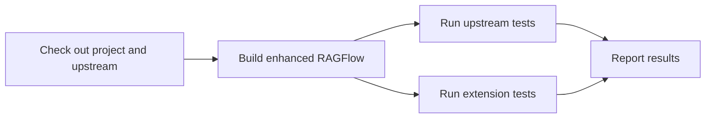

# oh-my-ragflow

English | [简体中文](README.zh-CN.md)

An independent extension project for RAGFlow. It adds capabilities around RAGFlow while keeping the upstream kernel unchanged.

## Status

The project is under active development and may undergo aggressive, breaking refactoring; backward compatibility with earlier versions is not a goal at this stage. See each extension's README for its scope and implementation status.

## Baseline

- RAGFlow: [`v1.0.0`](https://github.com/infiniflow/ragflow/releases/tag/v1.0.0), commit `db1cd5929a7885a3074547791f5ecc4d2f891739`.
- The baseline is tracked as an official upstream Git submodule and is kept unchanged.

Initialize the submodule after cloning the project:

```sh
git submodule update --init
```

## Principles

- Do not modify the upstream kernel. Prefer existing extension points, overlays, public APIs, and independent services.
- Before implementing a major feature, evaluate whether a widely adopted and actively maintained open-source project can serve as a core building block. Consider functional fit, licensing, maintenance cost, and architectural compatibility; validate compatibility against pinned versions. Implement it in-house when no suitable option exists.
- Keep extensions focused; handle unrelated upstream issues separately.
- Evaluate review feedback against the code, the change's objective, and its intended scope. Contributors are encouraged to respectfully challenge feedback with evidence rather than accept it uncritically. Fix valid issues introduced by the change; avoid adding unrelated features or expanding a PR merely to address every suggestion, and document valid out-of-scope issues for separate follow-up.
- Keep documentation in English and Simplified Chinese, with extension-specific details under the corresponding extension.

See [RAGFlow extension points](docs/extension-points.md) for the shared integration rules and upstream seams.

## Contributing

Please write issue and pull request titles and descriptions in English.

## CI principles

The intended CI pipeline builds the enhanced RAGFlow distribution first, then runs the upstream RAGFlow tests, except Infinity-specific coverage, and our extension tests against it. The upstream baseline on its own is not a substitute for testing the enhanced build.



The goal is complete coverage on free standard GitHub-hosted runners. Test jobs may be split to fit their resource limits; unavailable or skipped checks must be reported explicitly, not counted as passing. The CI workflow builds and tests the enterprise distribution assembled by `apply-overlay.sh` with `RAGFLOW_GO_TAGS=ee`. It currently covers the enterprise Go build and unit tier, the web build and tests, and the `model-platform` non-invasive audit plus live-gateway backend unit and E2E integration tests; upstream integration, API, SDK and model-backed tests remain to be added.

The upstream web test baseline excludes the known failing files listed in [`ci/upstream-web-known-failures.json`](ci/upstream-web-known-failures.json). CI reports each exclusion and requires all other discovered tests to pass. The list is pinned to the upstream commit and must be reviewed when it changes. These exclusions do not apply to extension tests; a passing baseline does not mean the excluded upstream tests passed.

## Layout

```text
extensions/        Independent extensions and their documentation
upstream/ragflow/  Official RAGFlow submodule at the pinned commit
build/             Generated build workspace (ignored by Git)
```

Build workspace assembly is automated via `extensions/model-platform/scripts/apply-overlay.sh`. Builds apply overlays into an isolated generated workspace (`build/ragflow`), keeping the upstream submodule 100% clean and pristine.
