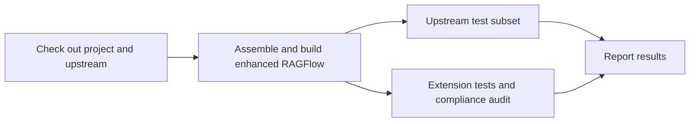

# oh-my-ragflow

English | [简体中文](README.zh-CN.md)

An independent extension project for RAGFlow. It adds capabilities around RAGFlow while keeping the upstream kernel unchanged.

## Status

The project is under active development and may undergo aggressive, breaking refactoring; backward compatibility with earlier versions is not a goal at this stage. See each extension's README for its scope and implementation status.

## Baseline

- RAGFlow: [`v1.0.0`](https://github.com/infiniflow/ragflow/releases/tag/v1.0.0), commit `db1cd5929a7885a3074547791f5ecc4d2f891739`.
- The baseline is tracked as an official upstream Git submodule and is kept unchanged.

Initialize the submodule after cloning the project:

```sh
git submodule update --init
```

## Principles

- Do not modify the upstream kernel. Prefer existing extension points, overlays, public APIs, and independent services.
- Before implementing a major feature, evaluate whether a widely adopted and actively maintained open-source project can serve as a core building block. Consider functional fit, licensing, maintenance cost, and architectural compatibility; validate compatibility against pinned versions. Implement it in-house when no suitable option exists.
- Keep extensions focused; handle unrelated upstream issues separately.
- Evaluate review feedback against the code, the change's objective, and its intended scope. Contributors are encouraged to respectfully challenge feedback with evidence rather than accept it uncritically. Fix valid issues introduced by the change; avoid adding unrelated features or expanding a PR merely to address every suggestion, and document valid out-of-scope issues for separate follow-up.
- Keep documentation in English and Simplified Chinese, with extension-specific details under the corresponding extension.

See [RAGFlow extension points](docs/extension-points.md) for the shared integration rules and upstream seams.

## Contributing

Please write issue titles, pull request titles and descriptions, and Git commit messages in English.

### Commit messages

- Use a concise Conventional Commits subject line (`type(scope): summary`, or `type: summary` when repo-wide), separated from the body by a blank line.
- Write a detailed commit body explaining the problem or context and the key changes. A subject-only commit is not sufficient for substantive changes.
- Wrap every line (subject and body) at **80 characters** maximum. Exempt unbreakable tokens such as URLs or raw command/log lines only when wrapping would break them; keep standard prose and bullet lines strictly within 80 characters.

### Pull request descriptions

- Write PR descriptions in the style of a concise design document using [`.github/pull_request_template.md`](.github/pull_request_template.md): clearly explain the background and problem statement, design approach, key decisions and trade-offs, and verification.
- Prefer visual presentation—architecture/flow/sequence diagrams (Mermaid), comparison tables, and structured formulas where they clarify behavior—over walls of prose.
- Verify that all Markdown, Mermaid diagrams, tables, and LaTeX math expressions render cleanly on GitHub before requesting review.

## CI principles

The CI pipeline runs on free standard GitHub-hosted runners. It first assembles the enhanced RAGFlow distribution (`RAGFLOW_GO_TAGS=ee`) with `apply-overlay.sh`, then runs a subset of the upstream RAGFlow tests alongside our extension tests and compliance checks against it.



- **Current coverage:** Enterprise Go build and unit tests, frontend build and tests (including isolated extension type-checking and zero-exclusion unit tests), the `model-platform` non-invasive compliance audit (verifying the upstream submodule remains pristine), and live-gateway backend unit and E2E integration tests. Upstream integration, API, SDK, and model-backed tests are not yet included.
- **Explicit coverage boundaries:** Test jobs may be split to fit runner resource limits; unavailable or skipped checks must be reported explicitly, not counted as passing.
- **Isolation from upstream exclusions:** Upstream web tests exclude only the commit-pinned known failures listed in [`ci/upstream-web-known-failures.json`](ci/upstream-web-known-failures.json). CI reports each exclusion and requires all other discovered tests to pass; extension tests run in dedicated steps with zero exclusions and never share this list.
- **Behavioral test expectations:** Substantive backend and frontend changes should add or update behavioral tests in the same PR—covering user-facing behavior, state transitions, access/safety boundaries, API contracts, and bug regressions—rather than fragile snapshots, styling assertions, or trivial static declarations.

## Layout

```text
extensions/        Independent extensions and their documentation
upstream/ragflow/  Official RAGFlow submodule at the pinned commit
build/             Generated build workspace (ignored by Git)
```

Build workspace assembly is automated via `extensions/model-platform/scripts/apply-overlay.sh`. Builds apply overlays into an isolated generated workspace (`build/ragflow`), keeping the upstream submodule 100% clean and pristine.
