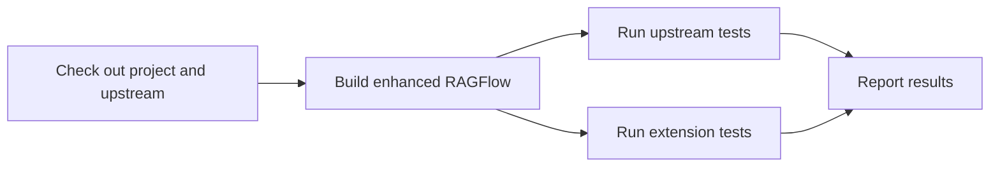

# oh-my-ragflow

English | [简体中文](README.zh-CN.md)

An independent extension project for RAGFlow. It adds capabilities around RAGFlow while keeping the upstream kernel unchanged.

## Status

The project is in the design stage. See each extension's README for its scope and implementation status.

## Baseline

- RAGFlow: [`v1.0.0`](https://github.com/infiniflow/ragflow/releases/tag/v1.0.0), commit `db1cd5929a7885a3074547791f5ecc4d2f891739`.
- The baseline is tracked as an official upstream Git submodule and is kept unchanged.

Initialize the submodule after cloning the project:

```sh
git submodule update --init
```

## Principles

- Do not modify the upstream kernel. Prefer existing extension points, overlays, public APIs, and independent services.
- Reuse mature components where appropriate and validate compatibility against pinned versions.
- Keep extensions focused; handle unrelated upstream issues separately.
- Keep documentation in English and Simplified Chinese, with extension-specific details under the corresponding extension.

## CI principles

The intended CI pipeline builds the enhanced RAGFlow distribution first, then runs the upstream RAGFlow tests, except Infinity-specific coverage, and our extension tests against it. The upstream baseline on its own is not a substitute for testing the enhanced build.



The goal is complete coverage on free standard GitHub-hosted runners. Test jobs may be split to fit their resource limits; unavailable or skipped checks must be reported explicitly, not counted as passing. Until extensions are implemented, the CI workflow builds and tests the pinned upstream source. It currently targets the Go build and unit tier plus the web build and tests; integration, API, SDK and model-backed tests remain to be added.

The upstream web test baseline excludes the known failing files listed in
[`ci/upstream-web-known-failures.json`](ci/upstream-web-known-failures.json).
CI reports each exclusion and requires all other discovered tests to pass. The
list is pinned to the upstream commit and must be reviewed when it changes.
These exclusions do not apply to extension tests; a passing baseline does not
mean the excluded upstream tests passed.

## Layout

```text
extensions/        Independent extensions and their documentation
upstream/ragflow/  Official RAGFlow submodule at the pinned commit
build/             Generated build workspace (ignored by Git)
```

Build scripts are not yet implemented. Builds should apply overlays in the generated workspace, keeping the upstream submodule unchanged.
