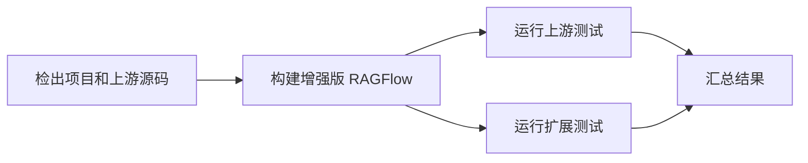

# oh-my-ragflow

[English](README.md) | 简体中文

一个独立的 RAGFlow 扩展项目，在保持上游内核不变的前提下，为 RAGFlow 增加能力。

## 当前状态

项目正处于积极开发阶段，可能进行激进的破坏性重构；现阶段不考虑与之前版本的向后兼容性。各扩展的范围与实现状态参见对应的 README。

## 适配基线

- RAGFlow：[`v1.0.0`](https://github.com/infiniflow/ragflow/releases/tag/v1.0.0)，提交 `db1cd5929a7885a3074547791f5ecc4d2f891739`。
- 此基线以官方上游 Git submodule 的形式记录，并保持原样。

克隆本项目后，初始化 submodule：

```sh
git submodule update --init
```

## 原则

- 不修改上游内核。优先使用已有扩展点、覆盖文件、公开 API 和独立服务。
- 实现重大功能前，评估广泛使用且持续维护的开源项目能否作为核心支撑。综合考虑功能适配、许可证、维护成本和架构兼容性，并针对固定版本验证兼容性；没有合适方案时再自行实现。
- 保持扩展范围聚焦，无关的上游问题单独处理。
- 根据代码、变更目标和既定范围审慎评估评审意见。鼓励贡献者基于证据、以尊重的方式质疑评审意见，而不是不加判断地接受。修复当前变更引入的有效问题；避免为了回应每条建议而引入无关功能或扩大 PR，将有效但超出范围的问题记录下来，单独跟进。
- 文档保持英文和简体中文双语；扩展专属内容放在对应扩展目录中。

共同的集成规范与上游接缝见 [RAGFlow 扩展点](docs/extension-points.zh-CN.md)。

## 贡献

请使用英文撰写 Issue 和 Pull Request 的标题与描述。

## CI 原则

计划中的 CI 流水线先构建增强后的 RAGFlow，再针对增强版运行上游 RAGFlow 测试（不包含 Infinity 专项覆盖）和我们的扩展测试。仅测试未增强的上游基线，不能替代对增强版的测试。



目标是在免费的 GitHub 标准托管 runner 上完整覆盖测试。可以拆分测试任务以适应资源限制；无法运行或被跳过的检查必须明确披露，不能计为通过。CI 流水线构建并测试由 `apply-overlay.sh` 组装并启用 `RAGFLOW_GO_TAGS=ee` 的企业级扩展分发版本。目前覆盖企业版 Go 构建与单元测试（包含扩展模块自身单元测试）、前端构建与测试；集成、API、SDK 和模型测试仍待加入。

上游前端测试基线会排除 [`ci/upstream-web-known-failures.json`](ci/upstream-web-known-failures.json) 中记录的已知失败文件。CI 会逐项报告排除内容，并要求其余发现的测试全部通过。清单绑定上游提交，升级时必须重新核查。这些排除项不适用于扩展自身的测试；基线通过不代表被排除的上游测试通过。

实质性的前后端变更应在同一 PR 中同步新增或更新行为测试，覆盖用户可见行为、状态流转、权限与安全边界、API 契约及缺陷回归，避免脆弱的快照、样式断言或对纯静态声明的无效测试。扩展测试在独立的 CI 步骤中以零排除运行，与上游已知失败排除清单相互隔离。

## 目录结构

```text
extensions/        独立扩展及其文档
upstream/ragflow/  指向固定提交的官方 RAGFlow submodule
build/             构建时生成的工作区（Git 忽略）
```

构建工作区组装已通过 `extensions/model-platform/scripts/apply-overlay.sh` 脚本自动化实现。构建时在生成的隔离工作区（`build/ragflow`）应用覆盖层，保持上游 submodule 100% 纯净未修改。
