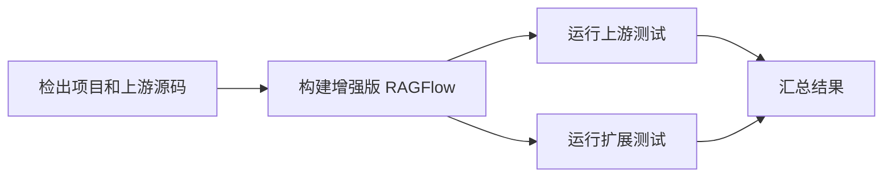

# oh-my-ragflow

[English](README.md) | 简体中文

一个独立的 RAGFlow 扩展项目，在保持上游内核不变的前提下，为 RAGFlow 增加能力。

## 当前状态

项目处于设计阶段。各扩展的范围与实现状态参见对应的 README。

## 适配基线

- RAGFlow：[`v1.0.0`](https://github.com/infiniflow/ragflow/releases/tag/v1.0.0)，提交 `db1cd5929a7885a3074547791f5ecc4d2f891739`。
- 此基线以官方上游 Git submodule 的形式记录，并保持原样。

克隆本项目后，初始化 submodule：

```sh
git submodule update --init
```

## 原则

- 不修改上游内核。优先使用已有扩展点、覆盖文件、公开 API 和独立服务。
- 适当复用成熟组件，并针对固定版本验证兼容性。
- 保持扩展范围聚焦，无关的上游问题单独处理。
- 文档保持英文和简体中文双语；扩展专属内容放在对应扩展目录中。

## CI 原则

计划中的 CI 流水线先构建增强后的 RAGFlow，再针对增强版运行上游 RAGFlow 测试（不包含 Infinity 专项覆盖）和我们的扩展测试。仅测试未增强的上游基线，不能替代对增强版的测试。



目标是在免费的 GitHub 标准托管 runner 上完整覆盖测试。可以拆分测试任务以适应资源限制；无法运行或被跳过的检查必须明确披露，不能计为通过。在扩展实现之前，CI 流水线构建并测试固定版本的上游源码。目前计划覆盖 Go 构建与单元测试、前端构建与测试；集成、API、SDK 和模型测试仍待加入。

上游前端测试基线会排除 [`ci/upstream-web-known-failures.json`](ci/upstream-web-known-failures.json)
中记录的已知失败文件。CI 会逐项报告排除内容，并要求其余发现的测试全部通过。
清单绑定上游提交，升级时必须重新核查。这些排除项不适用于扩展自身的测试；
基线通过不代表被排除的上游测试通过。

## 目录结构

```text
extensions/        独立扩展及其文档
upstream/ragflow/  指向固定提交的官方 RAGFlow submodule
build/             构建时生成的工作区（Git 忽略）
```

构建脚本尚未实现。构建时应在生成的工作区应用覆盖文件，保持上游 submodule 不变。
