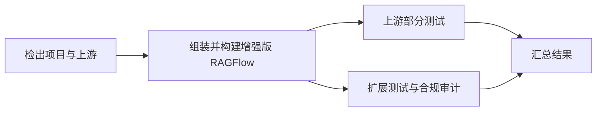

# oh-my-ragflow

[English](README.md) | 简体中文

一个独立的 RAGFlow 扩展项目，在保持上游内核不变的前提下，为 RAGFlow 增加能力。

## 当前状态

项目正处于积极开发阶段，可能进行激进的破坏性重构；现阶段不考虑与之前版本的向后兼容性。各扩展的范围与实现状态参见对应的 README。

## 适配基线

- RAGFlow：[`v1.0.0`](https://github.com/infiniflow/ragflow/releases/tag/v1.0.0)，提交 `db1cd5929a7885a3074547791f5ecc4d2f891739`。
- 此基线以官方上游 Git submodule 的形式记录，并保持原样。

克隆本项目后，初始化 submodule：

```sh
git submodule update --init
```

## 原则

- 不修改上游内核。优先使用已有扩展点、覆盖文件、公开 API 和独立服务。
- 实现重大功能前，评估广泛使用且持续维护的开源项目能否作为核心支撑。综合考虑功能适配、许可证、维护成本和架构兼容性，并针对固定版本验证兼容性；没有合适方案时再自行实现。
- 保持扩展范围聚焦，无关的上游问题单独处理。
- 根据代码、变更目标和既定范围审慎评估评审意见。鼓励贡献者基于证据、以尊重的方式质疑评审意见，而不是不加判断地接受。修复当前变更引入的有效问题；避免为了回应每条建议而引入无关功能或扩大 PR，将有效但超出范围的问题记录下来，单独跟进。
- 文档保持英文和简体中文双语；扩展专属内容放在对应扩展目录中。

共同的集成规范与上游接缝见 [RAGFlow 扩展点](docs/extension-points.zh-CN.md)。

## 贡献

请使用英文撰写 Issue 标题、Pull Request 标题与描述以及 Git 提交信息。

### Git 提交信息规范

- 使用简洁的 Conventional Commits 标题行（`type(scope): summary`，全仓库范围变更可使用 `type: summary`），并与正文之间保留一个空行。
- 正文须内容详细，说明问题或背景以及关键变更；实质性变更不应只有标题行。
- 每行（含标题行与正文）长度不超过 **80 个字符**。仅在换行会破坏完整性的极少数场景（如长 URL 或原始命令/日志）可豁免，常规叙述与列表行必须严格控制在 80 字符以内。

### Pull Request 描述规范

- 参照 [`.github/pull_request_template.md`](.github/pull_request_template.md) 按设计文档风格撰写：讲清楚背景与问题、设计思路、关键决策与取舍，以及验证方式。
- 优先使用图表展示（Mermaid 架构图/流程图/时序图、对比表格、必要的公式等）以清晰表达系统行为，避免大段纯文字堆砌。
- 提交评审前检查所有 Markdown、Mermaid 图表、表格和 LaTeX 数学公式在 GitHub 页面的实际渲染效果。

## CI 原则

CI 流水线在免费的 GitHub 标准托管 runner 上先通过 `apply-overlay.sh` 组装增强版 RAGFlow（`RAGFLOW_GO_TAGS=ee`），再对增强版运行上游部分测试和我们的扩展测试与合规检查。



- **当前覆盖范围**：企业版 Go 构建与单元测试、前端构建与测试（含扩展前端独立类型检查与零排除单测）、`model-platform` 非侵入合规审计（验证上游 submodule 保持纯净）以及连接真实网关的后端单元与 E2E 集成测试。上游集成、API、SDK 和模型测试尚未纳入。
- **诚实披露覆盖边界**：可以拆分任务以适应 runner 资源限制；无法运行或被跳过的检查必须显式报告，不能计为通过。
- **扩展测试与上游排除相互隔离**：上游前端测试仅排除 [`ci/upstream-web-known-failures.json`](ci/upstream-web-known-failures.json) 中绑定固定提交的已知失败文件，CI 会逐项报告排除项并要求其余测试全部通过；扩展测试在独立步骤中零排除运行，绝不使用该排除清单。
- **行为测试要求**：实质性的前后端变更应在同一 PR 中同步新增或更新行为测试，覆盖用户可见行为、状态流转、权限与安全边界、API 契约及缺陷回归，避免脆弱的快照、样式断言或无意义的静态声明测试。

## 目录结构

```text
extensions/        独立扩展及其文档
upstream/ragflow/  指向固定提交的官方 RAGFlow submodule
build/             构建时生成的工作区（Git 忽略）
```

构建工作区组装已通过 `extensions/model-platform/scripts/apply-overlay.sh` 脚本自动化实现。构建时在生成的隔离工作区（`build/ragflow`）应用覆盖层，保持上游 submodule 100% 纯净未修改。
