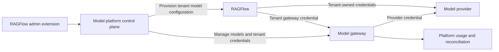

# Architecture and validation

English | [简体中文](architecture.zh-CN.md)

## Objective

An administrator can make platform models available to tenants. A tenant can use platform models or its own providers. Platform calls are attributable to the tenant, metered, and can eventually be charged according to platform policy. Tenant-owned provider usage is not billed as platform model usage.

## Proposed boundaries

- **RAGFlow** owns tenant identity, existing provider configuration, model choices, dataset bindings, and task behavior.
- **Model platform extension** connects administration, tenant provisioning, configuration lifecycle, and presentation to the gateway. It must use authenticated upstream extension points or supported APIs, without patching shared kernel code.
- **Gateway** holds upstream provider credentials and enforces tenant-scoped model access, credential status, and configured limits. LiteLLM is the candidate, not a validated integration.
- **Usage and settlement** distinguish gateway usage from application attribution and financial charges. The source of truth and reconciliation requirements must be established before charging customers.

## Tenant credentials and configuration

Platform models may be provisioned as tenant-scoped RAGFlow provider/model records pointing to the gateway. The copied credential is a tenant-scoped gateway key, never the upstream provider key. A tenant may use its gateway key directly if the gateway is reachable; such requests must still be attributed and limited by the gateway.

Provisioning must track the identity of managed records, avoid overwriting tenant-owned records or explicit selections, and handle retries and partial failures. Revocation or rotation must account for in-flight calls. Deactivating one model must not revoke a credential used for other models. Exact storage and API choices remain to be validated.

Defaults may be initialized when provisioning, using RAGFlow's existing selection rules. A tenant can change its selection if its existing permissions allow it. A changed platform default does not automatically replace a user's selection. On model deactivation, clear a default only if it still points to the deactivated managed model. Do not silently switch explicit selections to another model.

Preserve existing dataset embedding bindings and upstream behavior. Do not remap a stable embedding model alias to an incompatible model. Upstream dataset consistency issues are out of scope unless this extension creates them.

## Extension mechanisms to verify

The `v1.0.0` checkout contains an admin route registration seam, a tenant creation hook, default model configuration seams, and frontend route/navigation overlays. Their presence does not prove that they cover every lifecycle event or that remote calls are safe in a database transaction. Validate them from their callers before selecting an implementation.

The tenant creation hook runs before the tenant row is created, inside a transaction. Do not assume a gateway key can safely be issued there or that the membership row already exists. An independent reconciler or a post-commit mechanism may be needed.

RAGFlow's runtime does not expose a confirmed universal model-usage hook carrying all tenant, user, task, and provider details. Gateway keys can identify tenants for platform calls; fine-grained application attribution and tenant-owned calls need separate verification. Direct gateway calls cannot be assumed to have trustworthy RAGFlow user or task identity.

## First validation slice

1. Pin a LiteLLM release and check its license and the availability of the required model, key, budget, and usage APIs.
2. Register one chat model and one embedding model. Issue a tenant-scoped key with only the intended model and route permissions.
3. Provision the tenant with gateway-backed records through a verified non-invasive integration; confirm the existing RAGFlow model picker and invocation paths work.
4. Verify tenant attribution, usage details, direct gateway calls, key revocation, model deactivation, and independent tenant-owned providers.
5. Verify user default changes do not get overwritten by reconciliation and existing dataset embedding references remain stable.
6. Exercise partial failures and retries between RAGFlow and the gateway. Record protocol and attribution gaps before deciding what can replace the existing experimental branches.

## Acceptance criteria

- Platform provider secrets are not stored in tenant provider configuration or returned to tenants.
- A tenant gateway key cannot access another tenant's management functions or exceed its configured model permissions.
- A tenant's platform usage, including direct gateway access when enabled, is attributed to that tenant.
- A tenant-owned provider remains usable and is not included in platform model charges.
- Model synchronization does not overwrite tenant-owned configuration or explicit default choices.
- Deactivating a platform model clears only defaults still pointing to it; unrelated models and credentials remain usable.
- Existing dataset bindings are not rewritten as a side effect of default changes or model synchronization.
- The extension does not require modifications to upstream shared kernel files.

Commercial settlement, plans, payment collection, and blocking tenant-owned providers are future capabilities; they are not implemented yet.

## Open decisions

- How to package and build Go `ee` implementations and frontend overlays without modifying the upstream checkout.
- Whether existing hooks and public APIs can safely cover initial provisioning and every lifecycle event.
- Where managed-record mappings and reconciliation state are stored.
- How LiteLLM usage is exported, reconciled, priced, and retained for billing.
- Which model protocols are supported by the initial release beyond chat and embedding.
- What application-level attribution is required for tenant-owned providers.

Do not equate an unvalidated hook or gateway metric with a completed feature.
