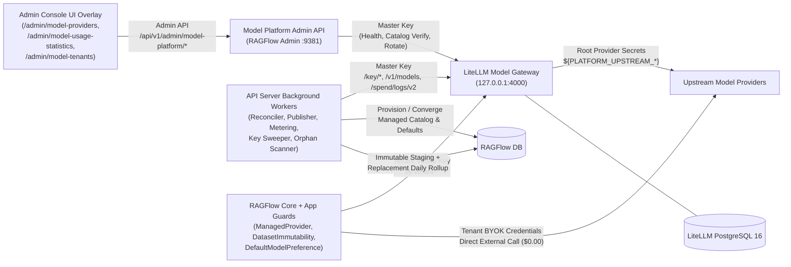

# Architecture and System Design

English | [简体中文](architecture.zh-CN.md)

> [!NOTE]
> **Document Scope**: This is a living architecture document defining the **topological boundaries, core invariants, and Architectural Decision Records (ADRs)** of the `model-platform` extension.
> - For detailed subsystem mechanisms, database schemas, overlay seams, and verification suites, see [Engineering Design Reference](implementation-plan.md).
> - For operator deployment, tenant workflows, and HTTP API contracts, see [Admin Guide](docs/admin-guide.md), [User Guide](docs/user-guide.md), and [API Reference](docs/api-reference.md).

---

## 1. Objectives

- **Centrally Managed Multi-Model Hosting**: Provision platform-managed models across all 7 gateway-routed RAGFlow model types (`chat`, `embedding`, `asr`, `vision`, `rerank`, `tts`, `decision`) to every tenant while keeping local `ocr` pipelines outside the gateway.
- **Autonomous BYOK Access**: Preserve every tenant owner's freedom to configure external or private Bring Your Own Key (BYOK) providers independently of the platform.
- **Authoritative Gateway Metering**: Attribute and meter platform model consumption at the gateway as the single source of truth (including prompt/completion/cached/reasoning tokens, TTS characters, spend, and cache savings).
- **Physical Zero-Billing Bypass**: Route tenant-owned BYOK calls directly to external endpoints so they never touch the gateway and incur strictly `$0.00` platform spend.
- **Safe Lifecycle & Credential Governance**: Support dynamic catalog onboarding, retirement, reactivation, default-model switching with sticky user choice protection, dataset embedding immutability, and zero-downtime emergency key rotation.

---

## 2. System Topology & Component Boundaries

| Component | Role & Responsibilities | Isolation Boundary |
| :--- | :--- | :--- |
| **RAGFlow Core (`upstream/ragflow`)** | Tenant auth, model factory/drivers, chat/dataset/agent pipelines, base Admin & User UI | 100% pristine Git submodule (zero diff) |
| **Control Plane & Guards (`extensions/model-platform/backend`)** | 13 Admin API endpoints, 3 App API middleware guards, 5 background workers, 6 schema migrations | Wired solely through `ee-baseline` stubs and thin Go trampolines |
| **Web UI Overlay (`extensions/model-platform/overlay/web/src/ee`)** | 3 Admin governance pages, localized resources, `ProviderInstanceCardWithPrivilege` read-only shield | Injected via upstream `src/ee` seams with `VITE_RAGFLOW_ENTERPRISE=false` |
| **LiteLLM Gateway (`extensions/model-platform/gateway`)** | Root credential vault, team-scoped virtual keys, model whitelisting, authoritative spend logs | Loopback `127.0.0.1:4000` + dedicated PostgreSQL; root secrets stay in the gateway and are sent only to upstream providers (never exposed to tenants or Admin APIs) |

---

## 3. Core Invariant Guarantees

1. **Non-Invasive Extensibility**: `upstream/ragflow` carries zero local modifications. All backend and frontend integration relies exclusively on workspace overlays, Go `//go:build ee` stubs/trampolines, and external gateway services.
2. **Zero-Leakage Credential Boundary**: Root provider API keys reside strictly inside the gateway container environment. Tenants receive only team-scoped virtual keys (`sk-tenant-*`), and Admin APIs expose only key aliases and 8-character SHA-256 fingerprints — never plaintext keys.
3. **Transaction-Decoupled Side Effects**: Remote network RPCs are forbidden inside database transactions. `OnTenantCreateHook` writes only local SQL (`status = pending`), waits for commit visibility via `event.PreFlightCheck`, and dispatches asynchronously onto `event.EventBus`.
4. **Sticky User Default Provenance**: Platform default rollouts only migrate users whose slot provenance is `platform_default`. Explicit user choices (`user_explicit`, observed by `DefaultModelPreferenceMiddleware`) are preserved unless the chosen model is retired and tombstoned.
5. **Dataset Vector Space Immutability**: Non-empty datasets (with documents or parsed chunks) cannot change their embedding model (HTTP `400`). Retired embedding models remain read-only for referencing datasets while being blocked from new or empty dataset bindings.
6. **Physical Zero-Billing Bypass**: Tenant-owned BYOK instances route directly to external endpoints without passing through the gateway, guaranteeing `$0.00` platform spend, auditable live via `GET /api/v1/admin/model-platform/usage/audit`.
7. **Gateway-First Convergence & Mathematical Metering Idempotence**: Catalog activation updates gateway whitelists before database visibility so newly onboarded models are routable before tenants see them; retirement revokes gateway whitelist access before disabling the `tenant_model` row (a brief fail-closed window where the gateway stops new traffic before the DB converges). Spend logs deduplicate on `spend_id` and aggregate via calendar-aligned replacement upserts rather than additive increments.

---

## 4. Architectural Decision Records (ADRs)

- **ADR-1: Workspace Overlay Pipeline vs. Core Kernel Patching**  
  *Context & Decision*: Enabling `RAGFLOW_GO_TAGS=ee` globally excludes all upstream `//go:build !ee` stubs across 19 packages. Decided to maintain affirmative `ee-baseline` fallback stubs plus thin router trampolines assembled into `build/ragflow` by `apply-overlay.sh`, keeping `upstream/ragflow` 100% clean.
- **ADR-2: PostgreSQL-Backed LiteLLM Gateway & Loopback Isolation**  
  *Context & Decision*: Persistent virtual keys and authoritative spend logs require durable storage and strict network isolation. Decided to run pinned LiteLLM (`v1.110.0`) with dedicated PostgreSQL 16 bound strictly to `127.0.0.1:4000`, `model_list: []` by default, key redaction enabled, and `user_api_key_cache_ttl: 5`.
- **ADR-3: Two-Tier Self-Healing Controller (In-Memory Retry + Level Poller)**  
  *Context & Decision*: Gateway restarts or transient outages must not block tenant registration or strand tenants permanently. Decided on Tier-1 fast in-memory exponential retries for jitter and a Tier-2 level-triggered background poller with lease reclamation for extended outages.
- **ADR-4: Atomic Defaults Initialization & Observed Sticky Provenance**  
  *Context & Decision*: Concurrent provisioning risks race overwrites, and platform default upgrades must respect user choices across all 7 managed model types (`model_slots.go`). Decided on conditional atomic SQL for empty-slot initialization, member default inheritance on join, and `DefaultModelPreferenceMiddleware` + `StickyGuard` provenance tracking.
- **ADR-5: Three-Stage Embedding Lifecycle (`Active` → `Deprecated` → `Tombstoned`)**  
  *Context & Decision*: Revoking an embedding model immediately breaks retrieval on existing knowledge bases. Decided to retain read-only gateway whitelist access for retired embeddings while any dataset references them, and tombstone only when references reach zero; non-embedding types transition directly to tombstoned.
- **ADR-6: Authoritative Gateway Spend Logs, Fine-Grained Metrics & Self-Healing Replacement Rollup**  
  *Context & Decision*: App-side metering is unreliable under retries, modern models require prompt-cache/reasoning token and TTS character breakdowns, and outages can create multi-day gaps. Decided on immutable staging (`platform_gateway_spend_log`), bounded online checkpoint polling, uncapped restart replay, calendar-aligned replacement upserts (`platform_tenant_usage_daily`) with automatic multi-day catch-up, and opt-in two-layer retention purging.
- **ADR-7: Intent-Driven Managed Model Catalog & Level-Triggered Fan-Out Convergence**  
  *Context & Decision*: Static hardcoded model lists cannot evolve cleanly across tenants. Decided to make `platform_managed_model` the single source of administrator intent (`active`/`retired`, `is_default`) and converge every tenant through an optimistic-locked publish worker and periodic drift sweep, updating gateway whitelists before tenant DB state.
- **ADR-8: Team-Scoped Key Identity & Zero-Downtime Emergency Key Rotation**  
  *Context & Decision*: `key_alias` uniqueness is only application-enforced in LiteLLM and insufficient for safe revocation. Decided to identify all keys of a tenant by LiteLLM `team_id = tenant_id` and address individual keys by SHA-256 `key_hash`. Rotation issues a replacement key, atomically cuts over the tenant instance while keeping status `ready`, and converges old-key revocation synchronously or via the background `sweepDirtyKeys` loop.

---

## 5. Current Scope & Evolution Boundaries

### In Scope (Implemented & Maintained)

- **7 Managed Model Types**: `chat` (1), `embedding` (2), `asr` (4), `vision` (8), `rerank` (16), `tts` (32), `decision` (128) via native `OpenAI-API-Compatible` → `platform` driver resolution.
- **Tenant Lifecycle & Credential Governance**: Post-commit async provisioning, two-tier self-healing, orphan tenant cleanup, zero-downtime single & batch emergency key rotation, and frontend/backend write protection.
- **Catalog & Default Governance**: Dynamic onboard/retire/reactivate/set-default APIs & Admin UI, fan-out progress tracking with failed-tenant retry, sticky user preferences, member default inheritance, and dataset embedding immutability.
- **Authoritative Metering & Audit**: Raw spend log staging, daily token/character/spend/cache-savings rollups, dynamic catch-up, opt-in retention sweeps, Admin usage dashboards, and live spend isolation audits.
- **Automated Verification**: Unit tests, live Docker E2E test suites, and automated non-invasive CI gates (`audit-non-invasive.sh`).

### Out of Scope (Non-Goals / Future Extensions)

- Commercial payment processing, invoicing, and subscription checkout (e.g., Stripe).
- Paid-tier rate-limit / quota plan enforcement per subscription tier.
- Restricting or disabling tenant-owned BYOK providers.
- Enterprise RBAC policy overrides beyond the community permission baseline (`ee-baseline`).
