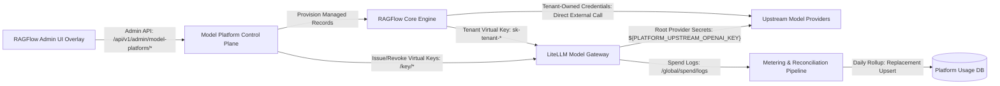

# Architecture and System Design

English | [简体中文](architecture.zh-CN.md)

> [!NOTE]
> **Document Scope**: This document defines the **topological boundaries, core architectural invariants, and Architectural Decision Records (ADRs)** for the `model-platform` extension. For engineering tasks, migration schemas, and runnable test guides, please refer to the [Implementation Plan](implementation-plan.md).

---

## 1. Objectives

- **Managed Provisioning**: Centrally provision platform-managed LLM and Embedding models for tenants.
- **Autonomous Access**: Preserve tenant freedom to configure and use external self-owned provider credentials.
- **Authoritative Metering**: Atomically audit and attribute managed invocations at the gateway as billing source of truth.
- **Physical Bypass**: Route self-owned models directly to external endpoints, generating strictly $0.00 platform spend.

---

## 2. System Topology & Component Boundaries

| Component | Role & Responsibilities | Isolation Boundary |
| :--- | :--- | :--- |
| **RAGFlow Core** | Tenant auth, model picker, chunk parsing, execution pipelines | 100% untouched pristine codebase (zero-invasive) |
| **Extension Control Plane** | Admin UI/API, tenant lifecycle reconciliation state machine | Decoupled via Go `ee` tag stubs & Web overlay seams |
| **LiteLLM Gateway** | Root credential hosting, virtual key routing, spend logs | Loopback `127.0.0.1:4000`, root secrets hidden |
| **Reconciliation Pipeline** | Gateway spend log pull & deduplication, 48h daily rollup | Immutable staging + replacement upsert (idempotent) |

---

## 3. Core Invariant Guarantees

1. **Non-Invasive Extensibility**: `upstream/ragflow` diff is strictly empty. Enhancements rely entirely on workspace overlays, Go build tag stubs, and external services.
2. **Zero-Leakage Credential Boundary**: Root provider API keys reside strictly inside the gateway. Tenants receive only scoped virtual keys (`sk-tenant-...`).
3. **Transaction Decoupled Events**: Remote network RPCs are strictly prohibited inside database transactions. Tenant lifecycle hooks dispatch asynchronously via post-commit transaction callbacks and an event bus (`RegisterPostCommitHook` / `event.EventBus`).
4. **Dataset Vector Space Immutability**: Once a dataset contains parsed chunks, its embedding model is permanently frozen. The API rejects mutation attempts with HTTP 400.
5. **Physical Zero-Billing Bypass**: Self-owned models connect directly to external endpoints, bypassing the gateway physically and incurring strictly $0.00 platform spend.

---

## 4. Architectural Decision Records (ADRs)

- **ADR-1: Workspace Overlay Pipeline vs. Core Kernel Patching**  
  *Tradeoff*: Upstream `!ee` tags exclude baseline packages under `ee` builds. Decided to introduce `ee-baseline` stubs and thin trampolines, keeping the upstream kernel 100% pristine.
- **ADR-2: PostgreSQL-Backed LiteLLM Gateway & Loopback Isolation**  
  *Tradeoff*: Gateway credentials and spend logs require persistence and network isolation. Decided to bind strictly to `127.0.0.1:4000` with dedicated PostgreSQL storage.
- **ADR-3: Two-Tier Self-Healing Controller (In-Memory Retry + Level Poller)**  
  *Tradeoff*: Gateway restarts or 45s maintenance windows must not abandon tenants. Decided on fast exponential retry for transient jitter, plus a background poller for sustained recovery.
- **ADR-4: Atomic Defaults Initialization and Explicit Intent Provenance**  
  *Tradeoff*: Concurrent registrations risk overwrite races, and default upgrades must not overwrite explicit user choices. Decided on atomic conditional SQL and preference tracking.
- **ADR-5: Three-Stage Embedding Lifecycle (Active -> Deprecated -> Tombstoned)**  
  *Tradeoff*: Revoking embedding models breaks retrieval for existing knowledge bases. Decided to retain gateway read-only access for deprecated models until reference count hits zero.
- **ADR-6: Authoritative Gateway Spend Logs, Fine-Grained Token Breakdown & Idempotent Replacement Rollup**  
  *Tradeoff*: App-level metering is unreliable and network retries risk double-billing. Also, modern prompt caching and reasoning models demand transparent audit breakdowns (cache read discounts, reasoning tokens, cache savings) rather than coarse total tokens. Decided on immutable spend log staging capturing normalized cache/reasoning metrics with 48h calendar-aligned replacement upserts. Late logs older than 48 hours are backfilled via on-demand historical window recomputation (`RunWindow(ctx, lookbackHours)`).

---

## 5. Scope and Boundaries

- **Planned Scope (Phase 0~5 Core Capability)**:
  - Native driver resolution for Chat (`gpt-4o-mini`) and Embedding (`text-embedding-3-small`).
  - Automated tenant virtual key provisioning and two-tier self-healing.
  - Default model governance and sticky user preference guard.
  - 3-tier embedding lifecycle and dataset vector space immutability guard.
  - Spend log staging deduplication, 48h idempotent daily rollup, and admin usage CSV export.
  - Automated CI audit gates asserting non-invasive compliance.
- **Out of Scope (Future Capabilities)**:
  - Commercial payment collection and billing integration (Stripe / invoices).
  - Rate-limit tier enforcement based on paid subscriptions.
  - Blocking or restricting tenant-owned custom providers.
