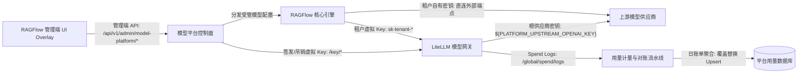

# 架构与系统设计

[English](architecture.md) | 简体中文

> [!NOTE]
> **文档定位**：本文档定义 `model-platform` 扩展的**顶层系统拓扑、核心架构不变式与架构决策记录（ADR）**。具体工程实现任务、表结构定义与测试指南参见 [工程实施计划](implementation-plan.zh-CN.md)。

---

## 1. 目标

- **受管预置**：管理员统一向租户预置托管的 LLM 与 Embedding 模型。
- **自主接入**：租户保留自主配置并使用外部自有供应商凭据的完整自由。
- **权威计量**：平台受管调用由网关原子审计并归属租户，作为对账结算的权威依据。
- **物理绕行**：租户自有模型直连外部端点，物理绕开网关，平台用量恒为 0.00 元。

---

## 2. 系统拓扑与职责划分

| 核心组件 | 定位与核心职责 | 边界红线 / 隔离机制 |
| :--- | :--- | :--- |
| **RAGFlow 内核** | 租户认证、模型选择器、知识库分块解析、业务流水线 | 100% 原始源码纯净（零侵入） |
| **扩展控制面** | 管理端 UI/API、租户生命周期协调状态机 | 基于 Go `ee` 标签桩与 Web Overlay 解耦 |
| **LiteLLM 网关** | 根凭据托管、租户虚拟 Key 路由、模型白名单与权威日志 | 独占回环 `127.0.0.1:4000`，物理隐藏根密钥 |
| **对账流水线** | 网关 Spend Log 拉取去重、48 小时滚动覆盖汇总 | 不可变日志暂存 + 替换 Upsert（数学幂等） |

---

## 3. 核心架构不变式保障 (Core Invariants)

1. **绝对非侵入（Non-Invasive Extensibility）**：`upstream/ragflow` 差异严格为空。所有增强均基于工作区 Overlay、Go 构建标签桩与外部服务解耦实现。
2. **凭据零泄露（Zero-Leakage Credential Boundary）**：根供应商真实 API Key 仅存在于网关环境。租户仅获取白名单受限的虚拟 Key（`sk-tenant-...`）。
3. **事务强解耦（Transaction Decoupled Events）**：严禁在 DB 事务内发起网络 RPC。租户生命周期钩子基于事务提交后回调机制（`RegisterPostCommitHook`）与异步事件总线（`event.EventBus`）解耦分发。
4. **向量空间不可变（Vector Space Immutability）**：已有分块的数据集向量模型永久冻结，API 强制拦截篡改请求并返回 HTTP 400。
5. **自有模型零计费（Zero-Billing Bypass）**：租户自有模型直接连接外部端点，物理绕开网关，平台账单恒为 0.00 元。

---

## 4. 架构决策记录 (ADRs)

- **ADR-1：工作区 Overlay 机制替代内核侵入 Patch**  
  *权衡*：上游 `!ee` 标签导致编译互斥；决定通过 `ee-baseline` 桩与薄跳板桥接，保障上游内核绝对纯净。
- **ADR-2：LiteLLM 网关采用独立 PostgreSQL 持久化与本地回环隔离**  
  *权衡*：网关凭据与日志需可靠持久化且防外网嗅探；决定绑定 `127.0.0.1:4000`，由独立 DB 承载状态。
- **ADR-3：Reconciler 采用“内存快速重试 + 水平扫描”两级自愈机制**  
  *权衡*：网关重启升级（如 45 秒停机）不能遗漏租户；决定内存重试处理瞬时抖动，后台 Poller 保障长效自愈。
- **ADR-4：模型默认值采用条件原子 SQL 与显式意图粘性保护**  
  *权衡*：并发注册存在覆盖竞态，且平台升级推荐模型不可覆盖用户显式选择；决定原子更新并记录偏好来源。
- **ADR-5：向量模型实施三段式生命周期管理（Active -> Deprecated -> Tombstoned）**  
  *权衡*：下架向量模型会导致存量知识库检索瘫痪；决定废弃后保留网关只读白名单，仅在引用归零后物理注销。
- **ADR-6：以网关 Spend Log 为权威计量边界、全细分 Token 对齐并执行确定性覆盖重算**  
  *权衡*：应用层统计存在漏洞且多轮对账易双重计费；现代上下文缓存与推理模型对账极其严苛（需精准体现缓存折扣、思考 Token 与节省金额）。决定网关日志去重暂存并提取标准化细分指标，以 48 小时窗口执行确定性覆盖替换。超过 48 小时的极端迟到日志支持通过指定历史重算窗口（`RunWindow(ctx, lookbackHours)`）按需回溯补偿。

---

## 5. 范围边界界定

- **第一期实施范围 (Phase 0~5 核心能力闭环)**：
  - Chat（`gpt-4o-mini`）与 Embedding（`text-embedding-3-small`）原生驱动无损解析。
  - 租户专属虚拟 Key 自动化签发与两级自愈状态机。
  - 默认模型条件原子初始化与显式意图粘性保护。
  - Embedding 三段式生命周期保护与数据集向量空间不可变守卫。
  - 网关日志暂存去重、48 小时幂等日账单聚合与管理端用量统计导出 API。
  - 自动化非侵入合规审计与 CI 门禁体系。
- **后续规划范围 (远期演进能力)**：
  - 商业支付与收款流水（Stripe / 信用卡）。
  - 基于付费等级的速率限制（Rate-limiting tier）。
  - 阻断或限制租户接入自有供应商。
