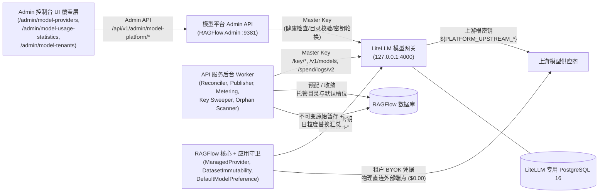

# 架构与系统设计

[English](architecture.md) | 简体中文

> [!NOTE]
> **文档定位**：本文档作为 `model-platform` 扩展的长期演进架构文档，负责定义**系统拓扑边界、核心不变式保证与架构决策记录（ADR）**。
> - 如需查看各子系统内部实现机制、数据库表结构、覆盖接缝与端到端测试指南，请参阅 [工程设计参考](implementation-plan.zh-CN.md)。
> - 如需查看部署运维、界面操作与 HTTP 接口契约，请参阅 [管理员与运维指南](docs/admin-guide.zh-CN.md)、[租户与用户指南](docs/user-guide.zh-CN.md) 与 [API 参考文档](docs/api-reference.zh-CN.md)。

---

## 1. 设计目标

- **多类型平台模型集中托管**：通过统一模型网关向全量租户提供全部 7 类网关路由模型（`chat`、`embedding`、`asr`、`vision`、`rerank`、`tts`、`decision`），同时保持本地 `ocr` 流水线运行在网关之外。
- **租户自有密钥（BYOK）自治**：完整保留租户 Owner 自由配置外部或私有模型供应商凭据的权利。
- **网关权威计量与归属**：以模型网关产生的原始账单日志作为唯一计费事实来源（覆盖输入/输出/缓存命中/缓存写入/推理 Token、TTS 字符数、费用与缓存节省金额）。
- **物理零计费直连旁路**：租户自有 BYOK 调用在物理链路上直连外部上游端点，不经过网关，产生严格 `$0.00` 平台费用。
- **全生命周期与凭据安全治理**：支持动态模型目录上架、退役、重新启用、保护粘性选择的默认模型切换、知识库向量空间不可变保护以及零中断应急密钥轮换。

---

## 2. 系统拓扑与组件边界

| 组件 | 职责定位 | 隔离边界 |
| :--- | :--- | :--- |
| **RAGFlow 核心（`upstream/ragflow`）** | 租户认证、模型工厂与驱动、对话/知识库/智能体流水线、基础前后端 UI | 100% 洁净的官方 Git 子模块（零本地改动） |
| **控制面与守卫（`extensions/model-platform/backend`）** | 13 个 Admin API 端点、3 个 App API 守卫中间件、5 个后台 Worker 循环、6 项数据库迁移 | 仅通过 `ee-baseline` 桩与薄 Go Trampoline 接入 |
| **Web UI 覆盖层（`extensions/model-platform/overlay/web/src/ee`）** | 3 个 Admin 治理页面、多语言文案、`ProviderInstanceCardWithPrivilege` 只读保护层 | 在 `VITE_RAGFLOW_ENTERPRISE=false` 条件下通过上游 `src/ee` 接缝注入 |
| **LiteLLM 网关（`extensions/model-platform/gateway`）** | 根密钥隔离托管、按 Team 划分的虚拟密钥、模型白名单路由与权威账单日志 | 仅监听环回 `127.0.0.1:4000` + 独立 PostgreSQL；根密钥仅驻留网关并仅用于请求上游供应商（绝不暴露给租户或 Admin API） |

---

## 3. 核心不变式保证

1. **严格非侵入扩展**：`upstream/ragflow` 保持零 diff，所有前后端扩展完全依赖工作区覆盖层、Go `//go:build ee` 桩/Trampoline 与独立网关服务实现。
2. **凭据零泄漏边界**：上游根密钥严格留在网关容器环境中。租户仅持有绑定至 `team_id` 的受限虚拟密钥（`sk-tenant-*`），Admin API 与控制台仅暴露密钥别名与 8 位 SHA-256 指纹，永不返回明文密钥。
3. **事务解耦异步副作用**：严禁在数据库事务内执行远程网络 RPC。`OnTenantCreateHook` 仅执行本地 SQL 写入 `status = pending`，经 `event.PreFlightCheck` 确认事务对外可见后再通过 `event.EventBus` 异步派发。
4. **默认模型粘性来源保护**：平台切换默认模型仅迁移来源为 `platform_default` 的用户；由 `DefaultModelPreferenceMiddleware` 观测并记录为 `user_explicit` 的用户选择受到保护，除非所选模型被退役并进入 `tombstoned`。
5. **知识库向量空间不可变**：包含文档或已解析切片的非空知识库禁止更换向量模型（HTTP `400`）；已退役向量模型对存量引用知识库保持只读可用，同时阻止新建或空知识库绑定。
6. **物理零计费直连旁路**：租户自有 BYOK 实例不经平台网关直连外部端点，产生严格 `$0.00` 平台费用，可通过 `GET /api/v1/admin/model-platform/usage/audit` 实时审计验证。
7. **先网关后数据库收敛与计量数学幂等**：目录上架/激活时先更新网关白名单再写入数据库，确保新模型对租户可见前已可路由；退役时同样先移除网关白名单再禁用 `tenant_model`（存在短暂的 fail-closed 窗口，网关先阻断新流量随后数据库收敛）。原始账单按 `spend_id` 去重，日汇总采用自然日对齐的替换 Upsert 而非增量累加。

---

## 4. 架构决策记录（ADR）

- **ADR-1：工作区覆盖流水线 vs. 修改上游内核**  
  *背景与决策*：开启 `RAGFLOW_GO_TAGS=ee` 会全局排除上游 19 个包中的 `//go:build !ee` 桩文件。因此建立肯定的 `ee-baseline` 回退桩与薄路由 Trampoline，由 `apply-overlay.sh` 组装到隔离目录 `build/ragflow`，保持 `upstream/ragflow` 100% 洁净。
- **ADR-2：PostgreSQL 持久化 LiteLLM 网关与环回隔离**  
  *背景与决策*：虚拟密钥和账单日志需要持久化存储与严格网络边界。选用锁定版本的 LiteLLM（`v1.110.0`）配合独立 PostgreSQL 16，强制仅绑定 `127.0.0.1:4000`，默认 `model_list: []`，开启日志凭据脱敏并设置 `user_api_key_cache_ttl: 5`。
- **ADR-3：单次事件快路径 + 统一数据库退避的自愈 Poller**  
  *背景与决策*：网关重启或短时不可达不能阻塞租户注册，也不能遗留永久不可用的租户；同时管理员通过 `POST /api/v1/admin/users` 创建的租户也应与自主注册一样即刻预配，且避免双调度器竞态或重复后台巡检。决定在 `ServerTypeAPI` 与 `ServerTypeAdmin` 均采用单次即时 Tier-1 事件尝试（失败即落盘交棒，无内存重试循环），所有延迟重试统一由 `ServerTypeAPI` 的数据库驱动 Tier-2 Poller 按单一 `BackoffPolicy`（`5s → 15s → 30s → 1m → 2m`，封顶 `2m`）、15 秒周期巡检与 2 分钟僵死租约回收完成。
- **ADR-4：默认槽位原子初始化与粘性来源观测**  
  *背景与决策*：并发初始化存在覆盖竞态，平台默认升级需覆盖全部 7 类托管模型（`model_slots.go`）且尊重用户显式偏好。采用条件原子 SQL 初始化空槽位、成员加入时继承 Owner 默认值，以及 `DefaultModelPreferenceMiddleware` + `StickyGuard` 追踪偏好来源。
- **ADR-5：向量模型三阶段生命周期（`Active` → `Deprecated` → `Tombstoned`）**  
  *背景与决策*：直接吊销向量模型会破坏存量知识库检索。对退役的向量模型在仍有知识库引用时保留只读网关白名单访问，引用清零后再进入 `tombstoned`；非向量模型直接进入 `tombstoned`。
- **ADR-6：网关权威账单、精细化指标与自愈替换汇总**  
  *背景与决策*：应用侧计量在重试场景下不可靠，且现代模型需呈现缓存命中/推理 Token 与 TTS 字符数，同时长时停机可能造成跨天缺口。采用不可变原始暂存表（`platform_gateway_spend_log`）、在线有界水位线轮询、重启无上限回放、按自然日对齐的替换 Upsert（`platform_tenant_usage_daily`）与自动多日 Catch-up 聚合，并提供可选双层日志保留清理。
- **ADR-7：意图驱动的托管模型目录与电平触发分发收敛**  
  *背景与决策*：静态硬编码模型列表难以演进。以 `platform_managed_model` 作为管理员意图的唯一真相源（`active`/`retired`、`is_default`），通过乐观锁分发 Worker 与周期性漂移巡检驱动全租户收敛，并严格执行“先更新网关白名单、再更新数据库”。
- **ADR-8：基于 Team 的密钥标识与零中断应急密钥轮换**  
  *背景与决策*：LiteLLM 对 `key_alias` 仅做应用层唯一校验，不足以作为安全吊销标识。决定以 `team_id = tenant_id` 归组租户全部密钥，以 SHA-256 `key_hash` 精确寻址单把密钥；轮换时保持租户 `ready` 状态，先签发新密钥并原子切换实例，再同步吊销旧密钥并由后台 `sweepDirtyKeys` 兜底收敛。

---

## 5. 当前能力边界与演进方向

### 当前已覆盖能力（已实现并持续维护）

- **7 类托管模型**：通过原生 `OpenAI-API-Compatible` → `platform` 驱动解析支持 `chat`（1）、`embedding`（2）、`asr`（4）、`vision`（8）、`rerank`（16）、`tts`（32）与 `decision`（128）。
- **租户生命周期与凭据治理**：事务后置异步预配、两级自愈、孤儿租户清理、单租户与批量零中断应急密钥轮换以及前后端写保护。
- **模型目录与默认治理**：动态上架/退役/重新启用/切默认 API 与 Admin 控制台界面、滚动下发进度追踪与失败重试、粘性偏好保护、新成员默认值继承以及知识库向量不可变守卫。
- **权威计量与隔离审计**：原始账单暂存、日粒度 Token/字符/费用/缓存节省汇总、动态多日补齐、可选保留清理、Admin 用量看板与实时消费隔离审计。
- **自动化验证**：单元测试、容器化 E2E 集成测试套件与自动化非侵入合规审计门禁（`audit-non-invasive.sh`）。

### 明确的非目标与后续可选演进

- 商业收单、账单开票与订阅支付系统（如 Stripe）。
- 基于付费套餐等级的差异化限流与配额控制。
- 限制或禁止租户使用自有 BYOK 模型供应商。
- 超出社区基线策略（`ee-baseline`）的企业级 RBAC 权限策略扩展。
