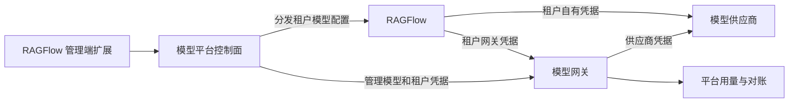

# 架构与验证

[English](architecture.md) | 简体中文

## 目标

管理员可以向租户提供平台模型。租户可以使用平台模型，也可以使用自己的供应商。平台模型调用能够归属到租户、计量，并最终按照平台策略计费。租户自有供应商的使用量不计入平台模型费用。

## 初步职责划分

- **RAGFlow** 负责租户身份、现有供应商配置、模型选择、知识库绑定和任务行为。
- **模型平台扩展** 将管理界面、租户配置分发、配置生命周期和展示与网关连接起来。它必须使用经过认证的上游扩展点或受支持的 API，不修改共享内核代码。
- **网关** 保存上游供应商凭据，执行租户模型访问权限、凭据状态和配置的限额。LiteLLM 是候选方案，尚未完成集成验证。
- **用量与结算** 区分网关用量、应用侧归因和实际收费。向客户收费前，需要明确权威数据来源和对账要求。

## 租户凭据和配置

平台模型可以作为指向网关的租户级 RAGFlow 供应商和模型记录进行分发。分发的凭据是租户专属网关 Key，绝不是上游供应商 Key。如果租户能够访问网关，也可能直接使用自己的网关 Key；这类请求仍必须由网关归属和限制。

分发过程必须跟踪受管理记录的身份，避免覆盖租户自有记录和显式选择，并处理重试及部分失败。撤销或轮换凭据时需要考虑进行中的调用。停用单个模型时，不能撤销同时供其他模型使用的凭据。具体存储和 API 方案仍需验证。

分发时可以按照 RAGFlow 现有选择规则初始化默认模型。只要现有权限允许，租户就可以自行修改选择。平台默认值变化不会自动覆盖用户选择。模型停用时，只有默认值仍指向该受管理模型才予以清理；不能静默地将显式选择切换到其他模型。

保留已有知识库的 embedding 绑定和上游行为。不能将稳定的 embedding 模型别名改指向不兼容的模型。除非由本扩展引入，否则上游知识库一致性问题不属于本项目范围。

## 待验证的扩展机制

`v1.0.0` 检出版本包含管理端路由注册接缝、租户创建钩子、默认模型配置接缝，以及前端路由和导航覆盖文件。这些接缝的存在并不证明它们覆盖所有生命周期事件，也不证明在数据库事务中调用远程服务是安全的。选定实现前，需要从调用方验证其行为。

租户创建钩子在事务中、租户记录写入之前执行。不能假定可以安全地在此签发网关 Key，也不能假定成员关系记录已经存在。可能需要独立的协调器或事务提交后的处理机制。

目前尚未确认 RAGFlow 运行时存在一个通用的模型用量钩子，能携带完整的租户、用户、任务和供应商信息。网关 Key 可以为平台调用识别租户；细粒度应用归因和租户自有模型调用需要单独验证。不能假定直接调用网关的请求携带可信的 RAGFlow 用户或任务身份。

## 首个验证切片

1. 固定 LiteLLM 版本，检查其许可及所需模型、Key、预算和用量 API 是否可用。
2. 注册一个聊天模型和一个 embedding 模型，签发仅拥有预期模型和路由权限的租户 Key。
3. 通过经过验证的非侵入式集成，为租户分发网关模型记录；确认 RAGFlow 现有模型选择和调用路径可用。
4. 验证租户归属、用量明细、直接调用网关、Key 撤销、模型停用和租户自有供应商的独立使用。
5. 验证协调过程不会覆盖用户对默认模型的修改，已有知识库 embedding 引用保持稳定。
6. 验证 RAGFlow 与网关之间的部分失败和重试。在决定如何替代已有实验分支之前，记录协议和归因方面的缺口。

## 验收条件

- 平台供应商密钥不存入租户供应商配置，也不返回给租户。
- 租户网关 Key 不能访问其他租户的管理功能，也不能超出为其配置的模型权限。
- 租户的平台用量归属到该租户，包括允许直接访问网关时产生的用量。
- 租户自有供应商保持可用，其使用量不计入平台模型费用。
- 模型同步不会覆盖租户自有配置或显式选择的默认模型。
- 停用平台模型时，仅清理仍指向该模型的默认值；无关模型和凭据保持可用。
- 默认值变更或模型同步不会顺带改写已有知识库绑定。
- 扩展不需要修改上游共享内核文件。

商业结算、套餐、收款和限制租户自有供应商属于未来能力，当前尚未实现。

## 待决事项

- 如何在不修改上游检出目录的前提下，打包和构建 Go `ee` 实现与前端覆盖文件。
- 现有钩子和公开 API 能否安全覆盖初始分发和全部生命周期事件。
- 受管理记录的映射和协调状态存放在哪里。
- 如何导出、对账、定价和保留 LiteLLM 用量以支持计费。
- 首个版本除聊天和 embedding 外支持哪些模型协议。
- 租户自有供应商需要哪些应用级归因能力。

未经验证的钩子或网关指标不能等同于已完成的功能。
