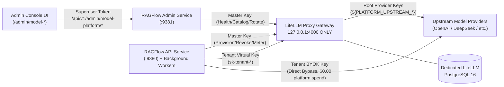
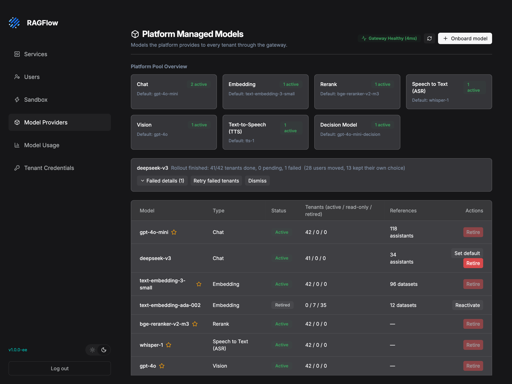
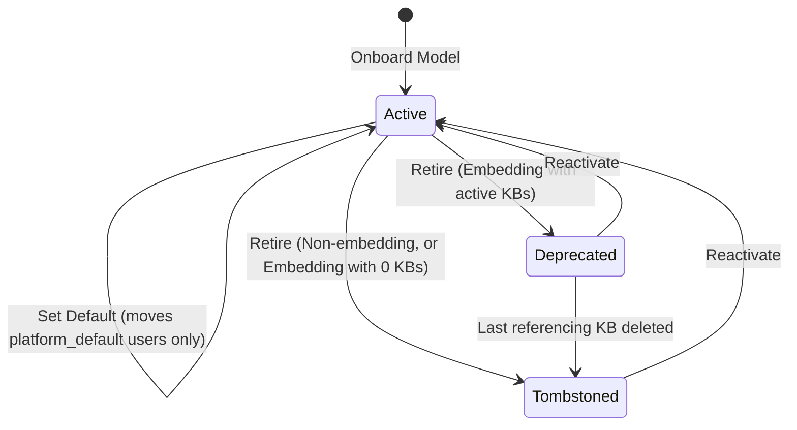
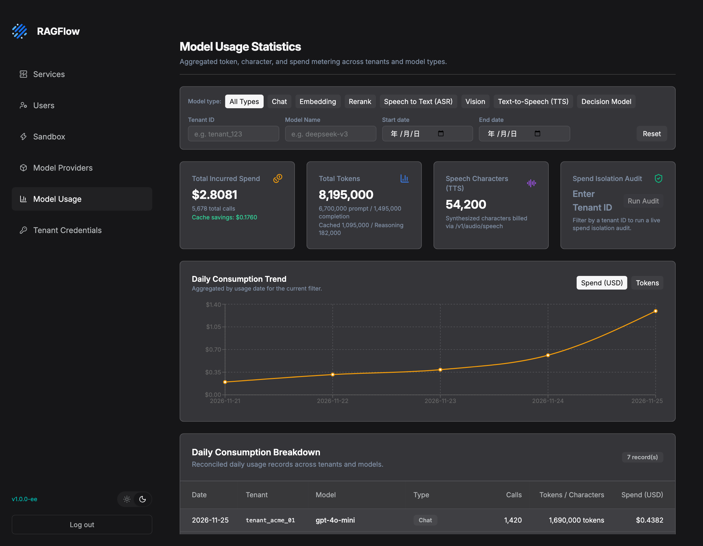
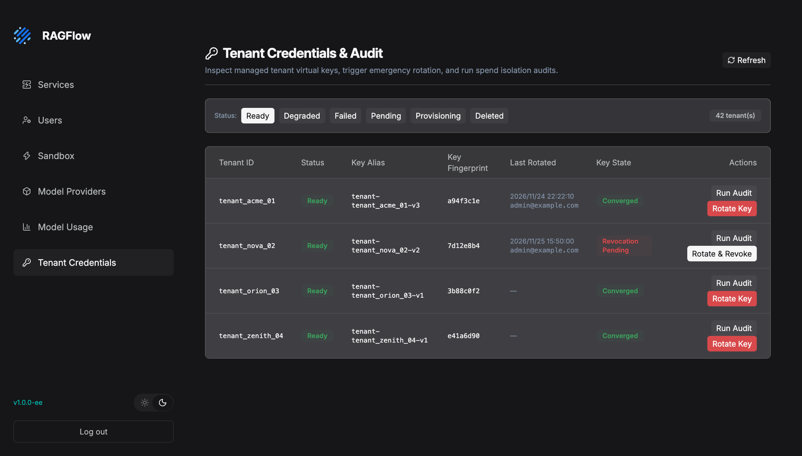
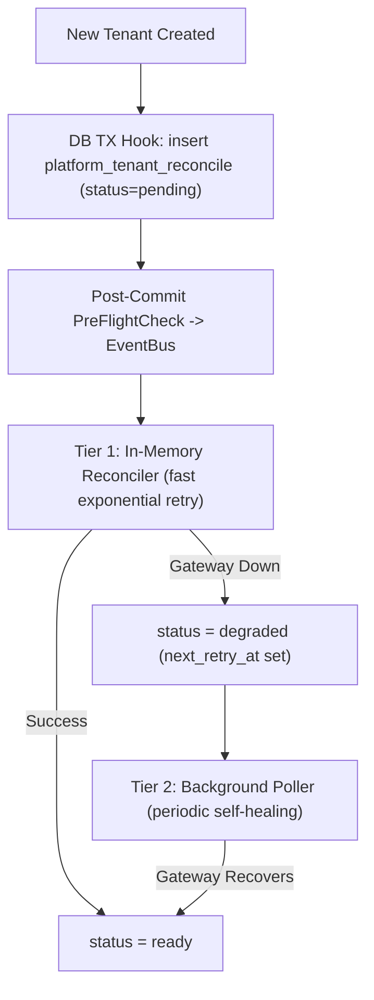

# Platform Operator & Administrator Guide

English | [简体中文](admin-guide.zh-CN.md)

This guide is written for **platform operators (SREs)** and **RAGFlow Superusers** who deploy, configure, monitor, and govern the `model-platform` extension.

> [!NOTE]
> For field-level request/response schemas and `curl` examples of every administrative endpoint, see the [API Reference](api-reference.md). For tenant-facing workflows, see the [Tenant & User Guide](user-guide.md).

---

## 1. Architecture & Network Topology

The extension enforces a strict physical credential boundary between RAGFlow tenants and upstream model providers:



### Security & Lifecycle Guarantees

1. **Loopback-Only Gateway Binding**: `gateway/docker-compose.yml` binds LiteLLM strictly to `127.0.0.1:4000:4000`. Exposing `0.0.0.0:4000` or routing public traffic directly to LiteLLM is forbidden and rejected by `gateway/validate-gateway-config.sh`.
2. **Zero Root Key Leakage**: Root upstream API keys exist only inside the LiteLLM container environment. Tenants receive scoped virtual keys (`sk-tenant-*`) bound to a dynamic model whitelist and stored on their managed `OpenAI-API-Compatible` → `platform` instance.
3. **Log Desensitization**: `litellm-config.yaml` enables `redact_user_api_key_info: true`, `drop_params: true`, `set_verbose: false`, `json_logs: true`, and bounds per-worker key cache staleness with `user_api_key_cache_ttl: 5`.
4. **Automatic Background Workers**: When the RAGFlow API server (`ServerTypeAPI`) starts with `LITELLM_BASE_URL` and `LITELLM_MASTER_KEY` configured, it automatically launches five background loops (`backend/worker/worker.go`):
   - **Self-Healing Tenant Reconciler**: Two-tier provisioning for new/degraded tenants.
   - **Publish Rollout Worker**: Converges tenants whenever models are onboarded, retired, reactivated, or promoted to default.
   - **Metering Daemon**: Watermark-driven spend log collector, daily rollup aggregator, and optional retention sweeper.
   - **Dirty Key Sweeper** (`sweepDirtyKeys`): Runs every `1m` to revoke superseded virtual keys left dirty for more than `2m`.
   - **Orphaned Tenant Scanner** (`scanOrphanedTenants`): Runs every `1h` to revoke gateway keys for deleted upstream tenants.

---

## 2. Production Deployment & Setup

### 2.1 Configure and Start the Gateway Stack

The gateway bundle lives in `extensions/model-platform/gateway/`:

- `docker-compose.yml`: Pins `postgres:16-alpine` and `ghcr.io/berriai/litellm:v1.110.0` on an isolated bridge network (`ragflow-model-platform-net`) with health checks.
- `litellm-config.yaml`: Defaults to `model_list: []` so private and air-gapped environments are never polluted with unreachable models.
- `validate-gateway-config.sh`: Security pre-flight validator.

**Step 1 — Prepare `.env`:**

```sh
cd extensions/model-platform/gateway
cp .env.example .env
```

Set strong, unique secrets in `.env`:

| Variable | Required | Description |
| :--- | :---: | :--- |
| `POSTGRES_DB` | No | Dedicated LiteLLM database name (default `litellm`). |
| `POSTGRES_USER` | No | Dedicated LiteLLM DB user (default `litellm`). |
| `POSTGRES_PASSWORD` | Yes | Strong password for the LiteLLM PostgreSQL instance. |
| `DATABASE_URL` | No | Full PostgreSQL DSN; auto-composed from `POSTGRES_*` if omitted. |
| `LITELLM_MASTER_KEY` | Yes | Master key for LiteLLM administrative APIs (e.g., `sk-master-...`). Shared with RAGFlow API & Admin processes. |
| `LITELLM_SALT_KEY` | Yes | Encryption salt used by LiteLLM for DB-stored secrets. **Never change after first boot** without migrating encrypted rows. |
| `PLATFORM_UPSTREAM_OPENAI_KEY` | Yes | Root upstream API key injected into `litellm-config.yaml` via `os.environ/...`. Add additional `PLATFORM_UPSTREAM_*` variables for other upstream providers as needed. |
| `PLATFORM_UPSTREAM_OPENAI_BASE` | No | Upstream base URL (default `https://api.openai.com/v1`). |

**Step 2 — Add model routes to `litellm-config.yaml`:**

Every model you plan to onboard in RAGFlow must first be routable by LiteLLM (`GET /v1/models`). Example:

```yaml
model_list:
  - model_name: gpt-4o-mini
    litellm_params:
      model: openai/gpt-4o-mini
      api_key: os.environ/PLATFORM_UPSTREAM_OPENAI_KEY
      api_base: os.environ/PLATFORM_UPSTREAM_OPENAI_BASE
  - model_name: text-embedding-3-small
    litellm_params:
      model: openai/text-embedding-3-small
      api_key: os.environ/PLATFORM_UPSTREAM_OPENAI_KEY
      api_base: os.environ/PLATFORM_UPSTREAM_OPENAI_BASE
```

> [!CAUTION]
> Never hardcode upstream API keys inside `litellm-config.yaml`. Always reference environment variables with `os.environ/<VAR_NAME>`.

**Step 3 — Validate and launch:**

```sh
./validate-gateway-config.sh
docker compose up -d
docker compose ps
```

Verify loopback health locally:

```sh
curl -fsS http://127.0.0.1:4000/health/liveliness
```

### 2.2 Build and Configure RAGFlow Services

Assemble the enterprise overlay workspace (`build/ragflow`):

```sh
./extensions/model-platform/scripts/apply-overlay.sh
```

Provide `LITELLM_BASE_URL` and `LITELLM_MASTER_KEY` to **both** the RAGFlow API server (which runs the background workers) and the RAGFlow Admin server (which serves `/api/v1/admin/model-platform/*`).

> [!WARNING]
> If `LITELLM_BASE_URL` or `LITELLM_MASTER_KEY` is omitted on the API server, model platform background workers do not start (`ErrGatewayNotConfigured`) and newly created tenants remain in `pending` state. On the Admin server, `POST /models` and `POST /tenants/:tenant_id/rotate-key` return `503 Service Unavailable`.

---

## 3. Configuration Reference

### 3.1 Gateway & Control Plane Variables (RAGFlow API / Admin Processes)

| Environment Variable | Default | Scope | Description |
| :--- | :--- | :--- | :--- |
| `LITELLM_BASE_URL` | *(unset)* | API + Admin | Internal URL of the LiteLLM gateway (e.g., `http://127.0.0.1:4000`). Required to enable workers, publishing, deep health checks, and key rotation. |
| `LITELLM_MASTER_KEY` | *(unset)* | API + Admin | LiteLLM master key paired with `LITELLM_BASE_URL`. |

### 3.2 Metering & Retention Variables (RAGFlow API Process)

All metering intervals use Go `time.ParseDuration` syntax (e.g., `30s`, `5m`, `1h`).

| Environment Variable | Default | Description |
| :--- | :--- | :--- |
| `METERING_DAEMON_ENABLED` | `true` | Set to `false` to disable background spend log polling, daily rollup, and purge workers. |
| `METERING_POLL_INTERVAL` | `5m` | Frequency of incremental spend log polling from LiteLLM `/global/spend/logs`. |
| `METERING_AGGREGATION_INTERVAL` | `1h` | Frequency of routine calendar-aligned daily rollup into `platform_tenant_usage_daily`. |
| `METERING_FETCH_OVERLAP` | `5m` | Safety overlap window subtracted from the watermark on each poll to catch delayed gateway writes without double-counting (deduplicated by `request_id`). |
| `METERING_LOOKBACK_HOURS` | `48` | Cold-start / routine rolling lookback window in hours (aligned to calendar day boundaries in `METERING_TIMEZONE`). |
| `METERING_TIMEZONE` | `UTC` | Business billing timezone for daily calendar buckets. Accepts `UTC`, `Local`, IANA names (e.g., `Asia/Shanghai`, `America/New_York`), or numeric offsets (`+08:00`, `-05:00`). |
| `METERING_SPEND_LOG_RETENTION_DAYS` | `0` | Opt-in raw `platform_gateway_spend_log` retention in days (`0` = retain indefinitely). When `> 0`, a daily purge worker deletes raw logs older than the cutoff **after** the initial startup poll completes and while holding the pipeline mutex so in-flight aggregations are never corrupted. |
| `METERING_COLLECTOR_BATCH_SIZE` | `100` | Number of raw spend log rows inserted per DB batch. |
| `METERING_PIPELINE_BATCH_SIZE` | `100` | Number of daily usage rollup rows upserted per DB batch. |

> [!TIP]
> If you also enable LiteLLM's `general_settings.maximum_spend_logs_retention_period` in `litellm-config.yaml`, keep LiteLLM's retention **shorter** than `METERING_SPEND_LOG_RETENTION_DAYS` (or keep RAGFlow retention at `0`) so the control plane remains the longer-lived audit archive.

---

## 4. Admin Console UI Guide

Log in to the Admin Console (`/admin`) with a **RAGFlow Superuser** account. The extension adds three pages to the left navigation sidebar:

- **Model Providers** (`/admin/model-providers`)
- **Model Usage** (`/admin/model-usage-statistics`)
- **Tenant Credentials** (`/admin/model-tenants`)

### 4.1 Model Providers (`/admin/model-providers`)



Use this page to monitor gateway reachability and manage the full lifecycle of platform models across all 7 managed model types (`Chat`, `Embedding`, `Rerank`, `Speech to Text (ASR)`, `Vision`, `Text-to-Speech (TTS)`, and `Decision Model`).

1. **Gateway Health Badge (top right)**: Automatically probes `GET /api/v1/admin/model-platform/health` every 30 seconds and displays latency (`Gateway Healthy (Nms)`), `Gateway Degraded`, or `Gateway Unreachable`. Click the refresh icon to probe on demand.
2. **Platform Pool Overview**: Seven summary cards showing active model count and the current platform default for each managed model type.
3. **Onboard a Model**:
   - Prerequisite: Add the model route to `gateway/litellm-config.yaml` and reload/restart LiteLLM first.
   - Click **Onboard model**, enter the exact gateway `model_name` (e.g., `deepseek-v3` or `tts-1`), select its model type, and confirm.
   - The backend verifies the route against the gateway, records the catalog entry, and fans out the model to every `ready` tenant asynchronously. **Onboarding never changes existing defaults.**
4. **Set Platform Default (`Set default`)**:
   - Available on any `Active` non-default model.
   - Moves users whose preference provenance is `platform_default` to the new model, while **preserving users who explicitly chose their own model** (`user_explicit`).
5. **Retire (`Retire`) & Reactivate (`Reactivate`)**:
   - You cannot retire a model that is currently the platform default for its type — promote another active model to default first.
   - Inspect the **Tenants (active / read-only / retired)** and **References** (`N datasets` / `N assistants`) columns before retiring:
     - **Embedding models** follow a 3-stage lifecycle (`Active` → `Deprecated / Read-Only` → `Tombstoned`). Tenants with active knowledge bases retain read-only retrieval access; tenants without references lose the model immediately.
     - **Non-embedding models** (`Chat`, `Decision`, `Rerank`, `ASR`, `Vision`, `TTS`) are disabled immediately across tenants; assistants referencing them prompt owners to choose another model, and default users move to the platform default.
   - Click **Reactivate** on a retired model to restore it across all tenants.
6. **Rollout Progress Banner**:
   - Appears whenever an onboard/retire/reactivate/set-default task runs, polling every 3 seconds until complete.
   - Displays `succeeded / total`, `pending`, `failed`, and (for default switches) `upgraded` vs. `preserved` user counts.
   - Expand **Failed details** to inspect per-tenant errors and click **Retry failed tenants** to re-queue failed items.



### 4.2 Model Usage Statistics (`/admin/model-usage-statistics`)



Use this page for cost visibility, multi-dimensional consumption analysis, and tenant billing isolation verification.

- **Filters**: Filter by **Model type** pills, **Tenant ID**, **Model Name**, **Start date**, and **End date** (`YYYY-MM-DD`), or click **Reset**.
- **KPI Summary Cards**:
  1. **Total Incurred Spend**: Cumulative USD spend, call count, and prompt cache savings.
  2. **Total Tokens**: Total tokens broken down into `prompt` / `completion` and `Cached` / `Reasoning` tokens.
  3. **Speech Characters (TTS)**: Synthesized characters billed via `/v1/audio/speech`.
  4. **Spend Isolation Audit**: Enter a **Tenant ID** in the filter bar and click **Run Audit** to verify live from `platform_gateway_spend_log` that the tenant has `$0.00` unmanaged/shadow spend. Violations raise an alert banner with offending model names.
- **Daily Consumption Trend**: Toggle between **Spend (USD)** and **Tokens** line series. When matching records exceed 100 rows, the chart displays a partial-data notice so you can narrow the date range.
- **Daily Consumption Breakdown**: Paginated table (20 rows/page) of reconciled daily usage per `(date, tenant, model)`.

### 4.3 Tenant Credentials & Audit (`/admin/model-tenants`)



Use this page to inspect managed tenant virtual key states, run emergency rotations, and audit individual tenants.

- **Status Filter & Cursor Pagination**: Filter tenants by reconcile status (`Ready`, `Degraded`, `Failed`, `Pending`, `Provisioning`, `Deleted`). Navigation uses stable cursor pagination (`after`) so concurrent status transitions never skip rows.
- **Key Metadata (Zero Secret Exposure)**: Displays `Key Alias`, 8-hex-character SHA-256 `Key Fingerprint`, `Last Rotated` timestamp/operator, and `Key State` (`Converged` vs. `Revocation Pending`). Raw virtual keys are never returned.
- **Rotate Key / Rotate & Revoke**:
  - Enabled for `Ready` tenants.
  - Issues a fresh virtual key, atomically updates the tenant's `platform` instance (zero downtime), and revokes the previous key.
  - If a prior rotation could not reach the gateway during revocation (`Key State = Revocation Pending`), the action label becomes **Rotate & Revoke** to finish convergence immediately (the background sweeper also retries automatically).
- **Run Audit**: Opens the **Tenant Spend Isolation Audit** modal for that tenant, comparing managed spend against any unmanaged/shadow spend.

---

## 5. Admin API Quick Reference & Batch Tooling

All 13 endpoints are served under `/api/v1/admin/model-platform` and require a Superuser `Authorization` header (see [API Reference](api-reference.md) for full request/response contracts).

| Method & Path | Purpose |
| :--- | :--- |
| `GET /health` | Admin service + downstream LiteLLM health probe |
| `GET /models` | List managed catalog with tenant state counts & KB/assistant references |
| `POST /models` | Onboard a gateway-routed model and start tenant fan-out (`202`) |
| `POST /models/:id/retire` | Retire a non-default model (`202`) |
| `POST /models/:id/reactivate` | Reactivate a retired model (`202`) |
| `PUT /models/:id/default` | Promote an active model to platform default (`202`) |
| `GET /models/publish/tasks/:id` | Poll rollout progress and paginated failed tenants |
| `POST /models/publish/tasks/:id/retry` | Re-queue all failed tenants of a rollout task |
| `GET /tenants` | Cursor-paginated list of managed tenant key states |
| `POST /tenants/:tenant_id/rotate-key` | Zero-downtime single-tenant virtual key rotation (`200` / `202`) |
| `GET /usage/daily` | Paginated daily consumption breakdown |
| `GET /usage/summary` | Aggregated spend/token/character summary with `by_model_type` |
| `GET /usage/audit` | Live tenant spend isolation audit (`tenant_id` required) |

### Emergency Batch Key Rotation Script

For credential leaks or scheduled fleet-wide secret rotation, use `extensions/model-platform/scripts/emergency-rotate-keys.sh` (requires `curl`, `jq`, and a Superuser `ADMIN_TOKEN` obtained from `POST /api/v1/admin/login`):

```sh
# 1. Preview affected tenants without making changes
ADMIN_TOKEN="<superuser-token>" \
ADMIN_URL="http://127.0.0.1:9381/api/v1/admin" \
./extensions/model-platform/scripts/emergency-rotate-keys.sh --all --dry-run

# 2. Rotate a single tenant
ADMIN_TOKEN="<superuser-token>" \
./extensions/model-platform/scripts/emergency-rotate-keys.sh --tenant tenant_acme_01

# 3. Rotate every ready tenant with bounded concurrency & rate limiting
ADMIN_TOKEN="<superuser-token>" \
./extensions/model-platform/scripts/emergency-rotate-keys.sh \
  --all --force --concurrency 10 --rate-limit 5 \
  --output ./rotate-keys.ndjson

# 4. Resume after fixing any failed (non-200) or pending-revocation (202) tenants
ADMIN_TOKEN="<superuser-token>" \
./extensions/model-platform/scripts/emergency-rotate-keys.sh \
  --all --force --resume ./rotate-keys.ndjson --output ./rotate-keys.ndjson
```

**Exit codes**: `0` = all targeted tenants rotated and old keys revoked (`200`); `1` = one or more tenants failed or returned `202` (superseded key revocation still converging); `2` = invalid CLI usage or missing prerequisites.

---

## 6. Disaster Recovery & Operational Playbook

### 6.1 Gateway Outage & Tenant Provisioning Recovery



- **During an outage**: Tenant registration still succeeds in milliseconds because `OnTenantCreateHook` executes local SQL only (never remote RPCs inside a transaction). Affected tenants sit in `pending` or `degraded` state.
- **Recovery steps**:
  1. Restore LiteLLM / PostgreSQL (`docker compose up -d` in `extensions/model-platform/gateway`).
  2. Confirm `GET /api/v1/admin/model-platform/health` returns `200` with `"gateway": "healthy"`.
  3. Open **Admin Console → Tenant Credentials**, filter by `Degraded` / `Pending` / `Failed`, and verify the Tier-2 poller converges them back to `Ready`.

### 6.2 Metering Outage & Spend Log Resynchronization

- **Online operation**: `SpendLogCollector` tracks an in-memory watermark with `METERING_FETCH_OVERLAP` (default `5m`) so queries stay small even across long idle periods.
- **After a prolonged API server or gateway outage**:
  - On restart, the collector replays uncapped from the database watermark (or `METERING_LOOKBACK_HOURS` on cold start) and deduplicates every row by `request_id` (`ON CONFLICT DO NOTHING`).
  - Whenever historical spend logs older than the routine lookback window are inserted, `MeteringDaemon` automatically triggers **dynamic multi-day catch-up aggregation** using **deterministic replacement upserts** (never additive `+=`), guaranteeing zero double-counting.
- **Manual check**: Query `GET /api/v1/admin/model-platform/usage/daily?start_date=...&end_date=...` after one `METERING_POLL_INTERVAL` + `METERING_AGGREGATION_INTERVAL` cycle to verify backfilled dates appear accurately.

### 6.3 Interrupted Key Rotation (`Revocation Pending`)

If the gateway becomes unreachable after issuing a new tenant virtual key and committing it to RAGFlow, the tenant continues working with zero downtime, and `key_dirty_since` is stamped on its reconcile record:

- **Automatic healing**: `sweepDirtyKeys` runs every `1m` and revokes any superseded keys older than `2m`.
- **Immediate manual convergence**: Open **Tenant Credentials**, locate rows marked **Revocation Pending**, and click **Rotate & Revoke** (or re-run `POST /tenants/:tenant_id/rotate-key`).

### 6.4 Shadow Spend / Isolation Violation Alert

If **Spend Isolation Audit** reports `audit_passed: false`:

1. Inspect `unmanaged_models_detected` and `violations` in the audit dialog or `GET /usage/audit?tenant_id=<id>`.
2. Check whether an uncataloged model route was accidentally granted on the tenant's LiteLLM virtual key or whether a model was removed from DB records without updating the gateway whitelist.
3. Rotate the tenant's virtual key (`POST /tenants/:tenant_id/rotate-key`) to immediately rebuild the virtual key whitelist strictly from the tenant's active/read-only managed models, then re-run **Run Audit** to confirm `Isolated`.
