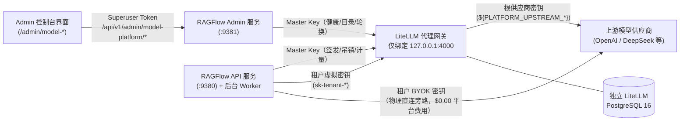
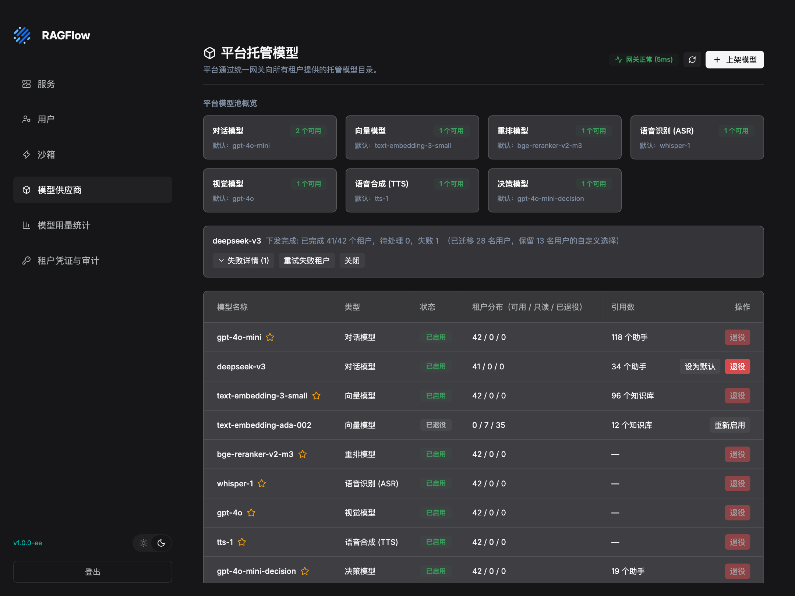
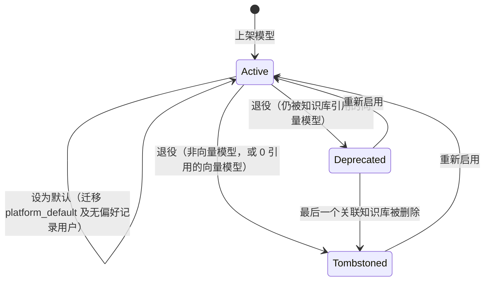
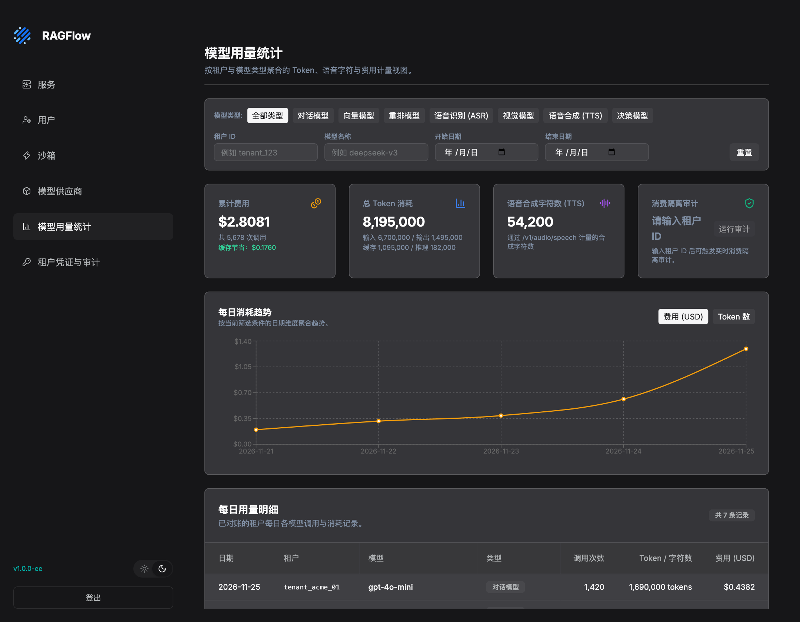
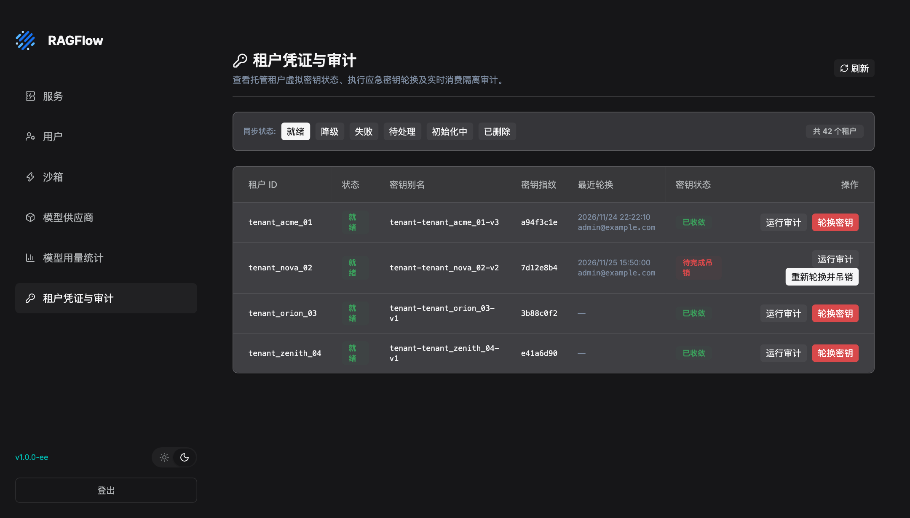
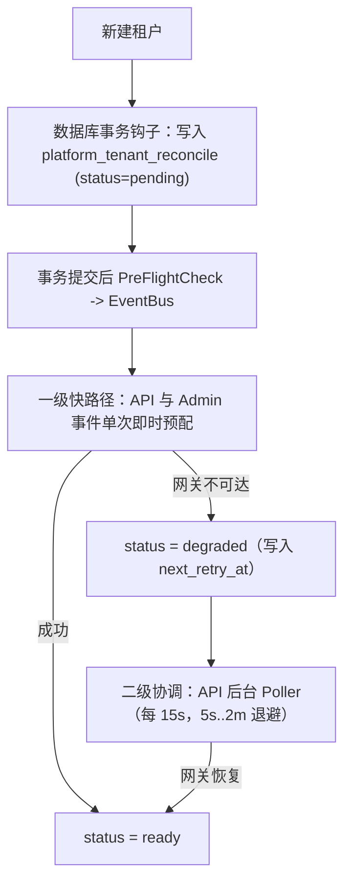

# 平台管理员与运维指南

[English](admin-guide.md) | 简体中文

本指南面向负责部署、配置、监控与治理 `model-platform` 扩展的**平台运维人员（SRE）**与 **RAGFlow 超级管理员（Superuser）**。

> [!NOTE]
> 如需查看全部管理接口的字段级请求/响应契约与 `curl` 示例，请参阅 [API 参考文档](api-reference.zh-CN.md)。如需了解租户侧界面使用方式与行为规则，请参阅 [租户与用户指南](user-guide.zh-CN.md)。

---

## 1. 架构与网络隔离拓扑

本扩展在 RAGFlow 租户与上游模型供应商之间建立了严格的物理凭据隔离边界：



> [!NOTE]
> **宿主机与容器网络连通及传输安全说明**：网关在宿主机环回发布 `127.0.0.1:4000:4000` 并加入 Docker 桥接网络 `ragflow-model-platform-net`。当 RAGFlow API/Admin 直接运行在宿主机时，配置 `LITELLM_BASE_URL=http://127.0.0.1:4000`；当 API/Admin 运行在 Docker 容器内时，请将容器加入 `ragflow-model-platform-net`（或其他共享内部 Docker 网络）并配置 `LITELLM_BASE_URL=http://litellm-proxy:4000`（容器内的 `127.0.0.1` 仅指向容器自身，且 `host.docker.internal` 无法访问仅绑定环回的宿主机端口）。注意：当前部署**未在 `litellm-proxy` 上启用 TLS**，`LITELLM_MASTER_KEY` 与租户虚拟密钥在内部桥接网络上以 HTTP 明文传输，请确保 `ragflow-model-platform-net` 仅包含受信任的 RAGFlow 控制面容器。

### 安全与生命周期核心保障

1. **仅环回地址监听**：`gateway/docker-compose.yml` 强制将 LiteLLM 绑定到 `127.0.0.1:4000:4000`。严禁暴露 `0.0.0.0:4000` 或将公网流量直接路由至 LiteLLM，`gateway/validate-gateway-config.sh` 会在部署前强制校验该规则。
2. **根密钥零泄漏**：上游供应商根密钥仅存在于 LiteLLM 容器环境变量中。每个租户仅获得带动态模型白名单约束的虚拟密钥（`sk-tenant-*`），并写入租户名下的托管实例 `OpenAI-API-Compatible` → `platform`。
3. **日志脱敏与吊销延迟收敛**：`litellm-config.yaml` 默认启用 `redact_user_api_key_info: true`、`drop_params: true`、`set_verbose: false`、`json_logs: true`，并通过 `user_api_key_cache_ttl: 5` 将网关工作进程内存缓存的密钥吊销延迟控制在 5 秒以内。
4. **后台 Worker 自动托管**：在配置了 `LITELLM_BASE_URL` 与 `LITELLM_MASTER_KEY` 的环境下，RAGFlow API 服务（`ServerTypeAPI`）自动拉起全部 5 个后台协同任务（`backend/worker/worker.go`），RAGFlow Admin 服务（`ServerTypeAdmin`）仅挂载轻量的 Tier-1 `TenantCreated` 事件监听器，使管理员创建的租户（如 `POST /api/v1/admin/users`）同样获得亚秒级预配且不重复运行周期巡检任务：
   - **自愈租户协调器（Self-Healing Tenant Reconciler）**：API 与 Admin 服务共同提供单次即时 Tier-1 快路径，延迟重试统一由 API 服务的数据库驱动 Tier-2 Poller（每 `15s` 巡检，`5s → 15s → 30s → 1m → 2m` 封顶退避）收敛。
   - **模型下发 Worker（Publish Rollout Worker）**：在上架、退役、重新启用、设为默认时异步向所有租户收敛。
   - **计量守护进程（Metering Daemon）**：基于水位线的增量账单采集、按日汇总与可选原始日志保留清理。
   - **滞留旧密钥清扫器（`sweepDirtyKeys`）**：每 `1m` 扫描一次超过 `2m` 仍未完成旧密钥吊销的租户并自动重试。
   - **孤儿租户扫描器（`scanOrphanedTenants`）**：每 `1h` 扫描已从上游删除的租户并自动回收其网关虚拟密钥。

---

## 2. 生产部署与初始化配置

### 2.1 配置并启动模型网关栈

网关部署文件位于 `extensions/model-platform/gateway/`：

- `docker-compose.yml`：锁定 `postgres:16-alpine` 与 `ghcr.io/berriai/litellm:v1.110.0`，运行在独立桥接网络 `ragflow-model-platform-net` 中并附带健康探针。
- `litellm-config.yaml`：默认 `model_list: []`，避免在私有化或离线部署中引入不可达的公网模型。
- `validate-gateway-config.sh`：安全与配置预检脚本。

**第一步 — 准备 `.env` 文件：**

```sh
cd extensions/model-platform/gateway
[ -f .env ] || cp .env.example .env
chmod 600 .env
```

在 `.env` 中配置高强度唯一密钥：

| 环境变量 | 必填 | 说明 |
| :--- | :---: | :--- |
| `POSTGRES_DB` | 否 | LiteLLM 专用数据库名（默认 `litellm`）。 |
| `POSTGRES_USER` | 否 | LiteLLM 专用数据库用户名（默认 `litellm`）。 |
| `POSTGRES_PASSWORD` | 是 | LiteLLM PostgreSQL 强密码。若密码包含 URL 特殊字符（如 `#`、`@`、`:`、`/`、`%`），请显式配置经过百分号编码（percent-encoded）的 `DATABASE_URL`，因为 Compose 会将 `POSTGRES_PASSWORD` 原样拼入默认 `DATABASE_URL`。 |
| `DATABASE_URL` | 否 | 完整 PostgreSQL DSN；留空时由 `POSTGRES_*` 自动拼装（当 `POSTGRES_PASSWORD` 含 URL 特殊字符时请显式覆盖为百分号编码后的 DSN）。 |
| `LITELLM_MASTER_KEY` | 是 | LiteLLM 管理接口主密钥（如 `sk-master-...`），需与 RAGFlow API/Admin 进程保持一致。 |
| `LITELLM_SALT_KEY` | 是 | LiteLLM 数据库密文字段加密盐。**首次启动后切勿随意变更**，否则将导致已加密记录无法解密。 |
| `PLATFORM_UPSTREAM_OPENAI_KEY` | 是 | 转发至 `litellm-proxy` 容器并在 `litellm-config.yaml` 中通过 `os.environ/PLATFORM_UPSTREAM_OPENAI_KEY` 引用的上游根供应商密钥。注意：`validate-gateway-config.sh` 当前强制要求 `litellm-config.yaml` 中**任何声明的 `api_key`** 均须引用 `os.environ/PLATFORM_UPSTREAM_OPENAI_KEY`（若需支持其他 `PLATFORM_UPSTREAM_*` 凭据变量，需同时更新 `docker-compose.yml` 与 `validate-gateway-config.sh`）。 |
| `PLATFORM_UPSTREAM_OPENAI_BASE` | 否 | 上游 API 基础地址（默认 `https://api.openai.com/v1`）。 |

**第二步 — 在 `litellm-config.yaml` 中添加模型路由：**

任何准备在 RAGFlow 中上架的模型，都必须先在 LiteLLM 中配置路由并可被 `GET /v1/models` 返回。示例：

```yaml
model_list:
  - model_name: gpt-4o-mini
    litellm_params:
      model: openai/gpt-4o-mini
      api_key: os.environ/PLATFORM_UPSTREAM_OPENAI_KEY
      api_base: os.environ/PLATFORM_UPSTREAM_OPENAI_BASE
  - model_name: text-embedding-3-small
    litellm_params:
      model: openai/text-embedding-3-small
      api_key: os.environ/PLATFORM_UPSTREAM_OPENAI_KEY
      api_base: os.environ/PLATFORM_UPSTREAM_OPENAI_BASE
```

> [!CAUTION]
> 严禁在 `litellm-config.yaml` 中硬编码任何明文 API Key；当前 `validate-gateway-config.sh` 强制要求统一引用 `os.environ/PLATFORM_UPSTREAM_OPENAI_KEY`。

**第三步 — 校验配置并启动：**

```sh
./validate-gateway-config.sh && docker compose up -d && docker compose ps
```

在宿主机本地验证环回健康状态：

```sh
curl -fsS http://127.0.0.1:4000/health/liveliness
```

### 2.2 构建并配置 RAGFlow 服务

先返回仓库根目录（从 `extensions/model-platform/gateway/` 向上三级），组装企业扩展叠加工作区（`build/ragflow`），并编译增强版后端与前端：

```sh
cd ../../.. \
  && ./extensions/model-platform/scripts/apply-overlay.sh \
  && (cd build/ragflow && RAGFLOW_GO_TAGS=ee bash build.sh --go) \
  && (cd build/ragflow/web && npm ci && VITE_RAGFLOW_ENTERPRISE=false npm run build)
```

在启动增强版 RAGFlow 服务时，请同时为 **API 服务**（运行后台 Worker）与 **Admin 服务**（提供 `/api/v1/admin/model-platform/*`）注入 `LITELLM_BASE_URL` 和 `LITELLM_MASTER_KEY`。

> [!WARNING]
> 若 API 服务未设置 `LITELLM_BASE_URL` 或 `LITELLM_MASTER_KEY`，后台 Worker 不会启动（`ErrGatewayNotConfigured`），新建租户将停留在 `pending` 状态；若 Admin 服务未配置，则 `POST /models` 与 `POST /tenants/:tenant_id/rotate-key` 会返回 `503 Service Unavailable`。

---

## 3. 环境变量配置参考

### 3.1 网关与控制面连接参数（RAGFlow API / Admin 进程）

| 环境变量 | 默认值 | 生效进程 | 说明 |
| :--- | :--- | :--- | :--- |
| `LITELLM_BASE_URL` | *(空)* | API + Admin | LiteLLM 网关内部地址：API/Admin 直接运行在宿主机时填写 `http://127.0.0.1:4000`，运行在共享 `ragflow-model-platform-net` 网络的 Docker 容器内时填写 `http://litellm-proxy:4000`。启用后台 Worker、模型上架、深度健康检查与密钥轮换的必需项。 |
| `LITELLM_MASTER_KEY` | *(空)* | API + Admin | 与 `LITELLM_BASE_URL` 配套的 LiteLLM 主密钥。 |

### 3.2 计量采集与数据保留参数（RAGFlow API 进程）

所有时间间隔均使用 Go `time.ParseDuration` 格式（例如 `30s`、`5m`、`1h`）。

| 环境变量 | 默认值 | 说明 |
| :--- | :--- | :--- |
| `METERING_DAEMON_ENABLED` | `true` | 设为 `false` 可关闭后台账单采集、每日汇总与过期日志清理任务。 |
| `METERING_POLL_INTERVAL` | `5m` | 从 LiteLLM `/spend/logs/v2` 增量拉取原始账单日志的周期。 |
| `METERING_AGGREGATION_INTERVAL` | `1h` | 执行常规日历日聚合写入 `platform_tenant_usage_daily` 的周期。 |
| `METERING_FETCH_OVERLAP` | `5m` | 每次轮询相对水位线向前重叠的安全窗口，用于兜底网关延迟写入（原始表通过 `spend_id` 唯一去重，缺失时回退至 `request_id`，不会重复计费）。 |
| `METERING_LOOKBACK_HOURS` | `48` | 冷启动与常规滚动聚合回看小时数（按 `METERING_TIMEZONE` 对齐到自然日边界）。 |
| `METERING_TIMEZONE` | `UTC` | 业务计费自然日所属时区。支持 `UTC`、`Local`、IANA 时区名（如 `Asia/Shanghai`、`America/New_York`）或数字偏移（如 `+08:00`、`-05:00`）。 |
| `METERING_SPEND_LOG_RETENTION_DAYS` | `0` | 原始账单表 `platform_gateway_spend_log` 的可选保留天数（`0` 表示永久保留）。设为 `> 0` 后，每日清理任务会在**首次启动拉取完成之后**并在聚合互斥锁保护下分批清理过期原始日志，避免影响同一进程内进行中的历史补齐聚合。注意：待补齐状态仅驻留于进程内存、不跨 API 重启持久化；若早于保留期的原始日志在聚合完成前经历进程重启，重启后的清理任务可能将其提前清除。 |
| `METERING_COLLECTOR_BATCH_SIZE` | `100` | 原始账单日志单批写入数据库的记录条数。 |
| `METERING_PIPELINE_BATCH_SIZE` | `100` | 每日用量汇总单批 Upsert 的记录条数。 |

> [!TIP]
> 如果同时在 `litellm-config.yaml` 中启用了 `general_settings.maximum_spend_logs_retention_period`，必须确保该保留周期**足以覆盖最大 API 服务停机时长加采集延迟**（否则停机期间在网关过期的日志无法通过重启回放找回），同时仍将其设置得**短于** RAGFlow 侧的 `METERING_SPEND_LOG_RETENTION_DAYS`（或保持 RAGFlow 为 `0` 永久保留），以便控制面作为更长周期的权威审计库。

---

## 4. Admin 控制台界面操作指南

使用 **RAGFlow 超级管理员（Superuser）** 账号登录 Admin 控制台（`/admin`）。模型平台扩展在左侧导航栏新增了 3 个管理页面：

- **模型供应商**（`/admin/model-providers`）
- **模型用量统计**（`/admin/model-usage-statistics`）
- **租户凭证与审计**（`/admin/model-tenants`）

### 4.1 模型供应商（`/admin/model-providers`）



用于监控网关连通性，并全生命周期管理 7 类平台托管模型（`对话模型`、`向量模型`、`重排模型`、`语音识别 (ASR)`、`视觉模型`、`语音合成 (TTS)`、`决策模型`）。

1. **网关健康状态徽章（右上角）**：每 30 秒自动探测 `GET /api/v1/admin/model-platform/health`，展示 `网关正常 (Nms)`、`网关异常` 或 `网关不可达`，支持点击刷新图标立即探活。
2. **平台模型池概览**：7 张卡片分别汇总各类模型的可用数量与当前平台默认模型。
3. **上架模型**：
   - 前置条件：先在 `gateway/litellm-config.yaml` 添加路由并重载/重启 LiteLLM。
   - 点击 **上架模型**，输入与网关路由一致的 `model_name`（如 `deepseek-v3` 或 `tts-1`），选择模型类型并确认。
   - 后端会校验网关路由存在性、写入平台目录并异步向所有就绪租户分发。**上架新模型不会修改任何现有默认模型设置。**
4. **设为默认（`设为默认`）**：
   - 对任意“已启用”且非默认的模型可执行。
   - 系统将把来源为 `platform_default`（或尚无偏好记录）的用户自动迁移到新默认模型，同时**完整保留已手动自定义过默认模型的用户（`user_explicit`）**。
5. **退役（`退役`）与重新启用（`重新启用`）**：
   - 当前某类型的平台默认模型不允许直接退役，需先将同类型其他活跃模型设为默认。
   - 退役前请先核对表格中的 **租户分布（可用 / 只读 / 已退役）** 与 **引用数**（`N 个知识库` / `N 个助手`）：
     - **向量模型（Embedding）** 采用三阶段退役（`已启用` → `只读/弃用` → `已退役`）：仍关联知识库的租户保留只读检索能力，无引用的租户立即移除。
     - **非向量模型**（对话、决策、重排、ASR、视觉、TTS）会异步在所有租户禁用：仍绑定该模型的存量助手在发起请求时会因模型已禁用/不可用而失败（需所有者手动切换为活跃模型），默认使用该模型的用户会迁移至当前平台默认模型（若无可用默认模型则清空槽位）。
   - 点击已退役模型的 **重新启用** 可将其重新恢复至全部租户。
6. **下发进度横幅（Rollout Banner）**：
   - 触发上架、退役、重新启用或设为默认后自动显示，每 3 秒轮询最新进度。
   - 展示已完成/总租户数、待处理数、失败数，以及（切默认场景下）已迁移用户数与保留自定义选择用户数。
   - 可展开 **失败详情** 分页查看具体租户报错，并点击 **重试失败租户** 一键重新入队。



### 4.2 模型用量统计（`/admin/model-usage-statistics`）



用于查看平台整体或单租户的消费明细、Token 结构与消费隔离状态。

- **多维筛选栏**：支持按 **模型类型**、**租户 ID**、**模型名称**、**开始日期**、**结束日期**（`YYYY-MM-DD`）组合过滤，支持一键 **重置**。
- **核心 KPI 卡片**：
  1. **累计费用**：展示总费用（USD）、总调用次数及提示词缓存节省金额。
  2. **总 Token 消耗**：拆分展示输入 / 输出 Token 与缓存 / 推理 Token。
  3. **语音合成字符数 (TTS)**：展示通过 `/v1/audio/speech` 计量的合成字符总数。
  4. **消费隔离审计**：在筛选栏填入 **租户 ID** 后点击 **运行审计**，直接基于 `platform_gateway_spend_log` 核验该租户是否存在非托管/影子模型费用。如检测到违规，将弹出醒目告警横幅并列出异常模型。
- **每日消耗趋势**：支持在 **费用 (USD)** 与 **Token 数** 折线之间切换。当匹配明细超过 100 条时，页面会提示当前为部分统计，建议缩小日期范围查看完整趋势。
- **每日用量明细**：按 `(日期, 租户, 模型)` 分页展示已对账记录（每页 20 条）。

### 4.3 租户凭证与审计（`/admin/model-tenants`）



用于巡检各托管租户的虚拟密钥状态、触发单租户应急轮换以及执行消费隔离审计。

- **同步状态筛选与游标翻页**：支持按 `就绪`、`降级`、`失败`、`待处理`、`初始化中`、`已删除` 6 种状态筛选；列表采用稳定游标分页（`after`），可避免租户移出当前筛选状态时产生翻页偏移。注意游标分页并非时间点快照（若某租户在游标越过之后才进入所选状态，后续页不会包含该租户），状态收敛稳定后请从第一页重新扫描确认。
- **密钥元数据（绝不暴露明文）**：仅展示 `密钥别名`、8 位 SHA-256 `密钥指纹`、`最近轮换` 时间/操作人以及 `密钥状态`（`已收敛` / `待完成吊销`），API 与界面均永不返回明文密钥。
- **轮换密钥 / 重新轮换并吊销**：
  - 仅 `就绪` 状态的租户允许触发。
  - 执行时先签发新虚拟密钥并原子更新租户 `platform` 实例（零业务中断），随后立即吊销旧密钥。
  - 若上次轮换时旧密钥吊销尚未完成（`密钥状态 = 待完成吊销`），按钮显示为 **重新轮换并吊销**，点击可立即尝试重新轮换并吊销（若网关仍不可用，旧密钥吊销仍会保持待完成；请确认返回 HTTP `200` 或页面状态变为 `已收敛` 后再视为吊销完成，后台清扫任务也会持续自动重试）。
- **运行审计**：弹出 **租户消费隔离审计** 对话框，对比平台托管费用与非托管/影子消费并展示违规明细。

---

## 5. Admin API 速查与批量运维工具

全部 13 个管理端点均挂载于 `/api/v1/admin/model-platform` 下，需携带 Superuser `Authorization` 请求头（完整参数与 JSON 示例见 [API 参考文档](api-reference.zh-CN.md)）。

| 方法与路径 | 用途 |
| :--- | :--- |
| `GET /health` | 管理服务与下游 LiteLLM 网关深度健康检查 |
| `GET /models` | 查询托管模型目录、租户分布状态及知识库/助手引用数 |
| `POST /models` | 上架已在网关配置路由的模型并启动全租户下发（`202`） |
| `POST /models/:id/retire` | 退役非默认托管模型（`202`） |
| `POST /models/:id/reactivate` | 重新启用已退役托管模型（`202`） |
| `PUT /models/:id/default` | 将活跃模型设为该类型的平台默认模型（`202`） |
| `GET /models/publish/tasks/:id` | 查询下发任务进度及分页失败租户详情 |
| `POST /models/publish/tasks/:id/retry` | 将任务中所有失败租户重置为待重试状态 |
| `GET /tenants` | 游标分页查询托管租户及其密钥状态 |
| `POST /tenants/:tenant_id/rotate-key` | 单租户零中断虚拟密钥轮换（`200` / `202`） |
| `GET /usage/daily` | 多维筛选分页查询每日用量明细 |
| `GET /usage/summary` | 查询聚合消费汇总（含 `by_model_type` 分类型统计） |
| `GET /usage/audit` | 实时执行单租户消费隔离审计（`tenant_id` 必填） |

### 应急批量密钥轮换脚本

遇到密钥疑似泄露或例行全量轮换时，可使用 `extensions/model-platform/scripts/emergency-rotate-keys.sh`（依赖 `curl`、`jq`，以及通过 `POST /api/v1/admin/login` 获取的 Superuser `ADMIN_TOKEN`）：

```sh
# 1. 干跑预览将被轮换的租户清单，不做任何变更
ADMIN_TOKEN="<superuser-token>" \
ADMIN_URL="http://127.0.0.1:9381/api/v1/admin" \
./extensions/model-platform/scripts/emergency-rotate-keys.sh --all --dry-run

# 2. 轮换单个租户
ADMIN_TOKEN="<superuser-token>" \
./extensions/model-platform/scripts/emergency-rotate-keys.sh --tenant tenant_acme_01

# 3. 限制并发与速率，批量轮换全部就绪租户
# 每次轮换批次请使用新的 --output 结果文件；--resume 会向该文件追加并跳过
# 其中已有 HTTP 200 记录的租户（仅应用于续跑同一批次）。
ADMIN_TOKEN="<superuser-token>" \
./extensions/model-platform/scripts/emergency-rotate-keys.sh \
  --all --force --concurrency 10 --rate-limit 5 \
  --output ./rotate-keys-20261125.ndjson

# 4. 排查异常后断点续跑同一批次（自动跳过本批次已返回 HTTP 200 的租户）
ADMIN_TOKEN="<superuser-token>" \
./extensions/model-platform/scripts/emergency-rotate-keys.sh \
  --all --force --resume ./rotate-keys-20261125.ndjson --output ./rotate-keys-20261125.ndjson
```

**退出码说明**：`0` = 目标租户全部轮换完成且旧密钥吊销成功（`200`）；`1` = 存在失败租户或返回 `202`（旧密钥吊销仍在后台收敛）；`2` = 参数非法或缺少必要依赖。

---

## 6. 故障排查与容灾演练手册

### 6.1 网关宕机与租户初始化自愈



- **故障期间的表现**：租户注册仍可在毫秒级完成，因为 `OnTenantCreateHook` 在事务内仅执行本地 SQL，绝不发起外部 RPC；受影响租户暂处于 `pending` 或 `degraded` 状态。
- **恢复步骤**：
  1. 恢复 LiteLLM 与 PostgreSQL（在 `extensions/model-platform/gateway` 下执行 `docker compose up -d`）。
  2. 确认 `GET /api/v1/admin/model-platform/health` 返回 `200` 且 `"gateway": "healthy"`。
  3. 在 **Admin 控制台 → 租户凭证与审计** 中筛选 `降级` 与 `待处理`，确认二级 Poller 已将它们自动收敛回 `就绪`（前提是 `retry_count < 50`）。
  4. 同时检查 `失败` 筛选页：已耗尽 50 次重试进入 `failed` 状态的租户**不会**被二级 Poller 自动重试，且当前后端尚未提供面向运维人员的 `failed` 租户重置界面或接口（`rotate-key` 仅接受 `ready` 租户，发布任务重试仅作用于模型下发条目）。请通过内部故障工单或平台维护团队通道上报升级，并附上受影响租户的 `tenant_id` 以及 `GET /api/v1/admin/model-platform/tenants?status=failed` 返回的 `last_error`。

### 6.2 计量中断与历史账单自愈补齐

- **正常在线运行**：`SpendLogCollector` 使用内存水位线配合 `METERING_FETCH_OVERLAP`（默认 `5m`）执行小窗口增量拉取，长时空闲也不会产生超大范围扫描。
- **API 服务或网关长时间中断后恢复**：
  - 服务重启后，采集器从数据库持久水位线起无上限回放拉取（首次冷启动按 `METERING_LOOKBACK_HOURS` 自然日对齐），范围仅限于**网关仍保留的原始日志**，每条记录按 `spend_id`（缺失时回退至 `request_id`）幂等去重（`ON CONFLICT DO NOTHING`）。若网关启用了 `maximum_spend_logs_retention_period` 且日志在采集恢复前已过期清除，则无法通过回放补齐。
  - 一旦补齐写入了早于常规回看窗口的历史账单，`MeteringDaemon` 会自动触发**动态多日 Catch-up 聚合**，以**确定性替换写入（Replacement Upsert，绝不使用 `+=` 累加）**重算对应自然日数据，保证零重复计费。
    - **重启限制**：待补齐的日期范围仅保存在 `MeteringDaemon` 进程内存中，不会跨 API 进程重启持久化。若历史账单已写入，但补齐聚合完成前 API 进程发生重启，则超出 `METERING_LOOKBACK_HOURS` 的历史日期不会自动重新触发聚合（除非重启后的拉取又写入了更早的日志）。此时请先**确认待重算范围内每个自然日在 `platform_gateway_spend_log` 中的原始日志均完整未被保留清理**（因为对已部分清理的原始日志执行替换聚合会用偏小的值覆盖已有每日汇总），再临时调大 `METERING_LOOKBACK_HOURS` 重启 API 服务，或手工补跑聚合。
- **核验方式**：等待一个 `METERING_POLL_INTERVAL` + `METERING_AGGREGATION_INTERVAL` 周期后，查询 `GET /api/v1/admin/model-platform/usage/daily?start_date=...&end_date=...`，核对断档日期的数据已补齐。

### 6.3 密钥轮换中途中断（`待完成吊销`）

如果签发新虚拟密钥并写入 RAGFlow 数据库后网关恰好失联，RAGFlow 已持久保存新密钥，并在协调记录上打上 `key_dirty_since` 标记。网关本身不可达期间，平台托管模型推理请求会失败；待网关恢复可达后，请求会自动使用新密钥恢复（此时旧密钥吊销仍在后台收敛）：

- **自动清扫**：后台 `sweepDirtyKeys` 每 `1m` 自动巡检超过 `2m` 未收敛的租户并仅重试吊销旧密钥（不会签发新密钥）。
- **人工立即触发**：在 **租户凭证与审计** 页面找到状态为 **待完成吊销** 的租户，点击 **重新轮换并吊销**（或调用 `POST /tenants/:tenant_id/rotate-key`）。注意：再次调用轮换接口会签发一把新的替代密钥并尝试吊销包括前一次在内的一切旧密钥，而非仅仅补跑吊销。

### 6.4 影子消费 / 隔离违规告警排查

当 **消费隔离审计** 返回 `audit_passed: false` 时：

1. 在审计弹窗或 `GET /usage/audit?tenant_id=<id>` 响应中查看 `unmanaged_models_detected` 与 `violations`。
2. 核实是否有人手动在 LiteLLM 中给该租户虚拟密钥放开了未上架模型，或手工删除了数据库模型记录而未同步收缩网关白名单。
3. 执行单租户密钥轮换（`POST /tenants/:tenant_id/rotate-key`），根据租户当前的活跃/只读托管模型重建严格白名单并尝试吊销旧密钥。仅在返回 `HTTP 200`（`old_keys_revoked: true`）或后台清扫已将该租户收敛为 `已收敛`（`Converged`）状态后，才可视为**新增**非托管调用已被彻底阻断；若响应返回 `HTTP 202`（`old_keys_revoked: false`），旧密钥尚未吊销，请参考第 6.3 节监控或重新执行吊销收敛。
4. 单独追踪与处置历史违规记录：`GET /usage/audit` 会扫描 `platform_gateway_spend_log` 中该租户的全部存量记录（不设时间窗口），密钥轮换**不会**清除历史非托管账单，因此在历史违规记录过期清理或核销出范围之前，**运行审计**仍会持续返回 `audit_passed: false`。
