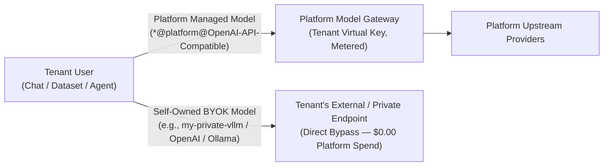
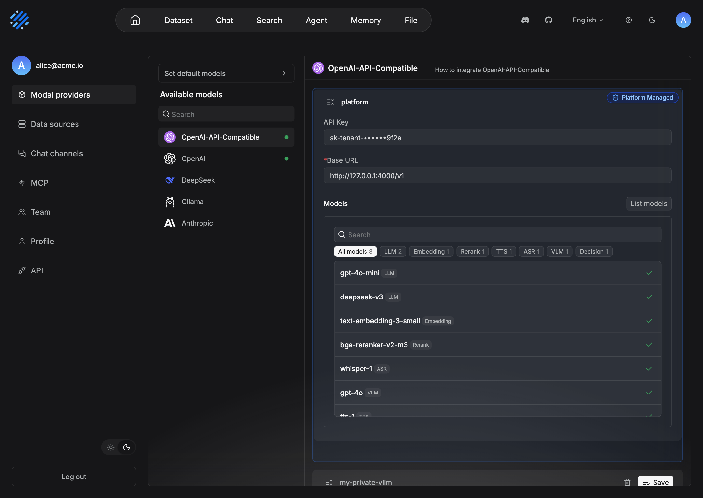
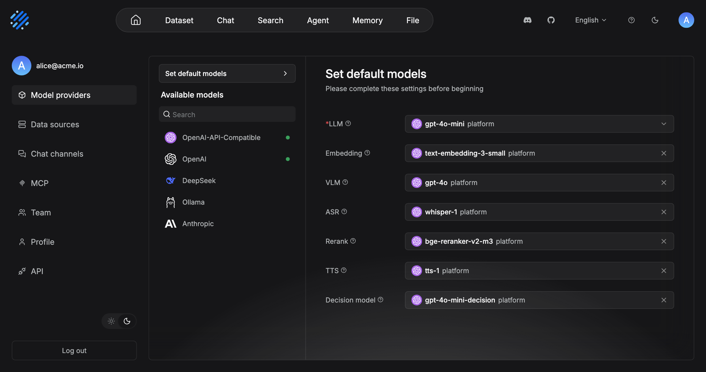
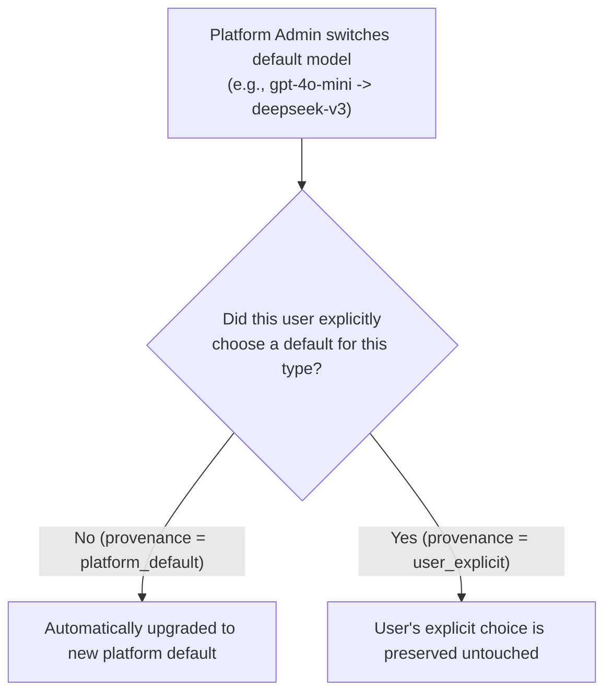
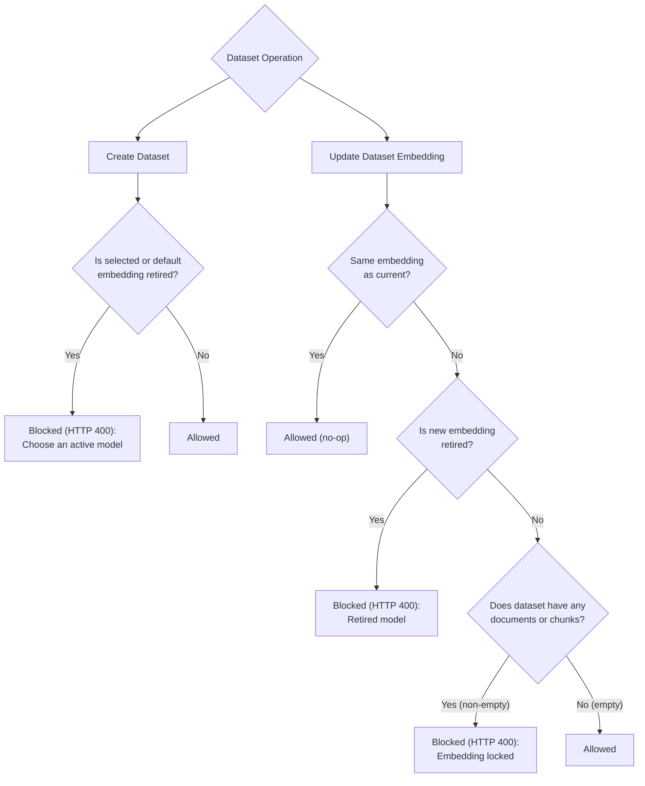

# Tenant & End-User Guide

English | [简体中文](user-guide.zh-CN.md)

This guide explains how **Tenant Owners**, **Tenant Admins**, and **Normal Users** work with platform-managed models and self-owned Bring Your Own Key (BYOK) models in the RAGFlow web UI.

> [!NOTE]
> If you integrate via HTTP APIs or SDKs, see the [API Reference](api-reference.md) for the exact error codes enforced by the platform protection middleware. Platform operators should consult the [Admin & Operator Guide](admin-guide.md).

---

## 1. Platform-Managed Models vs. Bring Your Own Key (BYOK)

RAGFlow with the `model-platform` extension lets every tenant combine **ready-to-use platform models** with **self-owned external model providers**:

| Dimension | Platform-Managed Models | Self-Owned Models (BYOK) |
| :--- | :--- | :--- |
| **Setup** | Pre-provisioned automatically for every tenant under `OpenAI-API-Compatible` → `platform` | Configured manually by the Tenant Owner with your own API key and endpoint |
| **Supported Model Types** | 7 types: `Chat`, `Embedding`, `Rerank`, `ASR`, `Vision`, `TTS`, `Decision` (`OCR` runs locally) | Any provider/model supported by upstream RAGFlow |
| **Traffic Path** | Routed through the isolated platform gateway using your tenant's virtual key | Sent **directly** to your configured endpoint (physical gateway bypass) |
| **Platform Billing** | Metered and attributed to your tenant at the gateway | Strictly **`$0.00`** platform spend (billed only by your own upstream vendor) |
| **Edit / Delete** | Read-only (protected by UI badge and backend `403` guard) | Fully editable and removable by the Tenant Owner |

---

## 2. Tenant Roles & Permissions (`owner` / `admin` / `normal`)

RAGFlow models workspace membership using three built-in tenant roles (`owner`, `admin`, and `normal`). Understanding what each role can see and change prevents surprises when collaborating in a shared workspace.

| Capability / UI Action | Tenant Owner (`owner`) | Tenant Admin (`admin`) | Normal Member (`normal`) | Platform Model Rule (All Roles) |
| :--- | :---: | :---: | :---: | :--- |
| **Use platform & tenant-shared models** in Chat, Datasets, Agents, Search | Yes | Yes | Yes | All active managed models are usable; retired embeddings remain read-only for existing datasets |
| **View & change personal Default Models** (`User Settings → Model providers → Set default models`) | Yes | Yes | Yes | Stored per `(user, tenant)`. Explicit changes are protected by **Sticky Selection** |
| **Inherit Owner's defaults on join** | N/A (creates tenant) | Automatic on join | Automatic on join | Empty default slots are copied from the Tenant Owner when joining (`tenant.member.joined`) |
| **Inspect managed `platform` card** (search, type filter, connectivity check) | Yes (read-only) | Cannot access Owner's provider credentials | Cannot access Owner's provider credentials | Even the Owner cannot edit, save, or delete `platform` or add/remove models inside it |
| **Add / edit / delete tenant-wide BYOK providers & instances** | Yes (full control) | No (cannot edit Owner's provider instances) | No (cannot edit Owner's provider instances) | Tenant-wide model lists (`GET /api/v1/models`) expose the **Tenant Owner's** configured providers + platform models |
| **Invite / remove workspace members** (`User Settings → Team`) | Yes | No *(in current OSS baseline)* | No | Membership lifecycle triggers default-model inheritance for joining users |
| **Create / update Datasets & bind Embedding** | Yes | Yes (for permitted datasets) | Yes (for permitted datasets) | Non-empty datasets cannot change embedding model (`400`); retired embeddings cannot be bound to new/empty datasets (`400`) |

> [!IMPORTANT]
> **About `admin` vs. `normal` in the current baseline**: `oh-my-ragflow` builds on the community permission policy (`ee-baseline`), where tenant-level provider instances and team membership management are governed by the **Tenant Owner**. Both `admin` and `normal` members share the same read/use access to tenant models and maintain their own personal default model preferences, without access to view or modify the Tenant Owner's API credentials.

---

## 3. Using the Web UI

Open **User Settings → Model providers** (`/user-setting/model`) from the top-right user menu.

### 3.1 Viewing & Verifying Platform-Managed Models

Select **OpenAI-API-Compatible** in the left **Available models** list to view your tenant's configured instances.

- **Visual Identifier**: The platform-managed instance is named `platform`, highlighted with a subtle blue border and a **`Platform Managed`** shield badge in the top-right corner (`ProviderInstanceCardWithPrivilege`).
- **What you CAN do**:
  - Search models inside the card.
  - Filter models by type tags (`All models`, `LLM`, `Embedding`, `Rerank`, `ASR`, `VLM`, `TTS`, `Decision`).
  - Run read-only connectivity verification.
- **What is locked (including for Tenant Owners)**:
  - Form inputs (`API Key`, `Base URL`) are read-only.
  - Instance save/delete buttons and model add/edit/toggle/delete controls are hidden in the UI and rejected with HTTP `403 Forbidden` by the backend API (`ManagedProviderGuardMiddleware`).

### 3.2 Configuring Default Models & Sticky Selection (All Roles)

Click **Set default models** at the top of the left sidebar in **User Settings → Model providers**.

Every member (`owner`, `admin`, or `normal`) manages their own default model slot for each of the 7 managed types (`LLM`, `Embedding`, `VLM`, `ASR`, `Rerank`, `TTS`, `Decision model`).

#### How Sticky Selection Works

The platform tracks whether each default slot was assigned automatically by the platform (`platform_default`) or explicitly chosen by you (`user_explicit`):

- **Never changed the slot?** Your slot stays `platform_default` and automatically upgrades when the platform administrator promotes a newer default model.
- **Manually switched to a different model (platform or BYOK)?** `DefaultModelPreferenceMiddleware` records that change as `user_explicit`. Future platform default upgrades will **not** overwrite your selection. (Re-selecting the model that is already assigned as `platform_default` does **not** change its provenance to `user_explicit`, so a later platform upgrade may still update it.)
- **Newly joined team members**: Empty default slots are initialized from the Tenant Owner's current defaults when you join the workspace.

> [!NOTE]
> Clearing a default slot or re-selecting the exact same model does not overwrite existing provenance. When a platform model is **tombstoned** in your tenant (for example, any retired non-embedding model or a retired embedding model with no remaining datasets), your default slot is automatically moved to the current active platform default for that type — or cleared (with its preference record removed) if no usable active platform default currently exists. However, if a retired **embedding** model is still referenced by existing datasets in your tenant, it remains in a read-only `deprecated` state and your default slot stays unchanged until it is tombstoned; creating a new dataset without specifying an explicit `embedding_model` will return HTTP `400`, so either choose an active embedding model on creation or update your default embedding slot.

### 3.3 Bring Your Own Key (BYOK) — Tenant Owner Workflow

As a **Tenant Owner**, you can add your own API keys alongside platform-managed models at any time:

1. Go to **User Settings → Model providers**.
2. Choose **any provider** from the left list:
   - Use a dedicated provider (e.g., **OpenAI**, **DeepSeek**, **Anthropic**, **Ollama**), **or**
   - Click **OpenAI-API-Compatible** and click **+ Add instance** below the `platform` card (as shown with `my-private-vllm` in the screenshot above).
3. Enter a custom instance name, your API key, and your endpoint URL, then add models and click **Save**.

> [!WARNING]
> **Reserved instance name**: Do not name any custom instance `platform` (case-insensitive, e.g., `Platform` or `PLATFORM`). Requests attempting to create or rename an instance to `platform` are rejected with HTTP `403 Forbidden`.

**Zero-Billing Independence**:
- Requests to any non-`platform` instance go directly from RAGFlow to your configured external URL and never touch the LiteLLM gateway.
- Platform spend for BYOK models is guaranteed to be `$0.00`, verifiable by administrators via the live Spend Isolation Audit.

### 3.4 Datasets & Embedding Model Immutability

Embedding models turn document chunks into fixed-dimension numerical vectors stored in the search index. Mixing embeddings from two different models inside one dataset breaks vector dimensions and corrupts semantic similarity search.

Therefore, the platform enforces three strict rules (`DatasetImmutabilityGuardMiddleware`):

- **Empty dataset**: You may switch its embedding model to any **active** model (platform or BYOK).
- **Non-empty dataset** (contains uploaded documents or parsed chunks): Its embedding model is permanently locked. To migrate to a different embedding model, **create a new dataset** with the target embedding model and re-upload/re-parse your documents.
- **When a platform embedding model is retired**:
  - **Existing datasets** already using that model keep working for retrieval (the model transitions to a read-only deprecated state on your tenant's gateway key).
  - **New datasets and empty datasets** cannot bind to the retired model.

### 3.5 What Happens When a Non-Embedding Platform Model Is Retired

For `Chat`, `Decision`, `Rerank`, `ASR`, `Vision`, and `TTS` models:

- A background rollout task disables the retired model across tenants as each tenant converges.
- Existing assistants (`Dialog`) still bound to the retired model will fail/be rejected when sending requests (because the model is disabled in the tenant and removed from the gateway whitelist) until the assistant owner switches to an active model in the assistant's settings.
- Once the model is tombstoned for your tenant, any user whose default model pointed to it is automatically moved to the current active platform default for that type (or the default slot is cleared if no usable platform default exists).

---

## 4. Frequently Asked Questions (FAQ)

**Q1: Why are the Edit, Save, and Delete buttons missing on the `platform` instance card?**  
Platform-managed instances use tenant-scoped virtual keys managed centrally by the platform control plane. Disabling edits prevents accidental credential tampering, model removal, or metering disruption. You can still search, filter, and verify connectivity, and you can always create separate BYOK instances.

**Q2: Why did creating a custom instance named `platform` fail with HTTP 403?**  
`platform` (case-insensitive) is reserved exclusively for platform-managed instances. Choose another name such as `my-openai` or `private-vllm`.

**Q3: Will using my own OpenAI / DeepSeek / Ollama API key incur platform charges?**  
No. BYOK instances bypass the platform model gateway completely and connect directly to your configured provider URL, incurring strictly `$0.00` platform spend.

**Q4: The platform admin changed the default chat model, why did mine stay the same (or why did it change)?**  
If you previously switched the chat slot to a different model in **Set default models**, Sticky Selection recorded your choice as `user_explicit` and preserved it. If you never changed that slot (or only re-selected the already-assigned `platform_default` model), its provenance remained `platform_default` and automatically upgraded to the new platform default.

**Q5: Why can't I change the embedding model of my existing dataset?**  
Once a dataset has documents or parsed chunks, changing its embedding model would mix incompatible vector spaces and corrupt search results. Create a new dataset with the new embedding model and re-index your files.

**Q6: Why can't a team `admin` or `normal` member edit the workspace's BYOK API keys?**  
In the current baseline permission model, workspace provider instances and credentials belong to the **Tenant Owner**. Other members can use all tenant models and configure their own personal default model selections, while credential management remains with the Owner.
