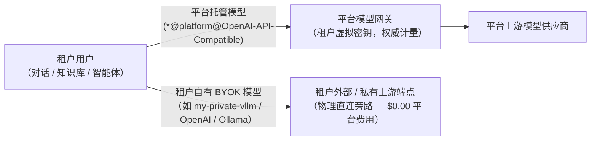
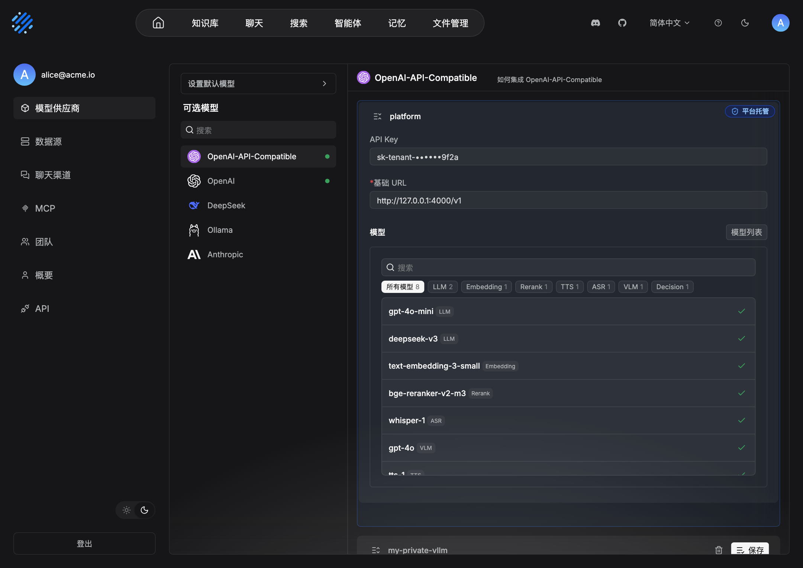
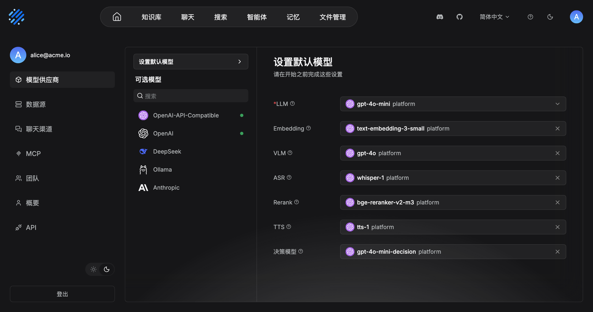
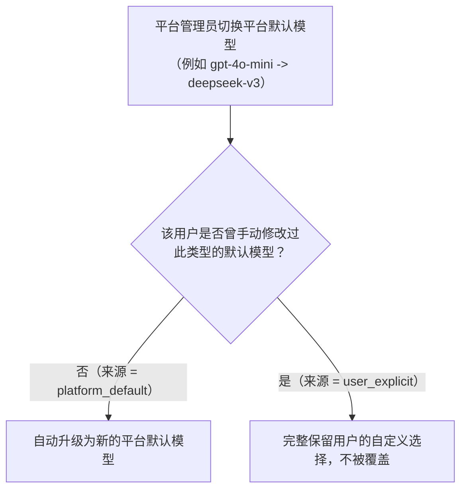
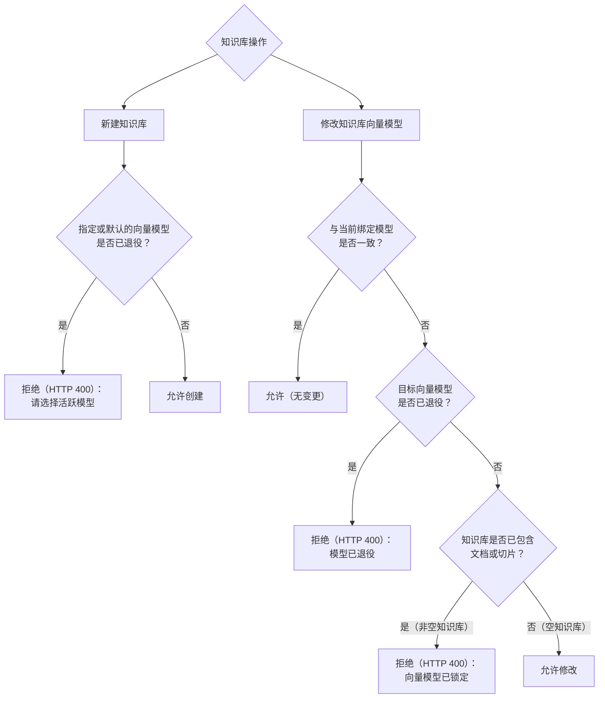

# 租户与用户指南

[English](user-guide.md) | 简体中文

本指南面向 **租户所有者（Tenant Owner）**、**租户管理员（Tenant Admin）** 与 **普通成员（Normal User）**，介绍如何在 RAGFlow Web 界面中使用平台托管模型与自有密钥（BYOK，Bring Your Own Key）模型。

> [!NOTE]
> 如果你通过 HTTP API 或 SDK 调用接口，请参阅 [API 参考文档](api-reference.zh-CN.md) 了解平台守卫中间件的具体拦截规则与错误码。平台运维与超级管理员请参阅 [管理员与运维指南](admin-guide.zh-CN.md)。

---

## 1. 平台托管模型与自有密钥（BYOK）对比

启用 `model-platform` 扩展后，每个租户都可以同时使用**开箱即用的平台托管模型**和**自主配置的外部 BYOK 模型**：

| 维度 | 平台托管模型（Platform Managed） | 租户自有模型（BYOK） |
| :--- | :--- | :--- |
| **配置方式** | 租户创建后由平台自动预配到 `OpenAI-API-Compatible` → `platform` | 由租户 Owner 使用自己的 API Key 和端点地址手动添加 |
| **支持的模型类型** | 7 类：`对话`、`向量`、`重排`、`语音识别 (ASR)`、`视觉`、`语音合成 (TTS)`、`决策`（`OCR` 本地运行） | 上游 RAGFlow 支持的所有供应商与模型 |
| **请求链路** | 携带租户专属虚拟密钥，经隔离部署的平台模型网关转发 | 由 RAGFlow **直接请求**你配置的上游地址（物理绕过网关） |
| **平台计费** | 在网关层按租户精准计量归属 | 严格 **`$0.00`** 平台费用（仅由你自己的上游供应商计费） |
| **编辑与删除权限** | 只读保护（前端隐藏编辑/删除控件 + 后端 `403` 拦截） | 租户 Owner 拥有完整增删改查权限 |

---

## 2. 租户角色与权限矩阵（`owner` / `admin` / `normal`）

RAGFlow 的工作空间成员模型包含三种内置角色：`owner`（租户所有者）、`admin`（租户管理员）与 `normal`（普通成员）。下表清晰列出了三种角色在模型平台相关界面与操作上的权限差异：

| 能力 / 界面操作 | 租户 Owner (`owner`) | 租户管理员 (`admin`) | 普通成员 (`normal`) | 平台托管模型通用规则（全角色适用） |
| :--- | :---: | :---: | :---: | :--- |
| **在对话、知识库、智能体、搜索中使用模型** | 支持 | 支持 | 支持 | 全部活跃平台模型立即可用；已退役的向量模型对存量知识库保持只读可用 |
| **查看与修改个人默认模型**（`用户设置 → 模型供应商 → 设置默认模型`） | 支持 | 支持 | 支持 | 按 `(用户, 租户)` 独立保存；手动修改后自动受**粘性选择**保护 |
| **加入团队时自动继承 Owner 默认模型** | 不适用（租户创建者） | 加入时自动继承 | 加入时自动继承 | 加入事件（`tenant.member.joined`）触发时自动填充空白默认槽位 |
| **查看托管 `platform` 卡片**（模型搜索、类型筛选、连通性校验） | 支持（只读） | 无权访问 Owner 的供应商凭据页 | 无权访问 Owner 的供应商凭据页 | 即便是 Owner 也不能编辑、保存、删除 `platform` 实例或增删其中的模型 |
| **添加 / 编辑 / 删除租户级 BYOK 供应商与实例** | 支持（完全控制） | 不支持（不可修改 Owner 实例） | 不支持（不可修改 Owner 实例） | 租户级可用模型列表（`GET /api/v1/models`）统一读取 **租户 Owner** 名下的供应商配置与平台模型 |
| **邀请 / 移除团队成员**（`用户设置 → 团队`） | 支持 | 不支持 *（当前社区基线策略）* | 不支持 | 新成员加入会自动继承 Owner 的默认模型配置 |
| **创建 / 更新知识库并绑定向量模型** | 支持 | 支持（有权限的知识库） | 支持（有权限的知识库） | 非空知识库禁止更换向量模型（`400`）；禁止为新建或空知识库绑定已退役向量模型（`400`） |

> [!IMPORTANT]
> **关于当前基线中 `admin` 与 `normal` 的说明**：当前 `oh-my-ragflow` 基于社区版权限策略（`ee-baseline`）运行，租户级模型供应商实例凭据与团队成员管理统一归属于 **租户 Owner**。因此 `admin` 与 `normal` 成员在模型消费与个人默认模型配置上的行为一致——都可以正常使用租户内的平台模型和共享 BYOK 模型，并独立维护自己的默认模型偏好，但无权查看或修改 Owner 的 API 凭据。

---

## 3. Web 界面操作指南

点击右上角用户菜单进入 **用户设置 → 模型供应商**（`/user-setting/model`）。

### 3.1 查看与验证平台托管模型

在左侧 **可选模型** 列表中点击 **OpenAI-API-Compatible**，即可看到租户的托管实例。

- **视觉标识**：平台托管实例固定命名为 `platform`，外围带有浅蓝色保护边框，右上角显示 **`平台托管`** 盾牌徽章（`ProviderInstanceCardWithPrivilege`）。
- **允许执行的操作**：
  - 在卡片内搜索模型名称。
  - 按模型类型标签筛选（`所有模型`、`LLM`、`Embedding`、`Rerank`、`ASR`、`VLM`、`TTS`、`决策模型`）。
  - 执行只读连通性校验。
- **被锁定的操作（包括租户 Owner）**：
  - 表单输入框（`API Key`、`基础 URL`）均为只读。
  - 实例保存/删除按钮以及模型的添加/编辑/批量启停/删除按钮在界面中隐藏，即使直接调用后端 API 也会被 `ManagedProviderGuardMiddleware` 以 HTTP `403 Forbidden` 拒绝。

### 3.2 配置默认模型与粘性选择机制（全角色适用）

在 **用户设置 → 模型供应商** 左侧栏顶部点击 **设置默认模型**。

每位成员（`owner`、`admin`、`normal`）均可为全部 7 类托管模型（`LLM`、`Embedding`、`VLM`、`ASR`、`Rerank`、`TTS`、`决策模型`）配置自己的默认模型。

#### 粘性选择（Sticky Selection）如何工作

系统会记录每个默认模型槽位的来源是“平台自动分配（`platform_default`）”还是“用户显式选择（`user_explicit`）”：

- **从未手动改动过默认模型**：槽位保持为 `platform_default`，当平台管理员升级全局默认模型时，你的默认设置会自动平滑跟进。
- **手动选择过任意模型（平台模型或 BYOK 模型）**：`DefaultModelPreferenceMiddleware` 会将其标记为 `user_explicit`，后续平台升级全局默认模型时**绝不会覆盖你的选择**。
- **新加入团队的成员**：加入租户时，空白的默认槽位会自动从租户 Owner 当前配置继承。

> [!NOTE]
> 清空默认模型或重复选择当前已选中的同一模型，不会覆盖已有来源标记。但如果你显式选择的平台模型后续被管理员**退役**，系统会将该槽位安全迁移至新的平台默认模型，避免新建对话或知识库失败。

### 3.3 配置自有密钥模型（BYOK）— 租户 Owner 操作步骤

**租户 Owner** 可随时在平台模型之外配置自己的供应商密钥：

1. 进入 **用户设置 → 模型供应商**。
2. 在左侧列表中选择任意供应商：
   - 直接选择对应供应商（如 **OpenAI**、**DeepSeek**、**Anthropic**、**Ollama**）；**或者**
   - 点击 **OpenAI-API-Compatible**，在 `platform` 卡片下方点击 **添加实例**（如上方截图中与 `platform` 共存的 `my-private-vllm`）。
3. 填写自定义实例名称、你的 API Key 与上游基础 URL，添加模型并点击 **保存**。

> [!WARNING]
> **保留实例名限制**：请勿将自定义实例命名为 `platform`（不区分大小写，如 `Platform`、`PLATFORM` 均不允许）。任何尝试创建或重命名为 `platform` 的请求都会被返回 HTTP `403 Forbidden`。

**零平台计费独立性保证**：
- 指向非 `platform` 实例的推理请求由 RAGFlow 直接发往你配置的外部端点，完全绕过 LiteLLM 平台网关。
- BYOK 模型产生严格 `$0.00` 平台费用，管理员可随时通过实时消费隔离审计核验。

### 3.4 知识库（Dataset）与向量模型不可变保护

向量模型（Embedding）会将文档切片编码为固定维度的向量并写入索引。在同一知识库中混用不同向量模型会破坏向量维度与语义空间，导致检索结果彻底失真。

因此，平台通过 `DatasetImmutabilityGuardMiddleware` 强制执行以下三条规则：

- **空知识库**：尚未上传文档和切片时，可以自由更换为任意**活跃**向量模型（平台模型或 BYOK 模型）。
- **非空知识库**（包含有效文档或已解析切片）：向量模型永久锁定。如需更换向量模型，请**新建一个知识库**、选定新向量模型，然后重新上传并解析文档。
- **平台向量模型退役时的行为**：
  - **已绑定该模型的存量知识库**：继续正常检索（该模型在租户虚拟密钥上进入只读兼容阶段，直到不再被任何知识库引用）。
  - **新建知识库与空知识库**：无法再绑定该已退役模型。

### 3.5 非向量类平台模型退役时的行为

对于 `对话`、`决策`、`重排`、`语音识别 (ASR)`、`视觉` 与 `语音合成 (TTS)` 模型：

- 模型一旦退役会在租户中立即禁用。
- 引用该模型的存量助手（Dialog）会提示所有者改选其他活跃模型。
- 默认模型指向该退役模型的用户，会自动迁移到同类型当前的平台默认模型。

---

## 4. 常见问题（FAQ）

**Q1：为什么 `platform` 实例卡片上没有编辑、保存和删除按钮？**  
平台托管实例由控制面统一维护租户虚拟密钥与模型白名单。锁定写操作可防止误改凭据、误删团队共享模型或破坏计量归属。你仍可在卡片内搜索、筛选和校验连通性，也可以随时在旁边新建独立的 BYOK 实例。

**Q2：为什么我新建一个名为 `platform` 的自定义实例时报错 HTTP 403？**  
`platform`（不区分大小写）是平台托管实例的保留名称，请改用其他名称（例如 `my-openai` 或 `private-vllm`）。

**Q3：我配置了自己的 OpenAI / DeepSeek / Ollama API Key，会被平台重复计费吗？**  
不会。BYOK 实例物理直连你配置的上游地址，完全不经过平台模型网关，平台费用严格为 `$0.00`。

**Q4：平台管理员切换了默认对话模型，为什么我的默认模型没变（或自动变了）？**  
如果你之前在 **设置默认模型** 中手动选过对话模型，粘性选择机制会将其标记为 `user_explicit` 并予以保留；如果你从未手动修改过，该槽位保持 `platform_default`，会随平台默认模型自动升级。

**Q5：为什么无法修改已有知识库的向量模型？**  
一旦知识库中存在文档或已解析切片，更换向量模型会导致新旧向量维度或语义空间不兼容，破坏检索效果。正确做法是新建知识库并选择新的向量模型重新解析文档。

**Q6：为什么团队里的 `admin` 或 `normal` 成员不能修改工作空间的 BYOK API Key？**  
在当前社区基线权限模型下，工作空间级别的模型供应商实例与凭据归属于 **租户 Owner** 管理；其他成员可以正常使用全部租户模型并自定义自己的默认模型，但无权查看或编辑 Owner 的密钥配置。
