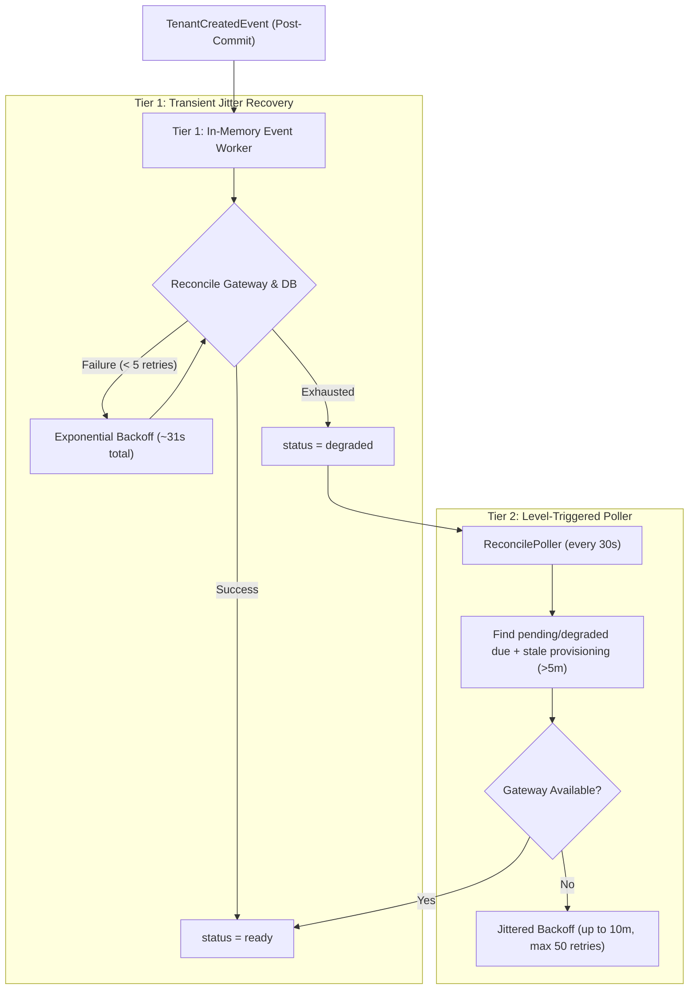
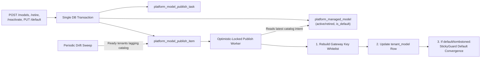
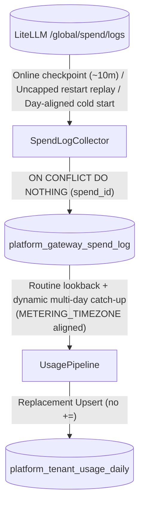

# Model Platform Engineering Design Reference

English | [简体中文](implementation-plan.zh-CN.md)

> [!NOTE]
> **Document Scope**: This is the long-lived engineering design reference for the `model-platform` extension. Keep it synchronized with code changes whenever subsystems, schemas, overlays, or verification workflows evolve.
> - **High-Level Architecture & ADRs**: [architecture.md](architecture.md)
> - **Operator Deployment & Admin Console**: [docs/admin-guide.md](docs/admin-guide.md)
> - **Tenant Workflows & Role Matrix**: [docs/user-guide.md](docs/user-guide.md)
> - **HTTP API & Guard Contracts**: [docs/api-reference.md](docs/api-reference.md)

---

## Table of Contents

- [1. Engineering Principles & Code Layout](#1-engineering-principles--code-layout)
- [2. Build & Workspace Overlay Integration](#2-build--workspace-overlay-integration)
  - [2.1 Go `ee` Global Build Tag Exclusion & Affirmative `ee-baseline` Stubs](#21-go-ee-global-build-tag-exclusion--affirmative-ee-baseline-stubs)
  - [2.2 Thin Router Trampolines & Runtime Wiring](#22-thin-router-trampolines--runtime-wiring)
  - [2.3 Frontend Web Overlay Seams & Enterprise Flag Defense](#23-frontend-web-overlay-seams--enterprise-flag-defense)
  - [2.4 Workspace Assembly & Non-Invasive CI Gates](#24-workspace-assembly--non-invasive-ci-gates)
- [3. LiteLLM Gateway & Credential Pipeline](#3-litellm-gateway--credential-pipeline)
  - [3.1 Gateway Topology & Loopback Isolation](#31-gateway-topology--loopback-isolation)
  - [3.2 Key Identity, Scoped Virtual Keys & Revocation](#32-key-identity-scoped-virtual-keys--revocation)
  - [3.3 Emergency Key Rotation](#33-emergency-key-rotation)
  - [3.4 Tenant Decommissioning & Orphan Cleanup](#34-tenant-decommissioning--orphan-cleanup)
- [4. Tenant Lifecycle, Self-Healing & Write Protection](#4-tenant-lifecycle-self-healing--write-protection)
  - [4.1 Transaction-Decoupled Hook & Pre-Flight Visibility](#41-transaction-decoupled-hook--pre-flight-visibility)
  - [4.2 Two-Tier Self-Healing Controller](#42-two-tier-self-healing-controller)
  - [4.3 Reconcile State Machine & Schema (`platform_tenant_reconcile`)](#43-reconcile-state-machine--schema-platform_tenant_reconcile)
  - [4.4 Native Driver Resolution & Compensating Rollback](#44-native-driver-resolution--compensating-rollback)
  - [4.5 Managed Provider Write Protection (`ManagedProviderGuardMiddleware`)](#45-managed-provider-write-protection-managedproviderguardmiddleware)
- [5. Managed Model Catalog, Defaults & Dataset Protection](#5-managed-model-catalog-defaults--dataset-protection)
  - [5.1 Managed Model Slots (7 Gateway-Routed Types)](#51-managed-model-slots-7-gateway-routed-types)
  - [5.2 Catalog, Fan-Out Rollout & Lifecycle Convergence](#52-catalog-fan-out-rollout--lifecycle-convergence)
  - [5.3 Atomic Default Initialization, Inheritance & Sticky Provenance](#53-atomic-default-initialization-inheritance--sticky-provenance)
  - [5.4 Three-Stage Embedding Lifecycle & Dataset Immutability Guard](#54-three-stage-embedding-lifecycle--dataset-immutability-guard)
- [6. Metering, Reconciliation & Isolation Audit Pipeline](#6-metering-reconciliation--isolation-audit-pipeline)
  - [6.1 Raw Spend Log Staging & Deduplication](#61-raw-spend-log-staging--deduplication)
  - [6.2 Self-Healing Watermark Collector & Replacement Rollup](#62-self-healing-watermark-collector--replacement-rollup)
  - [6.3 Declarative Opt-In Spend Log Retention](#63-declarative-opt-in-spend-log-retention)
  - [6.4 Physical Zero-Billing BYOK Bypass & Live Isolation Audit](#64-physical-zero-billing-byok-bypass--live-isolation-audit)
- [7. Fault Tolerance Matrix & Verification Suite](#7-fault-tolerance-matrix--verification-suite)
  - [7.1 Failure Modes & Recovery Matrix](#71-failure-modes--recovery-matrix)
  - [7.2 End-to-End Verification & CI Commands](#72-end-to-end-verification--ci-commands)

---

## 1. Engineering Principles & Code Layout

All changes to `extensions/model-platform/` adhere to six invariants:

1. **Strict Non-Invasive Upstream**: `upstream/ragflow` remains 100% unmodified (`git status --porcelain` empty).
2. **Native Driver Resolution**: Managed models persist as `ProviderName = "OpenAI-API-Compatible"` with `InstanceName = "platform"` and `is_managed = true`, reusing upstream drivers directly.
3. **Physical Credential Isolation**: Root upstream secrets live solely in the loopback-bound LiteLLM container (`127.0.0.1:4000`); tenants receive team-scoped virtual keys (`sk-tenant-*`).
4. **Transaction-Decoupled Side Effects**: No remote RPC executes inside upstream DB transactions; background workers reconcile asynchronously after commit visibility.
5. **Atomic Defaults & Vector Space Safety**: Empty default slots initialize with conditional atomic SQL; explicit user choices are preserved by `StickyGuard`; non-empty dataset embeddings are immutable (`400`).
6. **Authoritative Metering Idempotence**: LiteLLM spend logs stage into `platform_gateway_spend_log` with `ON CONFLICT DO NOTHING` on `spend_id`, and roll up into `platform_tenant_usage_daily` via calendar-aligned replacement upserts.

```text
extensions/model-platform/
├── backend/
│   ├── admin/       # 13 Admin HTTP handlers (health, models, publish tasks, tenants, rotate-key, usage, audit)
│   ├── dao/         # Reconcile DAO & transaction-safe tenant creation hook
│   ├── entity/      # 7 domain entities & ManagedModelSlots single source of truth
│   ├── event/       # In-memory EventBus & post-commit PreFlightCheck
│   ├── gateway/     # LiteLLM HTTP client (keys, models, spend logs, health)
│   ├── guard/       # 3 App API middlewares (ManagedProvider, DatasetImmutability, DefaultModelPreference)
│   ├── metering/    # SpendLogCollector, UsagePipeline, MeteringDaemon, AuditTenantSpendIsolation
│   ├── migration/   # 6 idempotent GORM migrations + legacy catalog backfill
│   ├── publisher/   # Catalog CRUD, rollout task/item fan-out, optimistic-locked worker
│   ├── reconciler/  # TenantReconciler, two-tier SelfHealingController, StickyGuard, KeyRotator, lifecycles, cleanup
│   ├── router/      # App API middleware registration entrypoints
│   └── worker/      # Unified background worker lifecycle launched by ServerTypeAPI
├── gateway/         # Production Docker Compose, litellm-config.yaml, validate-gateway-config.sh
├── overlay/
│   ├── ee-baseline/ # Affirmative //go:build ee fallback stubs across 19 upstream packages + runtime seams
│   ├── trampolines/ # Thin admin & app router forwarding shims
│   └── web/src/ee/  # Admin UI pages, locales, routes, client, ProviderInstanceCardWithPrivilege
├── scripts/         # apply-overlay.sh, audit-non-invasive.sh, emergency-rotate-keys.sh
└── tests/e2e/       # Dockerized LiteLLM + PostgreSQL E2E test cluster & suites
```

---

## 2. Build & Workspace Overlay Integration

### 2.1 Go `ee` Global Build Tag Exclusion & Affirmative `ee-baseline` Stubs

Upstream `build.sh` appends `RAGFLOW_GO_TAGS` to `GO_BUILD_TAGS`. Passing `RAGFLOW_GO_TAGS=ee` globally excludes every upstream `//go:build !ee` community stub across 19 packages simultaneously. To compile cleanly without touching upstream, `overlay/ee-baseline/` supplies affirmative `//go:build ee` stubs across all 19 affected packages while reserving router registration symbols exclusively for `overlay/trampolines/`:

| Layer | Responsibility | Key Files |
| :--- | :--- | :--- |
| **`overlay/ee-baseline/`** | Community-equivalent fallback stubs across all 19 `!ee` packages plus runtime hook wiring | `internal/dao/stub_ee.go` (migrations, `OnTenantCreateHook`, DB provider), `internal/server/stub_ee.go` (`StartServer`/`ShutdownServer` worker lifecycle), `internal/service/stub_ee.go` (`tenant.member.joined` default inheritance), `internal/permission/stub_ee.go` (community policy fallback), plus pure stubs for `cmd`, `internal/admin`, `internal/cli`, `internal/common`, `internal/deepdoc/parser/pdf/table`, `internal/engine/clickhouse`, `internal/entity`, `internal/handler`, `internal/permission/testsupport`, `internal/router`, `internal/server/config`, `internal/server/local`, `internal/service/billing`, `internal/service/dataset`, `internal/service/document` |
| **`overlay/trampolines/`** | Exclusively declares `SetupEERouter`, `RegisterEERouter`, `RegisterEENoAuthRouter`, `RegisterEEProtectedRouter`, `RegisterEEAuthRouter` | `overlay/trampolines/internal/admin/model_platform_trampoline_ee.go`, `overlay/trampolines/internal/router/model_platform_trampoline_ee.go` |

### 2.2 Thin Router Trampolines & Runtime Wiring

- **Admin Router** (`overlay/trampolines/internal/admin/model_platform_trampoline_ee.go`): Forwards `RegisterEERouter(protected, r)` to `mpAdmin.RegisterModelPlatformAdminRoutes(protected)`, mounting all 13 endpoints under `/api/v1/admin/model-platform`.
- **App Router** (`overlay/trampolines/internal/router/model_platform_trampoline_ee.go`): Forwards `RegisterEEProtectedRouter(protected, r)` to `mpRouter.RegisterModelPlatformProtectedRoutes(protected)`, attaching the three middlewares after `AuthMiddleware` populates `tenant_id` and `user_id`:
  1. `guard.ManagedProviderGuardMiddleware()`
  2. `guard.DatasetImmutabilityGuardMiddleware()`
  3. `guard.DefaultModelPreferenceMiddleware()`
- **Schema Migrations & Hooks** (`overlay/ee-baseline/internal/dao/stub_ee.go`):
  - `migrateBillingSchemaEE` runs all 6 idempotent migrations (`001`–`005` + `006_backfill_catalog`).
  - `initializeTenantDefaultRoleEE` invokes `mpdao.OnTenantCreateHook`.
  - `init()` registers `mpworker.SetDBProvider(GetDB)`.
- **Background Workers** (`overlay/ee-baseline/internal/server/stub_ee.go`): `StartServer` starts `mpworker.Start(ctx)` when `serverType == common.ServerTypeAPI` and `LITELLM_BASE_URL` + `LITELLM_MASTER_KEY` are set; `ShutdownServer` drains and stops all workers cleanly.
- **Member Join Hook** (`overlay/ee-baseline/internal/service/stub_ee.go`): `recordTenantPermissionChangeEE` listens for `eventType == "tenant.member.joined"` and runs `DefaultsManager.InitializeMemberFromOwner`.

### 2.3 Frontend Web Overlay Seams & Enterprise Flag Defense

Upstream `web/src/pages/admin/utils.tsx` sets `IS_ENTERPRISE = import.meta.env.VITE_RAGFLOW_ENTERPRISE === 'RAGFLOW_ENTERPRISE'`. Keeping `VITE_RAGFLOW_ENTERPRISE` disabled prevents mounting un-stubbed upstream commercial admin routes (Whitelist, Roles, Monitoring). The extension injects only its own seams under `overlay/web/src/ee/`:

- `private-routes.tsx` & `merge-routes.tsx`: Injects `/admin/model-providers`, `/admin/model-usage-statistics`, and `/admin/model-tenants` into the admin navigation layout.
- `pages/admin/layouts/navigation-private.tsx`: Appends **Model Providers**, **Model Usage**, and **Tenant Credentials** to the admin sidebar.
- `pages/admin/{model-providers,model-usage-statistics,model-tenants}.tsx`: Complete React Query admin governance pages.
- `pages/user-setting/setting-model/provider-instance-card-with-privilege.tsx`: Wraps `ProviderInstanceCard`, detects `platform` / `is_managed` instances, renders the localized **`Platform Managed`** shield badge, and hides all instance/model mutation controls while preserving search, type filters, and connectivity checks.
- `constants/model-types.ts`: Frontend mirror of `backend/entity/model_slots.go`.
- `locales/{en,zh,zh-traditional}-private.ts` & `utils/{api-private,model-platform-client}.ts`: Localization bundles and typed Axios client.

### 2.4 Workspace Assembly & Non-Invasive CI Gates

- `scripts/apply-overlay.sh` extracts `upstream/ragflow` via `git archive` into `build/ragflow` and synchronizes layers in strict precedence order: `ee-baseline → trampolines → backend → web`.
- `scripts/audit-non-invasive.sh` enforces three CI gates:
  1. **Gate 1 (Submodule Cleanliness)**: `upstream/ragflow` matches the pinned gitlink with zero diff and clean status.
  2. **Gate 2 (Enterprise Flag Safety)**: Fails if `VITE_RAGFLOW_ENTERPRISE=RAGFLOW_ENTERPRISE`.
  3. **Gate 3 (19-Package EE Baseline Completeness)**: Verifies every upstream `//go:build !ee` package has affirmative `//go:build ee` stubs with no symbol collisions.

---

## 3. LiteLLM Gateway & Credential Pipeline

### 3.1 Gateway Topology & Loopback Isolation

`gateway/docker-compose.yml` runs pinned `ghcr.io/berriai/litellm:v1.110.0` backed by `postgres:16-alpine` on an isolated bridge network (`ragflow-model-platform-net`):

- **Loopback Binding**: `127.0.0.1:4000:4000` only (`gateway/validate-gateway-config.sh` rejects public exposure and plaintext keys).
- **Empty Default Catalog**: `litellm-config.yaml` ships `model_list: []` so private/air-gapped deployments are never polluted with unreachable routes.
- **Security & Cache Controls**: `redact_user_api_key_info: true`, `drop_params: true`, `set_verbose: false`, `json_logs: true`, `store_model_in_db: true`, `disable_spend_logs: false`, and `user_api_key_cache_ttl: 5` (bounds key revocation propagation delay to 5s per worker).

### 3.2 Key Identity, Scoped Virtual Keys & Revocation

A tenant's keys are grouped by LiteLLM **team** (`team_id = tenant_id`), never by `key_alias`:

- Individual keys are addressed by `key_hash` (the SHA-256 hex digest LiteLLM stores, accepts in `POST /key/delete`, and records as `api_key` in spend logs). The control plane stores only `key_hash` and `gateway_key_alias` on `platform_tenant_reconcile`.
- `GET /key/list?team_id=<tenant>&return_full_object=true` enumerates a tenant's keys. `ConvergeTenantKeys` revokes all keys except `key_hash` (refusing to revoke anything if `key_hash` is absent from the gateway list), and `RevokeTenantKeys` revokes all.
- `key_alias` (`tenant_<id>_<8 hex>`) is a human-readable label only; spend attribution uses `team_id`.
- An empty active catalog issues a virtual key carrying `RevokedModelPlaceholder` rather than an empty list because LiteLLM treats an empty `models` list as unrestricted.

### 3.3 Emergency Key Rotation

`KeyRotator.Rotate` (`backend/reconciler/key_rotation.go`) replaces a `ready` tenant's virtual key with zero downtime while holding the provider-row whitelist lock and in-process mutex (serializing against catalog rollouts):

1. CAS-mark `key_dirty_since` on `platform_tenant_reconcile` (incrementing `version`) before touching the gateway.
2. Issue a replacement key with the whitelist rebuilt from the tenant's active/read-only managed models.
3. In one DB transaction, update `tenant_model_instance.api_key` and record `key_hash`, `gateway_key_alias`, `key_rotated_at`, and `key_rotated_by`. On failure, re-read the record and revoke the newly issued key only if the read succeeds and still shows the prior key; on ambiguous failure, leave the dirty marker for the sweeper.
4. Converge the tenant's gateway team on the new `key_hash` (revoking superseded keys) and clear `key_dirty_since`.

The record stays `ready` throughout so `ReconcilePoller` never mistakes an interrupted rotation for abandoned provisioning. `worker.sweepDirtyKeys` runs every `1m` to converge records dirty for `> 2m`. Batch operations are driven by `scripts/emergency-rotate-keys.sh` with cursor pagination, concurrency/rate limits, and `--resume`.

### 3.4 Tenant Decommissioning & Orphan Cleanup

`TenantDecommissioner` (`backend/reconciler/tenant_cleanup.go`) revokes every gateway key in the tenant's team, marks `platform_tenant_reconcile.status = 'deleted'`, and scrubs local credentials. `worker.scanOrphanedTenants` runs every `1h` to detect and decommission any managed tenant whose upstream `tenant` row was removed.

---

## 4. Tenant Lifecycle, Self-Healing & Write Protection

### 4.1 Transaction-Decoupled Hook & Pre-Flight Visibility

`dao.OnTenantCreateHook` executes inside `initializeTenantDefaultRoleEE`:

1. Inserts a local `platform_tenant_reconcile` row (`status = 'pending'`, `max_retries = 50`, `version = 1`) with `ON CONFLICT DO NOTHING`. Zero network calls occur inside the transaction.
2. Spawns a goroutine using a root connection to run `event.PreFlightCheck` (3s timeout) until the committed tenant row is externally visible, then publishes `TenantCreatedEvent` to `event.GetDefaultBus()`.

### 4.2 Two-Tier Self-Healing Controller



- Concurrency across replicas is coordinated by optimistic version locking (`WHERE tenant_id = ? AND version = ?`) and lease reclamation for `provisioning` rows stale for `> 5m`.

### 4.3 Reconcile State Machine & Schema (`platform_tenant_reconcile`)

Managed by `migration/001_reconcile_schema.go` (compatible with MySQL, PostgreSQL, and SQLite):

```sql
CREATE TABLE IF NOT EXISTS platform_tenant_reconcile (
    tenant_id VARCHAR(32) PRIMARY KEY,
    status VARCHAR(32) NOT NULL DEFAULT 'pending', -- pending | provisioning | ready | degraded | failed | deleted
    retry_count INT NOT NULL DEFAULT 0,
    max_retries INT NOT NULL DEFAULT 50,
    next_retry_at DATETIME NULL,
    last_error TEXT NULL,
    gateway_key_alias VARCHAR(128) NULL,
    key_hash VARCHAR(128) NULL,
    key_dirty_since DATETIME NULL,
    key_rotated_at DATETIME NULL,
    key_rotated_by VARCHAR(128) NULL,
    version BIGINT NOT NULL DEFAULT 1,
    created_at DATETIME NOT NULL,
    updated_at DATETIME NOT NULL,
    INDEX idx_status_retry (status, next_retry_at),
    INDEX idx_key_dirty (key_dirty_since)
);
```

### 4.4 Native Driver Resolution & Compensating Rollback

`TenantReconciler.Reconcile` provisions `ProviderName = "OpenAI-API-Compatible"`, `InstanceName = "platform"`, `extra = {"is_managed": true}`, active catalog `tenant_model` rows, and initial empty default slots. Before issuing a new key it cleans up any leftover team keys; if DB persistence fails after issuing a key, compensating rollback revokes the new key immediately by its `key_hash`.

### 4.5 Managed Provider Write Protection (`ManagedProviderGuardMiddleware`)

Mounted on the App API `protected` group (`backend/guard/managed_provider_guard.go`):

- Intercepts `PUT`/`PATCH`/`DELETE` on provider routes (`/api/v1/providers/*`, `/setting/model/provider/*`, `/admin/model/provider/*`, excluding `/dataset` and `/artifacts`) plus `POST` on `.../instances` and `.../models`.
- Rejects mutations targeting managed providers/instances/models or attempting to create/rename an instance to reserved name `platform` (case-insensitive) with HTTP `403`.
- Enforces body size limits (`MAX_JSON_CONTENT_LENGTH`, default `1 MiB` → `413`), rejects duplicate JSON `instances` keys (`400`), and caps batch drops at `100` targets (`400`).

---

## 5. Managed Model Catalog, Defaults & Dataset Protection

### 5.1 Managed Model Slots (7 Gateway-Routed Types)

`backend/entity/model_slots.go` is the single source of truth shared by publisher validation, reconciler defaults, `StickyGuard`, `DefaultModelPreferenceMiddleware`, usage queries, and frontend `constants/model-types.ts`:

| `ModelType` Bit | Name | `user_tenant` ID Column | `user_tenant` Model ID Column | Nullable |
| :---: | :--- | :--- | :--- | :---: |
| `1` | `chat` | `llm_id` | `tenant_llm_id` | No |
| `2` | `embedding` | `embd_id` | `tenant_embd_id` | No |
| `4` | `asr` | `asr_id` | `tenant_asr_id` | No |
| `8` | `vision` | `img2txt_id` | `tenant_img2txt_id` | No |
| `16` | `rerank` | `rerank_id` | `tenant_rerank_id` | No |
| `32` | `tts` | `tts_id` | `tenant_tts_id` | Yes |
| `128` | `decision` | `decision_id` | `tenant_decision_id` | Yes |

Local `ModelTypeOCR` (`64`) runs as a local CV/layout pipeline and is excluded.

### 5.2 Catalog, Fan-Out Rollout & Lifecycle Convergence

Managed by `migration/005_publish_schema.go` and `migration/006_backfill_catalog.go`:

- `platform_managed_model` (`id`, unique `model_name`, `model_type`, `is_default`, `status` = `active` | `retired`): sole source of administrator intent.
- `platform_model_publish_task` (`id`, `model_name`, `model_type`, `created_at`): task header whose status (`running` | `completed` | `partial_failed`) is derived live from its items.
- `platform_model_publish_item` (PK `(task_id, tenant_id)`, `status`, `retry_count`, `next_retry_at`, `last_error`, `version`, `upgraded_count`, `preserved_count`): per-tenant convergence state claimed via optimistic locking (`version`), with 2-minute stale-lease recovery, 20-attempt backoff before `failed`, and manual retry via `POST /models/publish/tasks/:id/retry`.



Per-tenant derived model states:

| Catalog Intent | Model Type | Tenant KB References | `tenant_model` State | Gateway Whitelist |
| :--- | :--- | :--- | :--- | :--- |
| `active` | Any | Any | `active` | Included |
| `retired` | `embedding` (`2`) | `> 0` | `active` + `extra.{deprecated,read_only}=true` | Retained (read-only) |
| `retired` | `embedding` (`2`) | `0` | `disabled` + `extra.tombstoned=true` | Evicted |
| `retired` | All other 6 types | Any | `disabled` + `extra.tombstoned=true` | Evicted |

- **Gateway First, DB Second**: Always updates LiteLLM `/key/update` (rebuilding the full `models` list under the provider row lock + in-process mutex) before modifying `tenant_model`, so tenants never see an unroutable model.
- **Defaults Never Changed by Onboarding**: Only `PUT /models/:id/default` promotes a default; retiring a model currently marked `is_default` is rejected with `400`. When a model is tombstoned in a tenant, users whose default pointed to it are moved to the current platform default (or cleared if none exists).

### 5.3 Atomic Default Initialization, Inheritance & Sticky Provenance

- **Atomic Initialization (`DefaultsManager`)**: Uses conditional SQL (`WHERE ... AND (col IS NULL OR col = '')`) across all 7 slots so concurrent provisioning never overwrites an existing choice.
- **Member Join Inheritance**: `InitializeMemberFromOwner` copies the tenant owner's configured slots into empty slots of joining members.
- **Explicit Preference Tracking (`migration/002_preference_schema.go`)**:

```sql
CREATE TABLE IF NOT EXISTS platform_user_default_preference (
    id VARCHAR(32) PRIMARY KEY,
    tenant_id VARCHAR(32) NOT NULL,
    user_id VARCHAR(32) NOT NULL,
    model_type INT NOT NULL,
    origin VARCHAR(32) NOT NULL DEFAULT 'platform_default', -- platform_default | user_explicit
    current_model_id VARCHAR(128) NOT NULL,
    created_at DATETIME NOT NULL,
    updated_at DATETIME NOT NULL,
    UNIQUE KEY idx_pref_tenant_user_type (tenant_id, user_id, model_type)
);
```

- **Observation Middleware (`DefaultModelPreferenceMiddleware`)**: Wraps `PATCH /api/v1/models`, `PATCH /api/v1/models/default`, and `PATCH /api/v1/users/me/models`, diffs `user_tenant` slots before and after the upstream handler, and calls `StickyGuard.RecordObservedUserChoice` under a row lock whenever a slot changes to a different non-empty model.

### 5.4 Three-Stage Embedding Lifecycle & Dataset Immutability Guard

- `EmbeddingLifecycleManager` transitions retired embedding models to `deprecated`/`read_only` while referencing datasets exist, and the periodic sweep tombstones them once active references reach zero. `NonEmbeddingLifecycleManager` tombstones non-embedding types immediately.
- `DatasetEmbeddingGuardMiddleware` (`backend/guard/dataset_immutability_guard.go`, aliased as `DatasetImmutabilityGuardMiddleware`) intercepts `POST /api/v1/datasets` and `PUT|PATCH /api/v1/datasets/:dataset_id`:
  1. Rejects binding any retired/deprecated/read-only embedding on creation (explicit or resolved from user default) or update (`400`).
  2. Rejects changing the embedding model on any dataset with `chunk_num > 0`, `doc_num > 0`, or active rows in `document` (`400`).
  3. Permits unchanged re-submission and permits switching an empty dataset to an active model.

---

## 6. Metering, Reconciliation & Isolation Audit Pipeline

### 6.1 Raw Spend Log Staging & Deduplication

Managed by `migration/003_spend_log_schema.go` (`platform_gateway_spend_log`):

```sql
CREATE TABLE IF NOT EXISTS platform_gateway_spend_log (
    spend_id VARCHAR(128) PRIMARY KEY,
    tenant_id VARCHAR(64) NOT NULL,
    api_key VARCHAR(128) NULL,
    key_alias VARCHAR(128) NULL,
    model_name VARCHAR(128) NOT NULL,
    call_type VARCHAR(64) NULL,
    prompt_tokens INT NOT NULL DEFAULT 0,
    completion_tokens INT NOT NULL DEFAULT 0,
    total_tokens INT NOT NULL DEFAULT 0,
    cached_tokens INT NOT NULL DEFAULT 0,
    cache_write_tokens INT NOT NULL DEFAULT 0,
    reasoning_tokens INT NOT NULL DEFAULT 0,
    characters BIGINT NOT NULL DEFAULT 0,
    spend DECIMAL(14, 6) NOT NULL DEFAULT 0.000000,
    prompt_spend DECIMAL(14, 6) NOT NULL DEFAULT 0.000000,
    completion_spend DECIMAL(14, 6) NOT NULL DEFAULT 0.000000,
    cache_savings DECIMAL(14, 6) NOT NULL DEFAULT 0.000000,
    request_time DATETIME NOT NULL,
    raw_payload TEXT NULL,
    created_at DATETIME NOT NULL,
    INDEX idx_spend_tenant_time (tenant_id, request_time),
    INDEX idx_spend_time (request_time),
    INDEX idx_spend_alias (key_alias),
    INDEX idx_spend_model (model_name)
);
```

`SpendLogCollector` inserts rows in `METERING_COLLECTOR_BATCH_SIZE` chunks with `ON CONFLICT DO NOTHING` on `spend_id`.

### 6.2 Self-Healing Watermark Collector & Replacement Rollup

Managed by `migration/004_usage_schema.go` (`platform_tenant_usage_daily`, PK `(tenant_id, model_name, usage_date)` storing `call_count`, token breakdown, `characters`, `total_spend`, `prompt_spend`, `completion_spend`, `cache_savings`).



`MeteringDaemon` coordinates polling (`METERING_POLL_INTERVAL`, default `5m`), daily aggregation (`METERING_AGGREGATION_INTERVAL`, default `1h`), and optional retention purging (`24h`):

- **Cold Start**: Aligns fetch boundary to `00:00:00` in `METERING_TIMEZONE` for the day `METERING_LOOKBACK_HOURS` (default `48`) earlier.
- **Online Operation**: Advances an in-memory `lastCheckedAt` checkpoint after every successful poll (even with 0 logs), keeping queries bounded to `[lastCheckedAt - METERING_FETCH_OVERLAP, Now]`.
- **Restart Recovery & Dynamic Catch-up**: Resumes uncapped from `MAX(request_time) - METERING_FETCH_OVERLAP`. If any newly inserted row has `EarliestInsertedAt < EndTime - METERING_LOOKBACK_HOURS`, Loop 1 immediately triggers `UsagePipeline.AggregateDailyUsage` over `[EarliestInsertedAt, EndTime]` (retaining pending catch-up retries across cycles on transient failure).
- **Cross-Dialect SQL**: `resolveDateExpression` adapts timezone date bucketing across MySQL, PostgreSQL, and SQLite.

### 6.3 Declarative Opt-In Spend Log Retention

Raw spend log tables are retained indefinitely by default:

- **Gateway**: Uncomment `general_settings.maximum_spend_logs_retention_period` in `gateway/litellm-config.yaml` (does not affect virtual key `token.spend`).
- **Control Plane**: Set `METERING_SPEND_LOG_RETENTION_DAYS > 0`. `MeteringDaemon` waits for the first startup poll to complete, acquires `pipelineMu` (serializing against in-flight aggregations), clamps the cutoff outside the active lookback window, and deletes raw staging rows in `DefaultPurgeBatchSize` (`1000`) batches without touching `platform_tenant_usage_daily`.

### 6.4 Physical Zero-Billing BYOK Bypass & Live Isolation Audit

Self-owned BYOK instances connect directly to external URLs, generating zero LiteLLM spend logs (`$0.00` platform spend). `AuditTenantSpendIsolation` (`backend/metering/isolation_audit.go`, exposed at `GET /api/v1/admin/model-platform/usage/audit`) streams `platform_gateway_spend_log` for a tenant and verifies via exact string match that every billed `model_name` belongs to the tenant's managed `OpenAI-API-Compatible` → `platform` models.

---

## 7. Fault Tolerance Matrix & Verification Suite

### 7.1 Failure Modes & Recovery Matrix

| Failure Scenario | Impact Scope | Defense & Recovery Mechanism |
| :--- | :--- | :--- |
| Gateway down during tenant creation | Provisioning delayed | `OnTenantCreateHook` commits local SQL only; Tier-1 retries, then Tier-2 `ReconcilePoller` heals to `ready` on recovery. |
| DB failure after virtual key generated | Orphaned gateway key | Compensating rollback revokes the new key by `key_hash`; subsequent reconcile sweeps leftover team keys first. |
| Worker crash during provisioning or rollout | Stuck `provisioning` / `running` item | Lease timeout reclaims `provisioning` after `5m` and publish items after `2m`. |
| Tenant deleted upstream | Residual active key | `scanOrphanedTenants` (`1h`) + `TenantDecommissioner` revoke all team keys and mark `deleted`. |
| Tenant virtual key leaked | Unauthorized spend until rotated | `POST /tenants/:tenant_id/rotate-key` (or `emergency-rotate-keys.sh`) swaps keys atomically with zero downtime; `sweepDirtyKeys` (`1m`) guarantees old-key revocation converges. |
| Embedding model retired with active KBs | Existing KB vector search | 3-stage lifecycle preserves read-only gateway whitelist until KB count drops to 0; `DatasetImmutabilityGuard` blocks new/empty bindings. |
| Prolonged API or gateway outage | Metering gap across days | Uncapped DB-watermark replay + automatic dynamic multi-day catch-up with replacement upserts (zero double-counting). |
| Tenant attempts to modify/delete `platform` | Tampering / metering corruption | UI hides mutation controls (`ProviderInstanceCardWithPrivilege`); backend returns HTTP `403` (`ManagedProviderGuardMiddleware`). |

### 7.2 End-to-End Verification & CI Commands

```sh
# 1. Non-invasive compliance audit (3 CI gates: clean submodule, enterprise flag, 19-package stubs)
bash extensions/model-platform/scripts/audit-non-invasive.sh

# 2. Gateway configuration security validation
bash extensions/model-platform/gateway/validate-gateway-config.sh

# 3. Assemble isolated build workspace and compile Go (ee) + Web (enterprise flag off)
bash extensions/model-platform/scripts/apply-overlay.sh
(cd build/ragflow && RAGFLOW_GO_TAGS=ee bash build.sh --go)
(cd build/ragflow/web && VITE_RAGFLOW_ENTERPRISE=false npm run build)

# 4. Run Go unit tests across all model-platform backend packages
(cd build/ragflow && go test -tags "cgo,static,sonic,ee" ./extensions/model-platform/backend/...)

# 5. Run live Dockerized E2E suites (core, security/stability, admin integration, dynamic catalog, key rotation)
docker compose -f extensions/model-platform/tests/e2e/docker-compose.test.yml up -d
(cd build/ragflow && go test -v -tags "cgo,static,sonic,ee" ./extensions/model-platform/tests/e2e/...)
```
