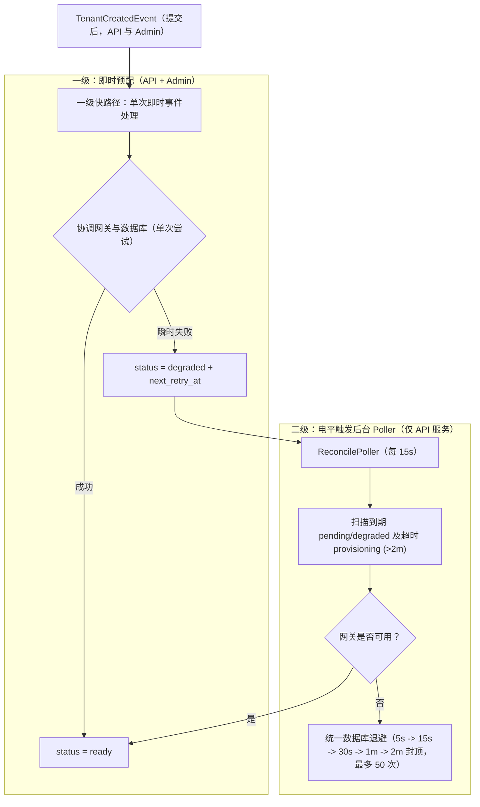
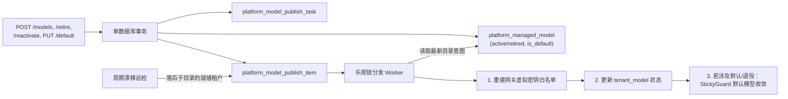
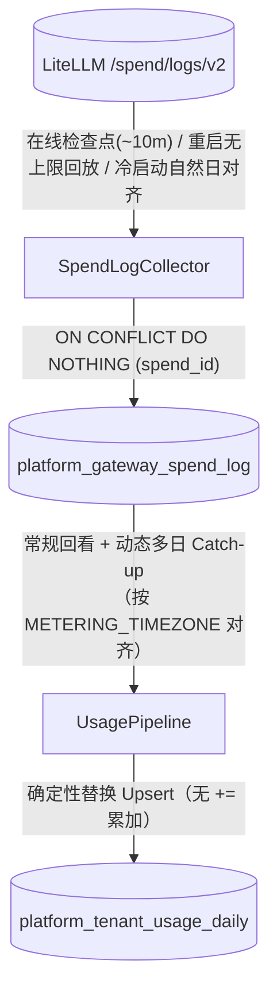

# 模型平台工程设计参考

[English](implementation-plan.md) | 简体中文

> [!NOTE]
> **文档定位**：本文档为 `model-platform` 扩展的长期演进工程设计参考。随着子系统机制、数据库结构、覆盖接缝或验证体系的演进，应与代码保持同步更新。
> - **系统架构与 ADR**：[architecture.zh-CN.md](architecture.zh-CN.md)
> - **运维部署与 Admin 控制台指南**：[docs/admin-guide.zh-CN.md](docs/admin-guide.zh-CN.md)
> - **租户角色与用户指南**：[docs/user-guide.zh-CN.md](docs/user-guide.zh-CN.md)
> - **HTTP API 与守卫契约**：[docs/api-reference.zh-CN.md](docs/api-reference.zh-CN.md)

---

## 目录

- [1. 工程约束与代码布局](#1-工程约束与代码布局)
- [2. 构建体系与工作区覆盖层集成](#2-构建体系与工作区覆盖层集成)
  - [2.1 Go `ee` 全局构建标签排除与 `ee-baseline` 肯定桩](#21-go-ee-全局构建标签排除与-ee-baseline-肯定桩)
  - [2.2 薄路由 Trampoline 与运行时接线](#22-薄路由-trampoline-与运行时接线)
  - [2.3 前端 Web 覆盖接缝与企业标志防御](#23-前端-web-覆盖接缝与企业标志防御)
  - [2.4 工作区组装与非侵入式 CI 门禁](#24-工作区组装与非侵入式-ci-门禁)
- [3. LiteLLM 网关与凭据流水线](#3-litellm-网关与凭据流水线)
  - [3.1 网关拓扑与环回隔离](#31-网关拓扑与环回隔离)
  - [3.2 密钥标识、受限虚拟密钥与吊销](#32-密钥标识受限虚拟密钥与吊销)
  - [3.3 零中断应急密钥轮换](#33-零中断应急密钥轮换)
  - [3.4 租户注销与孤儿清理](#34-租户注销与孤儿清理)
- [4. 租户生命周期、自愈协调与写保护](#4-租户生命周期自愈协调与写保护)
  - [4.1 事务解耦钩子与提交后可见性预检](#41-事务解耦钩子与提交后可见性预检)
  - [4.2 两级自愈控制器](#42-两级自愈控制器)
  - [4.3 协调状态机与表结构（`platform_tenant_reconcile`）](#43-协调状态机与表结构platform_tenant_reconcile)
  - [4.4 原生驱动解析与补偿回滚](#44-原生驱动解析与补偿回滚)
  - [4.5 托管供应商写保护（`ManagedProviderGuardMiddleware`）](#45-托管供应商写保护managedproviderguardmiddleware)
- [5. 托管模型目录、默认治理与知识库保护](#5-托管模型目录默认治理与知识库保护)
  - [5.1 托管模型槽位（7 类网关路由模型）](#51-托管模型槽位7-类网关路由模型)
  - [5.2 目录建模、全租户下发与生命周期收敛](#52-目录建模全租户下发与生命周期收敛)
  - [5.3 默认值原子初始化、成员继承与粘性来源追踪](#53-默认值原子初始化成员继承与粘性来源追踪)
  - [5.4 向量模型三阶段生命周期与知识库不可变守卫](#54-向量模型三阶段生命周期与知识库不可变守卫)
- [6. 计量、对账与消费隔离审计流水线](#6-计量对账与消费隔离审计流水线)
  - [6.1 原始账单暂存与物理去重](#61-原始账单暂存与物理去重)
  - [6.2 自愈水位线采集器与替换汇总](#62-自愈水位线采集器与替换汇总)
  - [6.3 声明式可选原始日志保留策略](#63-声明式可选原始日志保留策略)
  - [6.4 BYOK 物理零计费旁路与实时隔离审计](#64-byok-物理零计费旁路与实时隔离审计)
- [7. 容错矩阵与端到端验证命令](#7-容错矩阵与端到端验证命令)
  - [7.1 故障模式与恢复矩阵](#71-故障模式与恢复矩阵)
  - [7.2 端到端验证与 CI 检查命令](#72-端到端验证与-ci-检查命令)

---

## 1. 工程约束与代码布局

`extensions/model-platform/` 下的全部变更始终遵循六条硬性工程约束：

1. **上游严格零侵入**：`upstream/ragflow` 保持 100% 洁净（`git status --porcelain` 恒为空）。
2. **原生驱动复用**：托管模型以 `ProviderName = "OpenAI-API-Compatible"`、`InstanceName = "platform"`、`is_managed = true` 落库，直接复用上游驱动。
3. **凭据物理隔离**：上游根密钥仅驻留于环回绑定（`127.0.0.1:4000`）的 LiteLLM 容器内；租户仅获发按 `team_id` 隔离的虚拟密钥（`sk-tenant-*`）。
4. **事务解耦异步副作用**：严禁在上游数据库事务内发起远程 RPC；后台 Worker 在事务提交对外可见后异步协调。
5. **原子默认值与向量空间保护**：空默认槽位采用条件原子 SQL 初始化；显式用户偏好由 `StickyGuard` 保护；非空知识库向量模型不可修改（`400`）。
6. **权威计量数学幂等**：LiteLLM 账单按 `spend_id` 执行 `ON CONFLICT DO NOTHING` 暂存，日表 `platform_tenant_usage_daily` 采用自然日对齐的替换 Upsert。

```text
extensions/model-platform/
├── backend/
│   ├── admin/       # 13 个 Admin HTTP 处理器（健康、目录、发布任务、租户、轮换、用量、审计）
│   ├── dao/         # 协调状态 DAO 与事务安全租户创建钩子
│   ├── entity/      # 7 个领域实体与 ManagedModelSlots 唯一真相源
│   ├── event/       # 内存 EventBus 与提交后可见性 PreFlightCheck
│   ├── gateway/     # LiteLLM HTTP 客户端（密钥、模型列表、账单日志、健康检查）
│   ├── guard/       # 3 个 App API 中间件（ManagedProvider、DatasetImmutability、DefaultModelPreference）
│   ├── metering/    # SpendLogCollector、UsagePipeline、MeteringDaemon、AuditTenantSpendIsolation
│   ├── migration/   # 6 项幂等 GORM 迁移与存量目录回填
│   ├── publisher/   # 目录管理、滚动任务/子项扇出、乐观锁收敛 Worker
│   ├── reconciler/  # TenantReconciler、两级自愈控制器、StickyGuard、KeyRotator、生命周期与清理
│   ├── router/      # App API 中间件注册入口
│   └── worker/      # 由 ServerTypeAPI 统一启停的 5 个后台循环
├── gateway/         # 生产 Docker Compose、litellm-config.yaml、validate-gateway-config.sh
├── overlay/
│   ├── ee-baseline/ # 覆盖 19 个上游包的 //go:build ee 回退桩与运行时接缝
│   ├── trampolines/ # Admin 与 App 路由薄转发层
│   └── web/src/ee/  # 3 个 Admin 页面、多语言、路由、客户端与 ProviderInstanceCardWithPrivilege
├── scripts/         # apply-overlay.sh、audit-non-invasive.sh、emergency-rotate-keys.sh
└── tests/e2e/       # 容器化 LiteLLM + PostgreSQL 端到端测试集群与测试套件
```

---

## 2. 构建体系与工作区覆盖层集成

### 2.1 Go `ee` 全局构建标签排除与 `ee-baseline` 肯定桩

上游 `build.sh` 会将 `RAGFLOW_GO_TAGS` 追加至 `GO_BUILD_TAGS`。一旦传入 `RAGFLOW_GO_TAGS=ee`，Go 编译器会同时排除上游 19 个包中的所有 `//go:build !ee` 社区桩文件。为在不修改上游的前提下顺利编译，`overlay/ee-baseline/` 为这 19 个受影响包提供社区等价的 `//go:build ee` 肯定桩，并将路由注册符号独占划分给 `overlay/trampolines/`：

| 覆盖层 | 职责 | 关键文件 |
| :--- | :--- | :--- |
| **`overlay/ee-baseline/`** | 为全部 19 个 `!ee` 包提供社区等价回退桩并接入运行时生命周期钩子 | `internal/dao/stub_ee.go`（迁移、`OnTenantCreateHook`、DB 提供器）、`internal/server/stub_ee.go`（`StartServer`/`ShutdownServer` 后台 Worker 生命周期）、`internal/service/stub_ee.go`（`tenant.member.joined` 默认值继承）、`internal/permission/stub_ee.go`（社区权限策略回退），以及其余 15 个包的纯桩文件 |
| **`overlay/trampolines/`** | 独占声明 `SetupEERouter`、`RegisterEERouter`、`RegisterEENoAuthRouter`、`RegisterEEProtectedRouter`、`RegisterEEAuthRouter` | `overlay/trampolines/internal/admin/model_platform_trampoline_ee.go`、`overlay/trampolines/internal/router/model_platform_trampoline_ee.go` |

### 2.2 薄路由 Trampoline 与运行时接线

- **Admin 路由**（`overlay/trampolines/internal/admin/model_platform_trampoline_ee.go`）：将 `RegisterEERouter(protected, r)` 转发给 `mpAdmin.RegisterModelPlatformAdminRoutes(protected)`，在 `/api/v1/admin/model-platform` 下挂载全部 13 个管理端点。
- **App 路由**（`overlay/trampolines/internal/router/model_platform_trampoline_ee.go`）：将 `RegisterEEProtectedRouter(protected, r)` 转发给 `mpRouter.RegisterModelPlatformProtectedRoutes(protected)`，在 `AuthMiddleware` 写入 `tenant_id`/`user_id` 后挂载 3 个守卫中间件：
  1. `guard.ManagedProviderGuardMiddleware()`
  2. `guard.DatasetImmutabilityGuardMiddleware()`
  3. `guard.DefaultModelPreferenceMiddleware()`
- **迁移与钩子**（`overlay/ee-baseline/internal/dao/stub_ee.go`）：
  - `migrateBillingSchemaEE` 执行全部 6 项幂等迁移（`001`–`005` + `006_backfill_catalog`）。
  - `initializeTenantDefaultRoleEE` 调用 `mpdao.OnTenantCreateHook`。
  - `init()` 注册 `mpworker.SetDBProvider(GetDB)`。
- **后台 Worker**（`overlay/ee-baseline/internal/server/stub_ee.go`）：当配置了 `LITELLM_BASE_URL` 与 `LITELLM_MASTER_KEY` 时，`StartServer` 在 `common.ServerTypeAPI` 启动完整 `mpworker.Start(ctx)`，在 `common.ServerTypeAdmin` 启动轻量 `mpworker.StartAdminTier1(ctx)`（仅订阅 `TenantCreated` 事件，周期巡检任务仍由 API 服务统一承担）；`ShutdownServer` 优雅排空停止全部 Worker。
- **成员加入钩子**（`overlay/ee-baseline/internal/service/stub_ee.go`）：`recordTenantPermissionChangeEE` 监听 `eventType == "tenant.member.joined"`，触发 `DefaultsManager.InitializeMemberFromOwner`。

### 2.3 前端 Web 覆盖接缝与企业标志防御

上游 `web/src/pages/admin/utils.tsx` 通过 `VITE_RAGFLOW_ENTERPRISE === 'RAGFLOW_ENTERPRISE'` 决定是否启用商业企业路由。本扩展强制保持 `VITE_RAGFLOW_ENTERPRISE` 关闭，防止挂载未实现的商业页面（白名单、角色、监控），仅通过 `overlay/web/src/ee/` 注入自身能力：

- `private-routes.tsx` 与 `merge-routes.tsx`：向 Admin 导航布局注入 `/admin/model-providers`、`/admin/model-usage-statistics` 与 `/admin/model-tenants`。
- `pages/admin/layouts/navigation-private.tsx`：在 Admin 左侧菜单追加 **模型供应商**、**模型用量统计** 与 **租户凭证与审计**。
- `pages/admin/{model-providers,model-usage-statistics,model-tenants}.tsx`：基于 React Query 的三大治理页面。
- `pages/user-setting/setting-model/provider-instance-card-with-privilege.tsx`：包装 `ProviderInstanceCard`，识别 `platform` / `is_managed` 实例，渲染多语言 **`平台托管`** 徽章并隐藏全部实例/模型写操作按钮，同时保留搜索、类型筛选与连通性检查。
- `constants/model-types.ts`：与后端 `backend/entity/model_slots.go` 对齐的模型类型表。
- `locales/{en,zh,zh-traditional}-private.ts` 与 `utils/{api-private,model-platform-client}.ts`：国际化资源包与强类型 Axios 客户端。

### 2.4 工作区组装与非侵入式 CI 门禁

- `scripts/apply-overlay.sh` 通过 `git archive` 将 `upstream/ragflow` 导出至隔离目录 `build/ragflow`，并按严格顺序叠加：`ee-baseline → trampolines → backend → web`。
- `scripts/audit-non-invasive.sh` 执行三项自动化 CI 门禁：
  1. **门禁 1（子模块洁净度）**：校验 `upstream/ragflow` 锁定提交一致、零 diff、工作区洁净。
  2. **门禁 2（企业标志安全检查）**：若 `VITE_RAGFLOW_ENTERPRISE=RAGFLOW_ENTERPRISE` 则立即失败。
  3. **门禁 3（19 包 EE 基线完整性扫描）**：扫描所有上游 `//go:build !ee` 包，确保均具备无符号冲突的 `//go:build ee` 桩文件。

---

## 3. LiteLLM 网关与凭据流水线

### 3.1 网关拓扑与环回隔离

`gateway/docker-compose.yml` 在独立桥接网络 `ragflow-model-platform-net` 中编排锁定版本的 `ghcr.io/berriai/litellm:v1.110.0` 与 `postgres:16-alpine`：

- **环回隔离**：仅映射 `127.0.0.1:4000:4000`，`gateway/validate-gateway-config.sh` 校验禁止公网暴露及禁止明文密钥。
- **空默认目录**：`litellm-config.yaml` 默认 `model_list: []`，避免在私有/离线部署中污染不可达路由。
- **安全与缓存参数**：开启 `redact_user_api_key_info: true`、`drop_params: true`、`set_verbose: false`、`json_logs: true`、`store_model_in_db: true`、`disable_spend_logs: false`，并配置 `user_api_key_cache_ttl: 5` 将单 Worker 吊销传播延迟控制在 5 秒内。

### 3.2 密钥标识、受限虚拟密钥与吊销

租户密钥按 LiteLLM **Team**（`team_id = tenant_id`）归组，而不依赖 `key_alias`：

- 单把密钥由 `key_hash`（LiteLLM 内部存储、`POST /key/delete` 接收、账单 `api_key` 字段记录的 SHA-256 十六进制摘要）唯一定位；控制面在 `platform_tenant_reconcile` 中仅保存 `key_hash` 与 `gateway_key_alias`。
- `GET /key/list?team_id=<tenant>&return_full_object=true` 枚举租户全部密钥：`ConvergeTenantKeys` 吊销除 `key_hash` 外的所有密钥（若 `key_hash` 不在列表中则拒绝吊销以防断服），`RevokeTenantKeys` 吊销全部密钥。
- `key_alias`（`tenant_<id>_<8 hex>`）仅作为可读标签；账单归属统一依据 `team_id`。
- 平台活跃目录为空时，新租户虚拟密钥使用 `RevokedModelPlaceholder` 占位，避免 LiteLLM 将空 `models` 列表视为“无限制放行”。

### 3.3 零中断应急密钥轮换

`KeyRotator.Rotate`（`backend/reconciler/key_rotation.go`）在持有供应商行级白名单锁与进程内互斥锁（与模型目录分发互斥）的前提下对 `ready` 租户执行零中断轮换：

1. 在触碰网关之前，基于 `version` CAS 写入 `key_dirty_since` 标记。
2. 根据租户当前活跃/只读托管模型重建白名单并签发新虚拟密钥。
3. 在单个数据库事务内切换 `tenant_model_instance.api_key` 并写入 `key_hash`、`gateway_key_alias`、`key_rotated_at`、`key_rotated_by`。若事务失败则回读记录：仅当回读成功且仍指向旧密钥时才按 `key_hash` 吊销新密钥；若状态存疑（如断连），保留脏标记由后台清扫器收敛。
4. 在网关侧将该租户 Team 收敛到新 `key_hash`（吊销全部旧密钥）并清除 `key_dirty_since`。

整个过程中租户状态保持 `ready`，避免 `ReconcilePoller` 误判为初始化中断。后台 `worker.sweepDirtyKeys` 每 `1m` 扫描超过 `2m` 未收敛的租户并自动重试。批量操作通过 `scripts/emergency-rotate-keys.sh` 驱动，支持游标分页、并发/限速与 `--resume` 断点续跑。

### 3.4 租户注销与孤儿清理

`TenantDecommissioner`（`backend/reconciler/tenant_cleanup.go`）吊销租户 Team 下的全部网关密钥，将 `platform_tenant_reconcile.status` 置为 `deleted` 并抹除本地凭据。后台 `worker.scanOrphanedTenants` 每 `1h` 巡检上游 `tenant` 表已删除的孤儿租户并执行回收。

---

## 4. 租户生命周期、自愈协调与写保护

### 4.1 事务解耦钩子与提交后可见性预检

`dao.OnTenantCreateHook` 在 `initializeTenantDefaultRoleEE` 事务内执行：

1. 通过 `ON CONFLICT DO NOTHING` 仅写入本地 `platform_tenant_reconcile` 记录（`status = 'pending'`、`max_retries = 50`、`version = 1`），事务内零远程调用。
2. 启动独立 Goroutine 使用根连接执行 `event.PreFlightCheck`（3 秒超时）等待事务对外可见，随后向 `event.GetDefaultBus()` 发布 `TenantCreatedEvent`。

### 4.2 两级自愈控制器



- 多副本 API 与 Admin 一级事件之间的并发统一由乐观版本锁（`WHERE tenant_id = ? AND version = ?`）协调，`provisioning` 超过 `2m` 未更新时自动回收租约；所有退避间隔均由数据库 `retry_count` 驱动的单一 `BackoffPolicy` 计算，消除了进程内双调度器竞态。

### 4.3 协调状态机与表结构（`platform_tenant_reconcile`）

由 `migration/001_reconcile_schema.go` 管理（兼容 MySQL、PostgreSQL、SQLite）：

```sql
CREATE TABLE IF NOT EXISTS platform_tenant_reconcile (
    tenant_id VARCHAR(32) PRIMARY KEY,
    status VARCHAR(32) NOT NULL DEFAULT 'pending', -- pending | provisioning | ready | degraded | failed | deleted
    retry_count INT NOT NULL DEFAULT 0,
    max_retries INT NOT NULL DEFAULT 50,
    next_retry_at DATETIME NULL,
    last_error TEXT NULL,
    gateway_key_alias VARCHAR(128) NULL,
    key_hash VARCHAR(128) NULL,
    key_dirty_since DATETIME NULL,
    key_rotated_at DATETIME NULL,
    key_rotated_by VARCHAR(128) NULL,
    version BIGINT NOT NULL DEFAULT 1,
    created_at DATETIME NOT NULL,
    updated_at DATETIME NOT NULL,
    INDEX idx_status_retry (status, next_retry_at),
    INDEX idx_key_dirty (key_dirty_since)
);
```

### 4.4 原生驱动解析与补偿回滚

`TenantReconciler.Reconcile` 为租户创建 `ProviderName = "OpenAI-API-Compatible"`、`InstanceName = "platform"`、`extra = {"is_managed": true}`、当前活跃目录的 `tenant_model` 行及空白默认模型槽位。签发新密钥前会先清理残留 Team 密钥；若签发后落库失败，补偿回滚会尝试单次按 `key_hash` 调用 `DeleteKeysByHash` 吊销该密钥（若该次吊销亦失败，残留密钥会保留至网关恢复且后续协调重试在租户处于 `pending`/`degraded` 且未满 50 次重试上限时将其清扫；若租户已进入 `failed`，则需人工清理与升级处理）。

### 4.5 托管供应商写保护（`ManagedProviderGuardMiddleware`）

挂载于 App API `protected` 路由组（`backend/guard/managed_provider_guard.go`）：

- 拦截供应商路由（`/api/v1/providers/*`、`/setting/model/provider/*`、`/admin/model/provider/*`，排除 `/dataset` 与 `/artifacts`）上的 `PUT`/`PATCH`/`DELETE` 以及 `.../instances`、`.../models` 的 `POST`。
- 对任何试图修改/删除托管供应商、实例、模型或将自定义实例创建/重命名为保留字 `platform`（不区分大小写）的请求返回 HTTP `403`。
- 校验请求体上限（`MAX_JSON_CONTENT_LENGTH`，默认 `1 MiB` → `413`）、拒绝批量删除中重复的 `instances` 键（`400`），并限制单次批量删除不超过 `100` 个目标（`400`）。

---

## 5. 托管模型目录、默认治理与知识库保护

### 5.1 托管模型槽位（7 类网关路由模型）

`backend/entity/model_slots.go` 是发布校验、默认初始化、`StickyGuard`、`DefaultModelPreferenceMiddleware`、用量筛选与前端 `constants/model-types.ts` 共享的唯一真值：

| `ModelType` 位标志 | 名称 | `user_tenant` 模型列 | `user_tenant` 关联 ID 列 | 可空 |
| :---: | :--- | :--- | :--- | :---: |
| `1` | `chat` | `llm_id` | `tenant_llm_id` | 否 |
| `2` | `embedding` | `embd_id` | `tenant_embd_id` | 否 |
| `4` | `asr` | `asr_id` | `tenant_asr_id` | 否 |
| `8` | `vision` | `img2txt_id` | `tenant_img2txt_id` | 否 |
| `16` | `rerank` | `rerank_id` | `tenant_rerank_id` | 否 |
| `32` | `tts` | `tts_id` | `tenant_tts_id` | 是 |
| `128` | `decision` | `decision_id` | `tenant_decision_id` | 是 |

本地 `ModelTypeOCR`（`64`）运行在本地视觉/版面分析流水线中，不经过网关。

### 5.2 目录建模、全租户下发与生命周期收敛

由 `migration/005_publish_schema.go` 与 `migration/006_backfill_catalog.go` 管理：

- `platform_managed_model`（`id`、唯一 `model_name`、`model_type`、`is_default`、`status` = `active` | `retired`）：管理员意图的唯一真相源。
- `platform_model_publish_task`（`id`、`model_name`、`model_type`、`created_at`）：下发任务头，状态（`running` | `completed` | `partial_failed`）由子项实时聚合推导。
- `platform_model_publish_item`（主键 `(task_id, tenant_id)`、`status`、`retry_count`、`next_retry_at`、`last_error`、`version`、`upgraded_count`、`preserved_count`）：单租户收敛子项，通过乐观锁 `version` 认领，支持 2 分钟租约超时回收、20 次退避重试转 `failed` 及通过 `POST /models/publish/tasks/:id/retry` 人工重试。



租户侧模型状态由目录意图与租户引用实时推导：

| 目录意图 | 模型类型 | 租户活跃知识库引用 | `tenant_model` 状态 | 网关白名单 |
| :--- | :--- | :--- | :--- | :--- |
| `active` | 任意 | 任意 | `active` | 包含 |
| `retired` | `embedding`（`2`） | `> 0` | `active` + `extra.{deprecated,read_only}=true` | 保留（只读） |
| `retired` | `embedding`（`2`） | `0` | `disabled` + `extra.tombstoned=true` | 移除 |
| `retired` | 其余 6 类 | 任意 | `disabled` + `extra.tombstoned=true` | 移除 |

- **先网关后数据库**：始终在供应商行锁与进程内互斥锁保护下先调用 LiteLLM `/key/update` 重建完整白名单，再更新 `tenant_model`。上架/激活时，该顺序保证模型对租户可见前已在网关可路由；退役时则有意采用 fail-closed 顺序（先吊销网关权限再禁用 `tenant_model`），若网关更新后发生瞬时数据库错误，分发 Worker 会通过重试收敛状态。
- **上架绝不改变默认模型**：仅 `PUT /models/:id/default` 可切换平台默认；当前标记为 `is_default` 的模型禁止直接退役（返回 `400`）。当模型在租户中进入 `tombstoned` 时，默认指向它的用户会迁移至当前平台默认（若无默认则清空）。

### 5.3 默认值原子初始化、成员继承与粘性来源追踪

- **原子初始化（`DefaultsManager`）**：对全部 7 类槽位使用条件 SQL（`WHERE ... AND (col IS NULL OR col = '')`），杜绝并发覆盖竞态。
- **成员加入继承**：`InitializeMemberFromOwner` 将租户 Owner 当前默认槽位复制到新加入成员的空白槽位。
- **显式偏好来源表（`migration/002_preference_schema.go`）**：

```sql
CREATE TABLE IF NOT EXISTS platform_user_default_preference (
    id VARCHAR(32) PRIMARY KEY,
    tenant_id VARCHAR(32) NOT NULL,
    user_id VARCHAR(32) NOT NULL,
    model_type INT NOT NULL,
    origin VARCHAR(32) NOT NULL DEFAULT 'platform_default', -- platform_default | user_explicit
    current_model_id VARCHAR(128) NOT NULL,
    created_at DATETIME NOT NULL,
    updated_at DATETIME NOT NULL,
    UNIQUE KEY idx_pref_tenant_user_type (tenant_id, user_id, model_type)
);
```

- **观测中间件（`DefaultModelPreferenceMiddleware`）**：包裹 `PATCH /api/v1/models`、`PATCH /api/v1/models/default` 与 `PATCH /api/v1/users/me/models`，对比上游处理器执行前后的 `user_tenant` 槽位变化，在行锁下调用 `StickyGuard.RecordObservedUserChoice` 记录 `user_explicit`。

### 5.4 向量模型三阶段生命周期与知识库不可变守卫

- `EmbeddingLifecycleManager` 将仍有知识库引用的退役向量模型置于 `deprecated`/`read_only` 状态，并在引用归零后由周期巡检转入 `tombstoned`；`NonEmbeddingLifecycleManager` 对非向量模型直接执行 `tombstoned`。
- `DatasetEmbeddingGuardMiddleware`（`backend/guard/dataset_immutability_guard.go`，别名 `DatasetImmutabilityGuardMiddleware`）拦截 `POST /api/v1/datasets` 与 `PUT|PATCH /api/v1/datasets/:dataset_id`：
  1. 阻止新建（含隐式回退至用户默认向量模型）或更新知识库时绑定已退役/弃用/只读的向量模型（`400`）。
  2. 阻止对已存在 `chunk_num > 0`、`doc_num > 0` 或有效 `document` 行记录的知识库更换向量模型（`400`）。
  3. 放行原值幂等提交，以及将空知识库切换为活跃向量模型。

---

## 6. 计量、对账与消费隔离审计流水线

### 6.1 原始账单暂存与物理去重

由 `migration/003_spend_log_schema.go` 管理（`platform_gateway_spend_log`）：

```sql
CREATE TABLE IF NOT EXISTS platform_gateway_spend_log (
    spend_id VARCHAR(128) PRIMARY KEY,
    tenant_id VARCHAR(64) NOT NULL,
    api_key VARCHAR(128) NULL,
    key_alias VARCHAR(128) NULL,
    model_name VARCHAR(128) NOT NULL,
    call_type VARCHAR(64) NULL,
    prompt_tokens INT NOT NULL DEFAULT 0,
    completion_tokens INT NOT NULL DEFAULT 0,
    total_tokens INT NOT NULL DEFAULT 0,
    cached_tokens INT NOT NULL DEFAULT 0,
    cache_write_tokens INT NOT NULL DEFAULT 0,
    reasoning_tokens INT NOT NULL DEFAULT 0,
    characters BIGINT NOT NULL DEFAULT 0,
    spend DECIMAL(14, 6) NOT NULL DEFAULT 0.000000,
    prompt_spend DECIMAL(14, 6) NOT NULL DEFAULT 0.000000,
    completion_spend DECIMAL(14, 6) NOT NULL DEFAULT 0.000000,
    cache_savings DECIMAL(14, 6) NOT NULL DEFAULT 0.000000,
    request_time DATETIME NOT NULL,
    raw_payload TEXT NULL,
    created_at DATETIME NOT NULL,
    INDEX idx_spend_tenant_time (tenant_id, request_time),
    INDEX idx_spend_time (request_time),
    INDEX idx_spend_alias (key_alias),
    INDEX idx_spend_model (model_name)
);
```

`SpendLogCollector` 按 `METERING_COLLECTOR_BATCH_SIZE` 分批写入，利用 `spend_id` 主键执行 `ON CONFLICT DO NOTHING` 去重。

### 6.2 自愈水位线采集器与替换汇总

由 `migration/004_usage_schema.go` 管理（`platform_tenant_usage_daily`，联合主键 `(tenant_id, model_name, usage_date)`，汇总 `call_count`、精细 Token 拆分、`characters`、`total_spend`、`prompt_spend`、`completion_spend` 与 `cache_savings`）。



`MeteringDaemon` 协同调度轮询采集（`METERING_POLL_INTERVAL`，默认 `5m`）、每日汇总（`METERING_AGGREGATION_INTERVAL`，默认 `1h`）以及可选过期清理（`24h`）：

- **冷启动**：将首次拉取起点对齐到 `METERING_TIMEZONE` 下 `METERING_LOOKBACK_HOURS`（默认 `48`）小时前的 `00:00:00`。
- **在线运行**：每次轮询成功后推进内存检查点 `lastCheckedAt`（即使拉取到 0 条日志），将常规网关查询窗口锁定在 `[lastCheckedAt - METERING_FETCH_OVERLAP, Now]` 内。
- **重启恢复与动态 Catch-up**：重启时从 `MAX(request_time) - METERING_FETCH_OVERLAP` 无上限回放网关仍保留的日志；一旦新写入数据的最早时间 `EarliestInsertedAt < EndTime - METERING_LOOKBACK_HOURS`，立即触发 `[EarliestInsertedAt, EndTime]` 的多日补齐聚合。若瞬时聚合失败，`pendingCatchupStart` 仅保存在 `MeteringDaemon` 的进程内存中，会在同一进程内的后续轮询周期自动重试，但不会跨 API 进程重启持久化；因此若历史原始日志已落库而补齐聚合尚未成功前进程重启，超出 `METERING_LOOKBACK_HOURS` 的历史日期不会自动再次触发（重启后新进程的清理任务也不会知晓需保留这些尚未聚合的旧日志），需要临时调大 `METERING_LOOKBACK_HOURS` 或手工补跑聚合。**清理安全警示**：由于 `AggregateDailyUsage` 采用确定性替换写入且不校验某自然日是否已被部分清理，在调大 `METERING_LOOKBACK_HOURS` 或手工补跑历史聚合前，运维人员必须先确认目标范围内每个自然日在 `platform_gateway_spend_log` 中的原始日志均完整无缺失，否则对已被部分清理的自然日重算会用偏小的值覆盖已有每日汇总。
- **边界条件与参数规划**：在线轮询与重启回放均向前重叠 `METERING_FETCH_OVERLAP`（默认 `5m`）。若某条网关日志实际落库延迟超过 `request_time + METERING_FETCH_OVERLAP`，将落在查询下界之前而不会被采集，也不会触发动态 Catch-up；同理，停机期间因网关保留策略（`maximum_spend_logs_retention_period`）过期删除的日志亦无法回放。运维人员应将 `METERING_FETCH_OVERLAP` 配置为高于预期网关写入延迟，并确保网关保留周期覆盖最大可容忍停机时长加采集延迟。
- **多方言 SQL 适配**：`resolveDateExpression` 按业务时区截断自然日。PostgreSQL 对 IANA 时区名按行使用 `AT TIME ZONE` 换算时区规则；MySQL 与 SQLite 对所有行使用聚合时刻计算出的固定偏移，因此跨夏令时切换的历史回填可能将记录归入相邻的错误自然日。

### 6.3 声明式可选原始日志保留策略

原始账单表默认永久保留，支持在两层独立按需开启清理：

- **网关层**：在 `gateway/litellm-config.yaml` 中取消注释 `general_settings.maximum_spend_logs_retention_period`（不影响虚拟密钥 `token.spend` 预算统计）。
- **控制面层**：配置 `METERING_SPEND_LOG_RETENTION_DAYS > 0`。`MeteringDaemon` 在首次启动拉取完成之后、持有 `pipelineMu` 互斥锁（防止与聚合冲突）且将截止时间钳位在活跃回看窗口之外的前提下，按 `DefaultPurgeBatchSize`（`1000`）分批清理 `platform_gateway_spend_log`，绝不改动 `platform_tenant_usage_daily`。

### 6.4 BYOK 物理零计费旁路与实时隔离审计

租户自有 BYOK 实例直连外部上游端点，不经过网关，产生严格 `$0.00` 平台费用。`AuditTenantSpendIsolation`（`backend/metering/isolation_audit.go`，对应 `GET /api/v1/admin/model-platform/usage/audit`）流式扫描 `platform_gateway_spend_log`，以精确字符串匹配核验该租户每条计费 `model_name` 均属于其 `OpenAI-API-Compatible` → `platform` 授权模型。

---

## 7. 容错矩阵与端到端验证命令

### 7.1 故障模式与恢复矩阵

| 故障场景 | 影响范围 | 防护与恢复机制 |
| :--- | :--- | :--- |
| 租户注册期间网关宕机 | 模型预配延迟 | `OnTenantCreateHook` 仅提交本地 SQL；一级快路径单次即时尝试失败后交棒至 `degraded`，随后 API 服务的二级 `ReconcilePoller`（每 15s 巡检，统一 `5s → 15s → 30s → 1m → 2m` 退避）在 `retry_count < 50` 时将 `pending`/`degraded` 租户于网关恢复后自动收敛至 `ready`。一旦达到 50 次重试上限，租户转为 `failed`，不再被 `ReconcilePoller` 选中，需人工介入恢复。 |
| 签发虚拟密钥后数据库写入失败 | 潜在孤儿密钥 | 补偿回滚尝试单次按 `key_hash` 调用 `DeleteKeysByHash` 吊销新密钥；若该次吊销也失败，残留 Team 密钥会保留至网关恢复且后续协调重试执行（租户仍处于 `pending`/`degraded` 且未达 50 次重试上限时，`issueFreshKey` 会在重新签发前清扫残留 Team 密钥；已进入 `failed` 的租户需人工清理与升级处理）。 |
| Worker 在预配或分发途中崩溃 | 任务卡死在 `provisioning`/`running` | 租约超时自动回收（`provisioning` 与发布 `running` 子项均为 2 分钟）。 |
| 上游删除租户账号 | 残留可用虚拟密钥 | `scanOrphanedTenants`（每小时）与 `TenantDecommissioner` 物理吊销该 Team 全部密钥并标记 `deleted`。 |
| 租户虚拟密钥泄露 | 轮换前存在未授权消费 | `POST /tenants/:tenant_id/rotate-key`（或 `emergency-rotate-keys.sh`）零中断原子切换密钥；`sweepDirtyKeys`（每分钟）在网关可达时持续重试吊销旧密钥，网关不可达期间旧密钥吊销保持待完成状态。 |
| 存在知识库引用的向量模型退役 | 存量知识库检索 | 三阶段生命周期保留只读白名单直至引用归零；`DatasetImmutabilityGuard` 阻止新建或空知识库绑定。 |
| API 服务或网关长时间中断 | 跨天计量缺口 | 数据库水位线无上限回放 + 动态多日 Catch-up 替换聚合（零重复计费），受第 6.2 节边界约束：停机期间被网关保留策略（`maximum_spend_logs_retention_period`）清理的日志无法回放，且待补齐状态仅驻留进程内存（若聚合完成前 API 重启，运维人员须先确认 `platform_gateway_spend_log` 原始日志完整，再调大 `METERING_LOOKBACK_HOURS` 或手工补跑聚合）。 |
| 租户试图篡改或删除 `platform` 实例 | 凭据损坏或绕过计量 | 前端隐藏写控件（`ProviderInstanceCardWithPrivilege`），后端返回 HTTP `403`（`ManagedProviderGuardMiddleware`）。 |

### 7.2 端到端验证与 CI 检查命令

```sh
# 1. 非侵入合规审计（3 项 CI 门禁：子模块洁净、企业标志关闭、19 包桩完整）
bash extensions/model-platform/scripts/audit-non-invasive.sh

# 2. 网关配置安全预检
bash extensions/model-platform/gateway/validate-gateway-config.sh

# 3. 组装隔离工作区并编译 Go（ee 标签）与 Web（关闭商业企业标志）
bash extensions/model-platform/scripts/apply-overlay.sh
(cd build/ragflow && RAGFLOW_GO_TAGS=ee bash build.sh --go)
(cd build/ragflow/web && npm ci && VITE_RAGFLOW_ENTERPRISE=false npm run build)

# 4. 运行模型平台后端全部 Go 单元测试
(cd build/ragflow && go test -tags "cgo,static,sonic,ee" ./extensions/model-platform/backend/...)

# 5. 启动容器化测试集群并运行全部 E2E 集成测试套件（核心、安全稳定性、Admin 集成、动态目录、密钥轮换）
docker compose -f extensions/model-platform/tests/e2e/docker-compose.test.yml up -d --wait
(cd build/ragflow && REQUIRE_LIVE_GATEWAY=true go test -count=1 -v -tags "cgo,static,sonic,ee" ./extensions/model-platform/tests/e2e/...)
```
